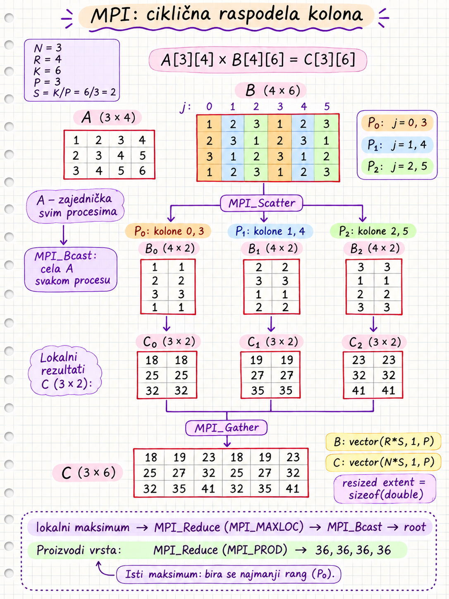

# Množenje matrica sa cikličnom raspodelom kolona

- `mpi_cyclic_matrix_product.c` - rešenje zadatka; tekst zadatka je iznad funkcije `main`.
- `distribution_sketch.png` - skica raspodele za N = 3, R = 4, K = 6 i 3 procesa.
- `../mpi_helpers.h` - zajednički helperi za prikaz matrica i raspodele.



Svaki proces dobija celu matricu A i dve kolone matrice B:

| Proces | Kolone B i C |
| --- | --- |
| P0 | 0, 3 |
| P1 | 1, 4 |
| P2 | 2, 5 |

Svaki proces računa svoje kolone C. Rezultati se prikupljaju u procesu koji sadrži maksimalni element B. Ako više procesa sadrži isti maksimum, bira se najmanji rang.

## Pokretanje

Iz ovog foldera:

```sh
mpicc mpi_cyclic_matrix_product.c -o mpi_cyclic_matrix_product
mpirun -np 3 ./mpi_cyclic_matrix_product
```

Možeš koristiti i postojeći VS Code zadatak za kompajliranje i pokretanje.

Skica je generisana ugrađenim imagegen alatom. Kompletan prompt je u `sketch_prompt.txt`.
