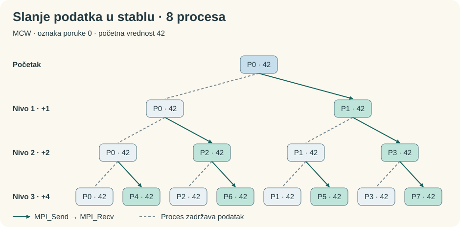

# 15.05.2015. — I kolokvijum, zadatak 3

[Rešenje u C-u](mpi_tree_broadcast.c)

1. P0 inicijalizuje podatak na `42`. Broj procesa mora biti stepen dvojke.
2. Na početku nivoa sa pomakom `step` podatak imaju procesi od P0 do P(step−1). Svaki od njih poziva `MPI_Send` i šalje podatak procesu sa rangom `rank + step`.
3. Procesi sa rangovima od `step` do `2*step−1` pozivaju `MPI_Recv` sa izvorom `rank - step` i odmah ispisuju primljenu vrednost. Zatim se pomak udvostručuje. Posle svakog nivoa dvostruko više procesa ima podatak.

Za osam procesa pomaci su 1, 2 i 4. Na drugom nivou P1 prosleđuje vrednost procesu P3, a na trećem P3 prosleđuje istu vrednost procesu P7. Redosled ispisa može da se razlikuje između pokretanja.



## Pokretanje

```sh
mpicc -std=c99 -Wall -Wextra -pedantic mpi_tree_broadcast.c -o mpi_tree_broadcast
mpirun -np 8 ./mpi_tree_broadcast
```

Slična lokalna vežba koristi stablo za akumuliranje parcijalnih suma u P0. [Sabiranje u stablu](../tree_sum/README.md)
