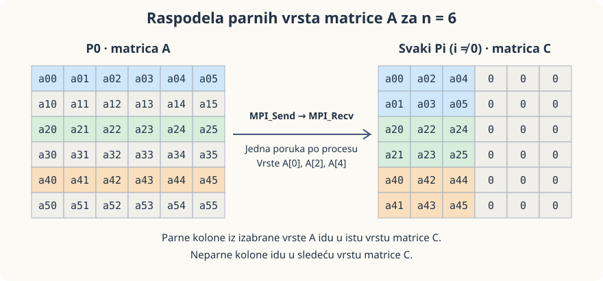

# MPI — Raspodela parnih vrsta matrice (08.09.2016, 4a)

Proces P0 ima matricu `A` reda `n`, gde je `n` parno. Svaki proces sa rangom različitim od nule formira istu matricu `C` reda `n`.



## Postupak

1. P0 opisuje vrste `0, 2, …, n - 2` matrice `A` pomoću `MPI_Type_vector(n/2, n, 2*n, MPI_INT, …)`. Svaki blok sadrži celu vrstu, a razmak između početaka dve izabrane vrste je `2*n` elemenata.
2. Primalac inicijalizuje `C` nulama. Za svaku parnu vrstu `r` i kolonu `j = 0, …, n/2 - 1`, upisuje `A[r][2*j]` u `C[r][j]` i `A[r][2*j+1]` u `C[r+1][j]`. Prva dva elementa poruke tako idu u `C[0][0]` i `C[1][0]`, a sledeća dva u `C[0][1]` i `C[1][1]`.
3. `MPI_Type_indexed` opisuje prijemne pozicije blokovima dužine 1, redom kojim elementi stižu. P0 poziva `MPI_Send` jednom po primaocu, a svaki primalac jednim pozivom `MPI_Recv` upisuje svih `n²/2` elemenata direktno u levu polovinu matrice `C`.

Za `n = 6` program popunjava `A` brojevima od 1 do 36 po vrstama. Svaki primalac dobija sledeću matricu.

```text
 1  3  5 0 0 0
 2  4  6 0 0 0
13 15 17 0 0 0
14 16 18 0 0 0
25 27 29 0 0 0
26 28 30 0 0 0
```

Na originalnoj slici poslednji element matrice `A` ponovo je označen kao `a54`. Na skici je ta oznaka ispravljena u `a55`.

## Pokretanje

```sh
mpicc -std=c11 -Wall -Wextra mpi_even_row_distribution.c -o mpi_even_row_distribution
mpirun -np 4 ./mpi_even_row_distribution
```

Za drugu pozitivnu parnu dimenziju pri prevođenju dodaj, na primer, `-DN=8`.
