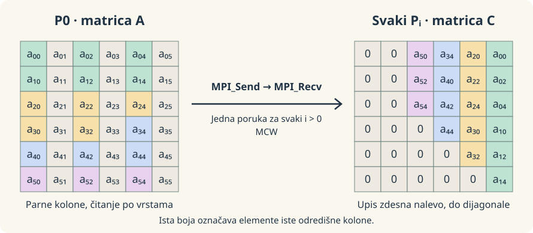

# MPI — Raspodela parnih kolona matrice (24.09.2016, 4a)

P0 ima matricu `A` reda `n`, gde je `n` parno. Iz jedne poruke svaki proces sa rangom većim od nule formira svoju matricu `C` reda `n`.



## Postupak

1. P0 obilazi `A` po vrstama i iz svake uzima elemente iz kolona `0, 2, 4, …, n - 2`. Pošto je `n` parno, razmak između dva izabrana elementa je svuda `2`, čak i preko granice vrste. Zato `MPI_Type_vector(n * (n / 2), 1, 2, MPI_INT, …)` opisuje sve elemente poruke.
2. Primalac postavlja `C` na nulu. Gornji trougao, uključujući glavnu dijagonalu, popunjava kolonu po kolonu zdesna nalevo. U koloni `col` prolazi kroz vrste od `0` do `col`, jer je na vrsti `col` glavna dijagonala. Staje čim rasporedi svih `n * (n / 2)` elemenata.
3. Za svaku izabranu poziciju `C[row][col]` primalac zadaje blok dužine `1` i pomeraj `row * n + col`. Pomeraj preskače `row` celih vrsta od po `n` elemenata, pa još `col` elemenata u izabranoj vrsti. `MPI_Type_indexed` čuva navedeni redosled upisa. P0 poziva `MPI_Send` jednom po primaocu, a svaki primalac poziva `MPI_Recv` jednom.

Za `n = 6` poruka sadrži 18 elemenata. Kolone matrice `C` popunjavaju se redom `5, 4, 3, 2`, sa po `6, 5, 4, 3` elemenata. Na primer, `a32` ide u `C[4][4]`. Time je kolona 4 popunjena do dijagonale, pa sledeći element `a34` ide u `C[0][3]`.

Program popunjava `A` brojevima od 1 do 36 po vrstama. Očekivani rezultat je:

```text
0 0 31 23 13  1
0 0 33 25 15  3
0 0 35 27 17  5
0 0  0 29 19  7
0 0  0  0 21  9
0 0  0  0  0 11
```

## Pokretanje

```sh
mpicc -std=c11 -Wall -Wextra mpi_even_column_distribution.c -o mpi_even_column_distribution
mpirun -np 4 ./mpi_even_column_distribution
```

Za drugu pozitivnu parnu dimenziju pri prevođenju dodaj, na primer, `-DN=8`.
