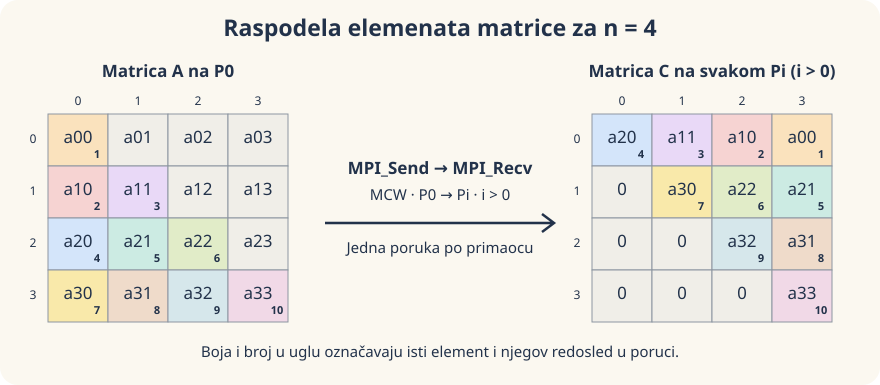

# 30.08.2019. — zadatak 4a

Proces P0 ima matricu A reda `n`. Svaki proces sa rangom većim od nule iz jedne poruke formira matricu C prema rasporedu sa slike. Elementi ispod glavne dijagonale C ostaju nule.



## Postupak

1. P0 obilazi donji trougao A po vrstama, sleva nadesno. U vrsti `row` šalje `row + 1` uzastopnih elemenata od pomeraja `row * n`. Tih `n` blokova opisuje jednim tipom `MPI_Type_indexed`.
2. Primalac postavlja C na nulu i obilazi gornji trougao po vrstama, od poslednje kolone do glavne dijagonale. Svaku poziciju opisuje blokom dužine 1 na pomeraju `row * n + col`. Pomeraji su dati u jedinicama `MPI_INT`.
3. P0 poziva `MPI_Send` jednom za svakog primaoca, a svaki primalac poziva `MPI_Recv` jednom. Oba tipa opisuju isti broj elemenata, `n * (n + 1) / 2`. MPI ih upisuje redom na pozicije iz prijemnog tipa.

Za `n = 4` prva četiri poslata elementa su `a00, a10, a11, a20`. Popunjavaju prvi red C zdesna nalevo, pa se taj red ispisuje kao `a20 a11 a10 a00`. Kada A sadrži brojeve od 1 do 16 po vrstama, svaki primalac dobija:

```text
9  6  5  1
0 13 11 10
0  0 15 14
0  0  0 16
```

## Pokretanje

```sh
mpicc -std=c99 -Wall -Wextra -pedantic mpi_reversed_upper_triangle.c -o mpi_reversed_upper_triangle
mpirun -np 4 ./mpi_reversed_upper_triangle
```

Za drugu pozitivnu dimenziju dodaj, na primer, `-DN=5` pri prevođenju.
