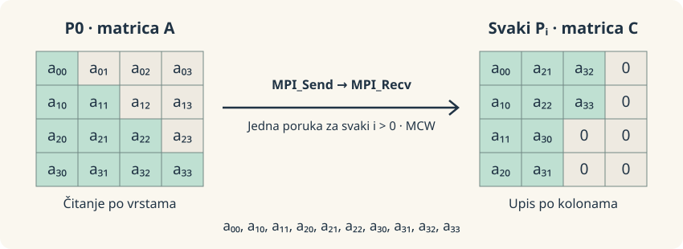

# MPI — Raspodela donjeg trougla matrice (04.09.2020, 4a)

Proces P0 ima matricu `A` reda `n`. Svaki proces sa rangom većim od nule iz jedne poruke formira istu matricu `C` reda `n`, prema rasporedu sa slike zadatka.



## Postupak

1. P0 čita donji trougao matrice `A`, uključujući glavnu dijagonalu, redom po vrstama. U vrsti `r` uzima `r + 1` uzastopnih elemenata od pomeraja `r * n`. Ovih `n` blokova opisuje pomoću `MPI_Type_indexed`.
2. Primalac postavlja matricu `C` na nulu. Element na poziciji `k` u poruci upisuje u vrstu `k % n` i kolonu `k / n`, gde je deljenje celobrojno. Pomeraj u memoriji je `(k % n) * n + k / n`. Primalac opisuje te pozicije pomoću `MPI_Type_indexed` tako što svaku dužinu bloka postavi na `1`.
3. P0 poziva `MPI_Send` jednom za svaki rang od 1 do `size - 1`. Svaki primalac poziva `MPI_Recv` jednom. Oba tipa opisuju niz od `n * (n + 1) / 2` elemenata tipa `MPI_INT`, pa MPI upisuje primljene vrednosti direktno na predviđena mesta u `C`.

Za `n = 4`, program popunjava `A` brojevima od 1 do 16 po vrstama. Redosled vrednosti u poruci je `1, 5, 6, 9, 10, 11, 13, 14, 15, 16`. Svaki primalac dobija sledeću matricu.

```text
1 10 15 0
5 11 16 0
6 13  0 0
9 14  0 0
```

## Pokretanje

```sh
mpicc -std=c11 -Wall -Wextra mpi_lower_triangle_distribution.c -o mpi_lower_triangle_distribution
mpirun -np 4 ./mpi_lower_triangle_distribution
```

Za drugu pozitivnu dimenziju pri prevođenju dodaj, na primer, `-DN=5`.
