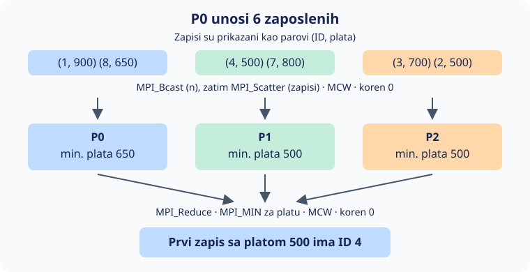

# Najmanja prosečna plata

Ispit 22. 6. 2023, zadatak 1.



1. Proces P0 učitava broj zaposlenih `n` i prosleđuje ga svim procesima pomoću `MPI_Bcast`. Broj zaposlenih mora biti pozitivan i deljiv brojem procesa `p`.
2. P0 učitava svih `n` zapisa. `MPI_Type_create_struct` opisuje identifikator, ime, prezime i platu. `MPI_Type_create_resized` postavlja razmak između uzastopnih zapisa na `sizeof(Employee)`. Jednim pozivom `MPI_Scatter` svaki proces dobija `n/p` celih zapisa.
3. Svaki proces nalazi svoju najmanju platu. `MPI_Reduce` sa `MPI_FLOAT` i `MPI_MIN` daje globalnu najmanju platu procesu P0.
4. P0 prolazi kroz originalni niz zaposlenih i ispisuje ID prvog zaposlenog sa tom platom, pa izlazi iz petlje pomoću `break`.

## Pokretanje

```sh
mpicc -std=c11 -Wall -Wextra -o mpi_minimum_salary mpi_minimum_salary.c
mpirun -np 3 ./mpi_minimum_salary <<'INPUT'
6
1 Ana Ilic 900
8 Iva Jovic 650
4 Marko Nikolic 500
7 Petar Simic 800
3 Milica Savic 700
2 Luka Kostic 500
INPUT
```

Očekivani izlaz je `Employee ID: 4, average salary: 500.00`.

Zadatak 3 sa istog roka odgovara već urađenom [paralelnom upisu i čitanju binarnih datoteka sa ispita 7. 7. 2022](../../parallel_io/exam_2022_07_07/README.md).
