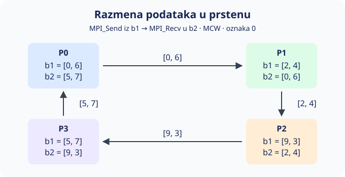

# MPI — Razmena podataka u prstenu (19.01.2026, deo b)



1. Proces sa rangom `rank` šalje svoj niz `b1` sledećem procesu i prima niz prethodnog procesa u `b2`. Za četiri procesa važi `destination = (rank + 1) % 4` i `source = (rank + 3) % 4`.
2. Svaka poruka sadrži dva cela broja i koristi oznaku `0` na komunikatoru `MCW`. Dva puna poziva su

   ```c
   MPI_Send(b1, 2, MPI_INT, destination, 0, MCW);
   MPI_Recv(b2, 2, MPI_INT, source, 0, MCW, MPI_STATUS_IGNORE);
   ```

3. Parni rangovi prvo primaju, a neparni prvo šalju. Tako P1 šalje P2 i P3 šalje P0 dok su odgovarajući prijemi već prvi pozivi na parnim rangovima. Zatim P0 šalje P1, a P2 šalje P3. Ovakav redosled radi i kada MPI ne baferuje poruke.

## Pokretanje

```sh
mpicc -std=c11 -Wall -Wextra mpi_ring_exchange.c -o mpi_ring_exchange
mpirun -np 4 ./mpi_ring_exchange
```

Redosled ispisivanja može da se razlikuje.

```text
P0: b1 = {0, 6}, b2 = {5, 7}
P1: b1 = {2, 4}, b2 = {0, 6}
P2: b1 = {9, 3}, b2 = {2, 4}
P3: b1 = {5, 7}, b2 = {9, 3}
```
