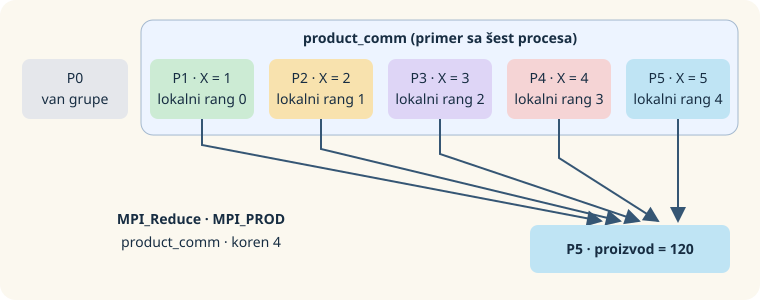

# 20.07.2026. — zadatak 7b



1. `MPI_Comm_group` preuzima grupu komunikatora `MCW`. `MPI_Group_excl` iz nje izostavlja P0 i zadržava redosled ostalih procesa.
2. Svi procesi pozivaju `MPI_Comm_create` u `MCW`. U novom komunikatoru `product_comm` proces P1 dobija lokalni rang 0, a P5 lokalni rang 4.
3. Procesi od P1 do Pn pozivaju `MPI_Reduce` sa operacijom `MPI_PROD` i korenom 4 u `product_comm`. P5 dobija i ispisuje proizvod, uključujući sopstvenu vrednost X.

Zadatak ne propisuje vrednosti X, pa za primer svaki proces uzima svoj globalni rang kao X. Potrebno je najmanje šest procesa da bi postojao P5.

```sh
mpicc -Wall -Wextra mpi_group_product.c -o mpi_group_product
mpirun -np 6 ./mpi_group_product
```

Očekivani ispis za šest procesa je `P5: product = 120`, jer je 1 · 2 · 3 · 4 · 5 = 120.
