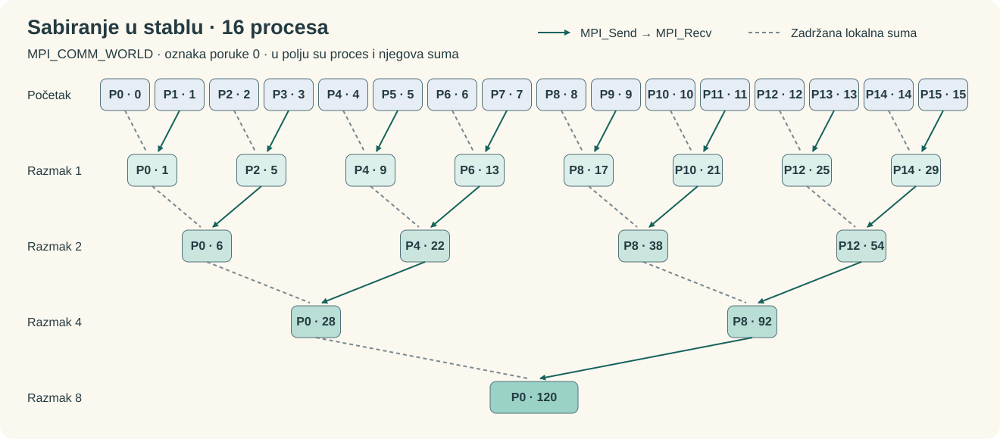

# MPI — Sabiranje u stablu (04.07.2015, zadatak 4a)

Koristi se `p = n` procesa, gde je `n` stepen dvojke. Svaki proces počinje sa jednim brojem. U primeru sa slike proces `Pᵣ` počinje sa vrednošću `r`, pa 16 procesa sabira brojeve od 0 do 15.



## Postupak

1. Razmak između partnera kreće od `step = 1` i udvostručuje se posle svakog koraka. Na početku koraka svaki aktivan proces sa rangom `r` drži sumu `step` vrednosti počevši od globalnog indeksa `r`.
2. Ako je rang `r` deljiv sa `2 * step`, proces prima sumu od `r + step` pomoću `MPI_Recv` i sabira je sa svojom. Svaki drugi aktivan proces šalje sumu procesu `r - step` pomoću `MPI_Send` i izlazi iz petlje. Obe operacije koriste `MPI_COMM_WORLD` i oznaku poruke `0`.
3. Za 16 procesa, P0 prolazi kroz sume `0 + 1 = 1`, `1 + 5 = 6`, `6 + 22 = 28` i `28 + 92 = 120`. Proces P0 ispisuje rezultat posle `log₂ p` koraka. Ukupno se šalje `p − 1` poruka, jer svaki proces osim P0 šalje tačno jednom.

## Pokretanje

```sh
mpicc -std=c11 -Wall -Wextra mpi_tree_sum.c -o mpi_tree_sum
mpirun -np 16 ./mpi_tree_sum
```

```text
Final sum is: 120
```
