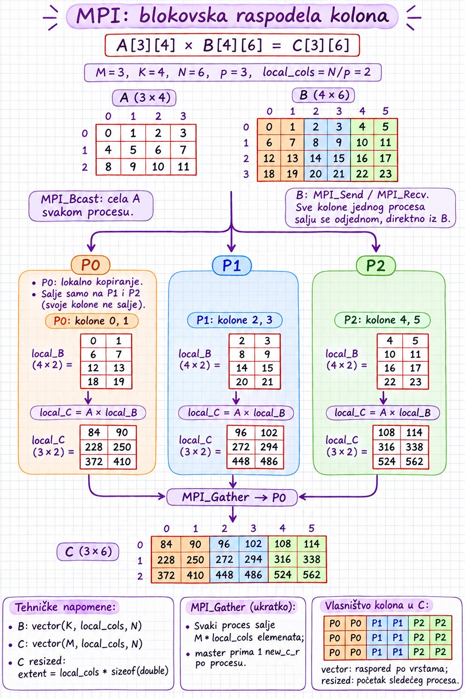

# Množenje matrica sa blokovskom raspodelom kolona

- `mpi_column_matrix_product.c` - rešenje zadatka; tekst zadatka je iznad funkcije `main`.
- `distribution_sketch.png` - skica raspodele za M = 3, K = 4, N = 6 i 3 procesa.
- `../../common/mpi_helpers.h` - zajednički helperi za prikaz matrica i raspodele.



Svaki proces dobija celu matricu A i N/p uzastopnih kolona matrice B:

| Proces | Kolone B i C |
| --- | --- |
| P0 | 0, 1 |
| P1 | 2, 3 |
| P2 | 4, 5 |

Matrica A se šalje pomoću `MPI_Bcast`. Master jednim `MPI_Send` pozivom šalje svakom drugom procesu sve njegove kolone direktno iz B, koristeći izvedeni tip `MPI_Type_vector(K, local_cols, N, ...)`. Svoj deo kopira lokalno.

Svaki proces računa svoje kolone C. `MPI_Gather` prikuplja rezultate u procesu P0. Prijemni tip opisuje blok kolona kroz svih M vrsta, a `MPI_Type_create_resized` postavlja extent na `local_cols * sizeof(double)`, tako da rezultat sledećeg procesa počinje u sledećem bloku kolona.

## Pokretanje

Iz ovog foldera:

```sh
mpicc mpi_column_matrix_product.c -o mpi_column_matrix_product
mpirun -np 3 ./mpi_column_matrix_product
```

Broj procesa mora da deli N = 6; podržani su 1, 2, 3 i 6 procesa. Za sve ove vrednosti rezultat je proveren sekvencijalnim množenjem.

Možeš koristiti i postojeći VS Code zadatak za kompajliranje i pokretanje.

Skica je generisana ugrađenim imagegen alatom. Opis za generisanje je u `sketch_prompt.txt`.
