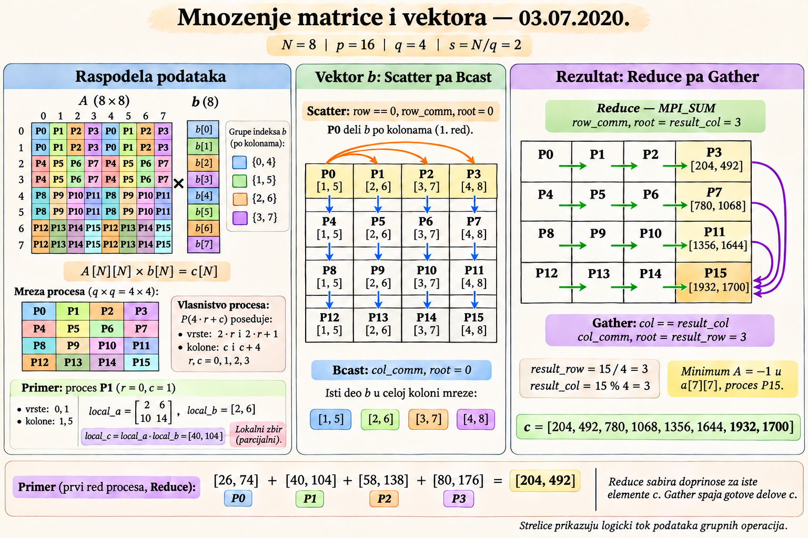

# Zadatak 3 — 03.07.2020.

- [Varijanta a](mpi_block_matrix_vector_a.c) šalje svaki blok matrice jednom naredbom `MPI_Send`, uz `count = 1` i izvedeni tip.
- [Varijanta b](mpi_block_matrix_vector_b.c) raspodeljuje matricu pomoću dva nivoa operacije `MPI_Scatter`.

Oba programa su samostalna. Matrica A ima dimenzije `N × N`, a vektori b i c imaju po `N` elemenata. Podrazumevano je `N = 8`. Broj procesa mora biti kvadrat `p = q*q`, a `N` deljivo sa `q`.



Skica je generisana ugrađenim imagegen alatom. Prompt ove skice je sačuvan u `matrix_vector_sketch_prompt.txt`.

Skica prikazuje i raspodelu b preko `MPI_Scatter` u prvoj vrsti mreže i `MPI_Bcast` po kolonama. Za rezultat, `MPI_Reduce` sabira doprinose u svakoj vrsti u P3, P7, P11 i P15. Zatim `MPI_Gather` sakuplja njihove delove u P15. U ovom primeru su `result_col = 3` i `result_row = 3`. Strelice prikazuju logički tok podataka grupnih operacija.

## 1. Raspodela podataka

Proces sa rangom `rank` ima koordinate

```c
row = rank / q;
col = rank % q;
rows = N / q;
cols = N / q;
```

Njegov lokalni element `local_a[i][j]` odgovara elementu

```c
a[row * rows + i][col + j * q]
```

Za `N = 8` i `p = 16`, mreža procesa ima dimenzije `4 × 4`, a lokalna matrica `2 × 2`.

| Proces | Vrste A | Kolone A | Elementi b |
| --- | --- | --- | --- |
| P0 | 0, 1 | 0, 4 | b[0], b[4] |
| P1 | 0, 1 | 1, 5 | b[1], b[5] |
| P4 | 2, 3 | 0, 4 | b[0], b[4] |
| P15 | 6, 7 | 3, 7 | b[3], b[7] |

Komunikator `row_comm` povezuje procese iste vrste mreže, sa lokalnim rangom `col`. Komunikator `col_comm` povezuje procese iste kolone, sa lokalnim rangom `row`.

## 2. Izvedeni tip bloka A

```c
MPI_Type_vector(rows * cols, 1, q, MPI_DOUBLE, &block_type);
```

Tip bira `rows * cols` pojedinačnih elemenata, sa razmakom od `q` elemenata. Pošto je `N = cols * q`, posle poslednje izabrane kolone jedne vrste sledeći korak prelazi na odgovarajuću kolonu naredne vrste.

Za P1 biraju se pomeraji `0, 4, 8, 12` u odnosu na `&a[0][1]`, odnosno elementi `a[0][1]`, `a[0][5]`, `a[1][1]`, `a[1][5]`. Prijem koristi četiri uzastopna elementa tipa `MPI_DOUBLE`, pa se dobija gusto zapakovana lokalna matrica.

### Varijanta a

Master kopira sopstveni blok i za svaki drugi proces izvršava

```c
MPI_Send(&a[(dest / q) * rows][dest % q], 1, block_type,
         dest, 0, MPI_COMM_WORLD);
```

Početna adresa određuje blok, a izvedeni tip bira sve njegove elemente u jednoj poruci.

### Varijanta b

1. U prvoj koloni mreže, `MPI_Scatter` deli matricu na trake od `rows` celih vrsta. P0, P4, P8 i P12 dobijaju odgovarajuće trake.
2. Svaki od tih procesa deli svoju traku procesima u svom `row_comm`. Drugi `MPI_Scatter` koristi ciklični tip bloka sa extent-om postavljenim na `sizeof(double)`.

Promenjeni extent pomera početak sledećeg bloka za jednu kolonu. Tako procesi u istoj vrsti mreže dobijaju početne kolone `0, 1, ..., q-1`.

## 3. Raspodela vektora b

Tip `vector_type` bira `cols` elemenata sa korakom `q`. Njegov extent se takođe postavlja na `sizeof(double)`.

1. U prvoj vrsti mreže, `MPI_Scatter` deli b ciklično između procesa P0, P1, ..., P(q-1).
2. Svaki od njih poziva `MPI_Bcast` u svom `col_comm`. Svi procesi iste kolone mreže dobijaju isti deo b.

## 4. Lokalno množenje i minimum

Svaki proces računa doprinos za svoje vrste

```c
local_c[i] += local_a[i][j] * local_b[j];
```

U istoj petlji pronalazi minimum lokalnog bloka. `MPI_Reduce` sa `MPI_MINLOC` nad parom `(vrednost, svetski rang)` određuje u master procesu ko poseduje globalni minimum. Zatim `MPI_Bcast` prosleđuje taj par svim procesima. Ako više procesa poseduje minimum, bira se najmanji rang.

## 5. Sakupljanje rezultata

Koordinate procesa koji poseduje minimum dobijaju se kao

```c
result_row = global_min.rank / q;
result_col = global_min.rank % q;
```

1. `MPI_Reduce` sabira parcijalne proizvode u svakoj vrsti mreže. Lokalni koren je `result_col`. Sada se svi delovi c nalaze u koloni mreže u kojoj je izabrani proces.
2. Samo procesi te kolone pozivaju `MPI_Gather` u svom `col_comm`. Lokalni koren je `result_row`. Delovi se slažu po redosledu vrsta i izabrani proces dobija ceo c.

Za minimum u P15, koreni obe operacije imaju lokalni rang 3. Svetski rang procesa se prevodi u lokalni rang odgovarajućeg komunikatora.

## Pokretanje

Iz ovog foldera

```sh
mpicc -std=c99 -Wall -Wextra mpi_block_matrix_vector_a.c -o mpi_block_matrix_vector_a
mpirun --oversubscribe -np 16 ./mpi_block_matrix_vector_a

mpicc -std=c99 -Wall -Wextra mpi_block_matrix_vector_b.c -o mpi_block_matrix_vector_b
mpirun --oversubscribe -np 16 ./mpi_block_matrix_vector_b
```

U VS Code-u otvori željeni C fajl, pokreni `Cmd+Shift+B` i unesi 16 procesa.

Za primer su izabrani `a[i][j] = i*N + j + 1`, `b[j] = j + 1` i `a[N-1][N-1] = -1`. Za 16 procesa očekuje se

```text
Result process: 15
Minimum A: -1
Vector C: 204 492 780 1068 1356 1644 1932 1700
```

Dimenzija se menja direktno u kodu, izmenom vrednosti u direktivi `#define N 8`.

## Lokalni izvori

Korišćeni su obrasci za izvedene tipove, `MPI_Comm_split`, raspodelu b i pronalaženje minimuma iz dopunskih rešenja

- `04 - Additional Materials/Paralelni sistemi/elfak-parallel-systems-main/Priprema/MPI/apr-2023-a/Source.c`
- `04 - Additional Materials/Paralelni sistemi/elfak-parallel-systems-main/Priprema/MPI/dec-2022/Zad1.cpp`

Putanje su relativne u odnosu na `01 - Current Accreditation`. Raspodela blokova i lokalni koreni završnih operacija prilagođeni su ovom zadatku.
