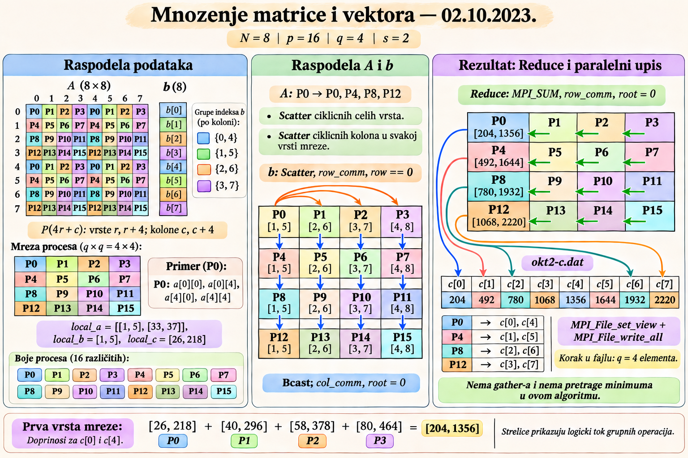

# Zadatak 1 — 02.10.2023.

[Rešenje](mpi_block_matrix_vector_file.c) množi matricu A dimenzija `N × N` vektorom b i paralelno upisuje vektor c u binarni fajl `okt2-c.dat`. Tekst zadatka je u komentaru iznad funkcije `main`.

Rešenje koristi dva nivoa raspodele kao varijanta b iz zadatka od 03.07.2020. Ovde su i vrste i kolone matrice raspodeljene ciklično. Podrazumevano je `N = 8`. Potrebno je `p = q*q`, `q >= 2` i `N` deljivo sa `q`. Uslov `q >= 2` obezbeđuje da u upisu učestvuje više procesa.



## 1. Koordinate i lokalni podaci

```c
row = rank / q;
col = rank % q;
rows = N / q;
cols = N / q;
```

Proces poseduje `rows` ciklično izabranih vrsta i `cols` ciklično izabranih kolona. Veza lokalnih i globalnih indeksa je

```c
local_a[i][j] = a[row + i * q][col + j * q];
local_b[j] = b[col + j * q];
```

Za `N = 8`, `p = 16`, svaki proces dobija matricu `2 × 2` i dva elementa b.

| Proces | Vrste A | Kolone A | Elementi b |
| --- | --- | --- | --- |
| P0 | 0, 4 | 0, 4 | b[0], b[4] |
| P1 | 0, 4 | 1, 5 | b[1], b[5] |
| P4 | 1, 5 | 0, 4 | b[0], b[4] |
| P15 | 3, 7 | 3, 7 | b[3], b[7] |

`MPI_Comm_split` formira `row_comm` za svaku vrstu mreže i `col_comm` za svaku kolonu. Lokalni rang u `row_comm` je `col`, a u `col_comm` je `row`.

## 2. Raspodela matrice A

1. Master inicijalizuje `a[i][j] = i*N + j + 1` i `b[j] = j + 1`.
2. Procesi prve kolone pozivaju `MPI_Scatter` u svom `col_comm`. Svaki dobija `rows` ciklično izabranih celih vrsta matrice, odnosno `rows*N` elemenata zapakovanih uzastopno u `row_a`. P0 dobija vrste 0 i 4, P4 vrste 1 i 5, P8 vrste 2 i 6, a P12 vrste 3 i 7.
3. Svaki proces prve kolone poziva drugi `MPI_Scatter` zajedno sa procesima svoje vrste. Svaki učesnik dobija ceo lokalni blok odjednom.

Prvi `MPI_Scatter` koristi tip

```c
MPI_Type_vector(rows, N, q * N, MPI_DOUBLE, &rows_type);
MPI_Type_create_resized(rows_type, 0, N * sizeof(double), &rows_resized);
```

Jedan blok tipa obuhvata celu vrstu, a korak između vrsta je `q*N` elemenata. Extent od jedne cele vrste pomera početak sledećeg procesa na sledeću vrstu matrice.

Drugi `MPI_Scatter` nad zapakovanim `row_a` koristi izvedeni tip

```c
MPI_Type_vector(rows * cols, 1, q, MPI_DOUBLE, &block_type);
MPI_Type_create_resized(block_type, 0, sizeof(double), &block_resized);
```

bira elemente sa korakom `q`. Pošto je `N = cols*q`, nakon poslednjeg izabranog elementa jedne vrste prelazi na odgovarajuću kolonu sledeće vrste. Promenjeni extent pomera početak bloka sledećeg procesa za jedan `double`. Drugi `MPI_Scatter` šalje po jedan takav tip, a primalac smešta `rows*cols` elemenata uzastopno u `local_a`.

Na primer, P1 dobija `a[0][1]`, `a[0][5]`, `a[4][1]`, `a[4][5]`. P0 dobija `a[0][0]`, `a[0][4]`, `a[4][0]`, `a[4][4]`.

## 3. Raspodela vektora b

Tip `vector_type` bira `cols` elemenata sa korakom `q`, a njegov extent postavlja se na `sizeof(double)`.

1. `MPI_Scatter` u prvoj vrsti mreže raspodeljuje ciklične delove b.
2. `MPI_Bcast` u svakoj koloni mreže prenosi taj deo svim procesima kolone.

Tako svaki proces dobija upravo elemente b koji odgovaraju njegovim kolonama matrice A.

## 4. Računanje vektora c

Svaki proces izračunava parcijalne sume

```c
local_c[i] += local_a[i][j] * local_b[j];
```

`MPI_Reduce` sa `MPI_SUM` i korenom 0 u svakom `row_comm` sabira doprinose po vrstama matrice. Procesi prve kolone sada imaju konačne delove vektora c. Za 16 procesa to su P0, P4, P8 i P12.

## 5. Paralelni upis

Samo procesi prve kolone otvaraju fajl, koristeći svoj zajednički `col_comm`. Svaki poseduje konačne vrednosti `c[row + i*q]`, za `i = 0, ..., rows-1`.

Izvedeni tip za pogled fajla bira `rows` vrednosti sa korakom `q`

```c
MPI_Type_vector(rows, 1, q, MPI_DOUBLE, &file_type);
MPI_Offset offset = (MPI_Offset)row * sizeof(double);
MPI_File_set_view(file, offset, MPI_DOUBLE, file_type, "native", MPI_INFO_NULL);
MPI_File_write_all(file, row_c, rows, MPI_DOUBLE, MPI_STATUS_IGNORE);
```

Pomeraj početka pogleda izražen je u bajtovima. Korak izvedenog tipa izražen je u elementima `MPI_DOUBLE`. Uzastopni elementi iz memorijskog bafera `row_c` upisuju se na ciklično raspoređena mesta u fajlu.

Za 16 procesa raspored je

| Proces | Deo c | Početni pomeraj u bajtovima |
| --- | --- | --- |
| P0 | c[0], c[4] | 0 |
| P4 | c[1], c[5] | sizeof(double) |
| P8 | c[2], c[6] | 2*sizeof(double) |
| P12 | c[3], c[7] | 3*sizeof(double) |

Upisi se ne preklapaju. `MPI_File_set_size` postavlja dužinu fajla na `N*sizeof(double)`, čime uklanja eventualni ostatak ranijeg, dužeg fajla. Fajl sadrži `N` vrednosti tipa `double` u izvornom binarnom zapisu platforme, redom od c[0] do c[N-1], bez zaglavlja.

## Pokretanje i provera

Iz ovog foldera pokreni

```sh
mpicc -std=c99 -Wall -Wextra mpi_block_matrix_vector_file.c -o mpi_block_matrix_vector_file
mpirun --oversubscribe -np 16 ./mpi_block_matrix_vector_file
```

Program prikazuje početne podatke i lokalnu raspodelu pomoću postojećeg `mpi_helpers.h`. Njegovi dodatni `MPI_Gather` pozivi služe prikazu raspodele. Završni vektor ostaje raspodeljen među procesima prve kolone i oni ga upisuju u fajl u trenutnom radnom folderu.

Za izabranu inicijalizaciju očekuje se

```text
204 492 780 1068 1356 1644 1932 2220
```

Binarni fajl možeš pročitati pomoću Pythona

```sh
python3 - <<'PYTHON'
import struct
from pathlib import Path

data = Path("okt2-c.dat").read_bytes()
print(*struct.unpack(f"{len(data) // struct.calcsize('d')}d", data))
PYTHON
```

Rešenje je kompajlirano bez upozorenja i izvršeno sa 4 i 16 procesa. Za oba pokretanja sadržaj binarnog fajla upoređen je sa sekvencijalnim proizvodom A i b.

## Lokalni izvori

- `../exam_2020_07_03/mpi_block_matrix_vector_b.c` za raspodelu blokova, izvedene tipove i komunikatore.
- `01 - Current Accreditation/04 - Additional Materials/Paralelni sistemi/elfak-parallel-systems-main/Priprema/MPIFiles/jun-2021/Source.c` za MPI upis sa pomerajima i kolektivni upis fajla. Ova putanja je relativna u odnosu na koren projekta.

Skica je generisana ugrađenim imagegen alatom po uzoru na obojenu skicu prethodnog zadatka. Prompt je sačuvan u `matrix_vector_sketch_prompt.txt`. Svaki proces ima svoju boju, a njegova četiri elementa u matrici obojena su dosledno. Strelice upisa prikazuju logički tok, dok tabela ispod fajla navodi oba indeksa koja upisuje svaki proces.
