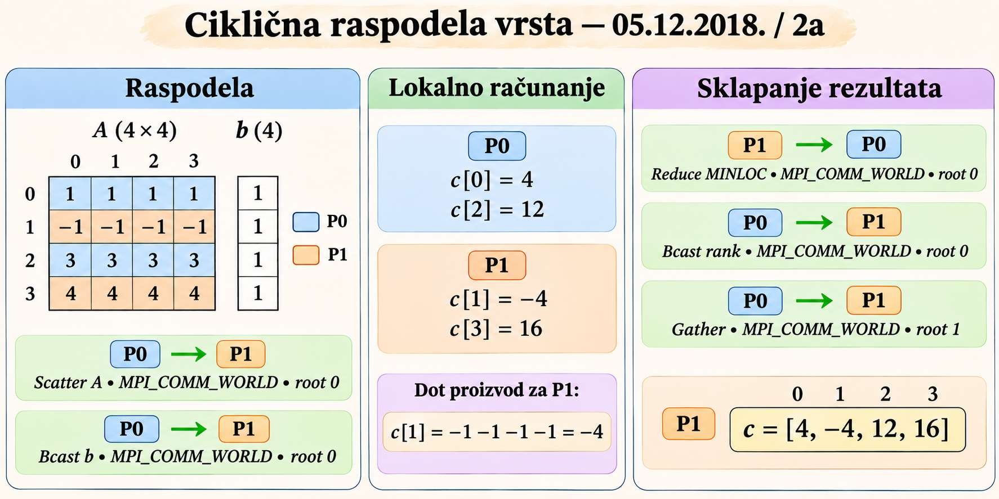
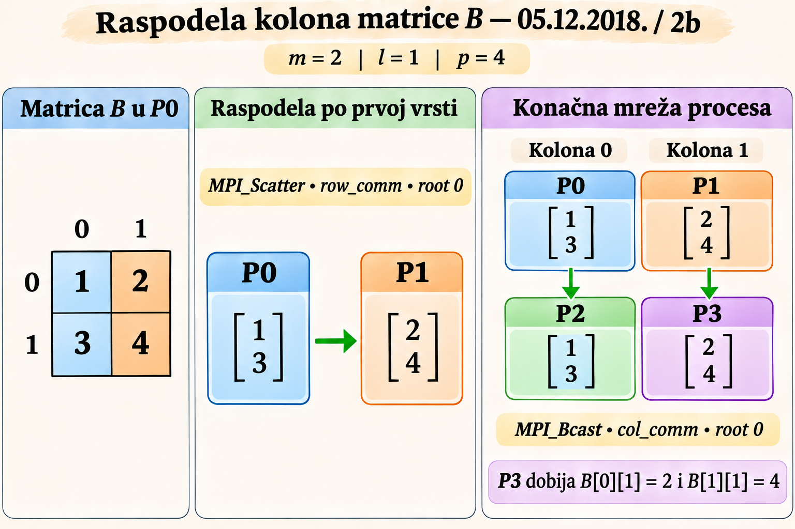

# MPI — 05.12.2018.

## 2a. Množenje matrice i vektora cikličnom raspodelom vrsta

[Izvorni kod](mpi_cyclic_row_matrix_vector_min.c)

1. P0 inicijalizuje matricu A i vektor b. Za `p` procesa svaki dobija `n/p` vrsta. Tip `MPI_Type_vector(n/p, n, p*n, MPI_INT, ...)` bira cele vrste na razmaku od `p` vrsta. Sa extentom od `n * sizeof(int)`, `MPI_Scatter` počinje blok procesa Pi od vrste `i` i uzima njegove vrste direktno iz A. `MPI_Bcast` šalje ceo b svim procesima.
2. Svaki proces računa skalarne proizvode svojih vrsta sa b. Za lokalnu vrstu `k` na procesu Pi globalni indeks rezultata je `i + k*p`.
3. Svaki proces upisuje lokalni minimum i svoj rang u polja `value` i `rank` strukture `local_min`. P0 koristi `MPI_Reduce` sa `MPI_MINLOC` i tipom `MPI_2INT` da pronađe rang procesa sa globalnim minimumom. Pri jednakim minimumima bira se manji rang. P0 prosleđuje polje `global_min.rank` svim procesima pomoću `MPI_Bcast`.
4. Izabrani proces prikuplja rezultate pomoću `MPI_Gather`. Prijemni tip bira `n/p` elemenata sa korakom `p`, a extent od `sizeof(int)` pomera početak za jedan element po rangu. Tako se vrednosti direktno upisuju u c na mesta `i, i+p, …`.



```sh
mpicc -std=c99 -Wall -Wextra mpi_cyclic_row_matrix_vector_min.c -o /tmp/mpi_cyclic_row_matrix_vector_min
mpiexec -n 2 /tmp/mpi_cyclic_row_matrix_vector_min
```

Za `n = 4` i dva procesa P0 računa `c[0] = 4` i `c[2] = 12`, a P1 računa `c[1] = -4` i `c[3] = 16`. P1 ima minimum i ispisuje ceo vektor `[4, -4, 12, 16]`.

## 2b. Raspodela kolonskih blokova matrice B

[Izvorni kod](mpi_column_block_distribution.c)

1. Mreža ima `q = m/l` vrsta i kolona. Proces ranga `rank` ima koordinate `row = rank/q` i `col = rank%q`. Prvi `MPI_Comm_split` formira po jedan `row_comm` za svaku vrstu, sa procesima poređanim po kolonama. Samo prva vrsta koristi svoj komunikator za raspodelu. Drugi formira po jedan `col_comm` za svaku kolonu, sa procesima poređanim po vrstama.
2. P0 inicijalizuje B. Tip `MPI_Type_vector(m, l, m, MPI_INT, ...)` iz svake vrste uzima `l` uzastopnih elemenata. Extent od `l * sizeof(int)` omogućava da `MPI_Scatter` direktno iz B pošalje sledeći blok sledećem procesu prve vrste. Lokalni rang korena u `row_comm` je 0.
3. Svaki proces prve vrste ima lokalni rang 0 u svojoj koloni. Pomoću `MPI_Bcast` šalje isti blok svim procesima u svom `col_comm`. Procesi u koloni `col` dobijaju kolone B sa indeksima od `col*l` do `(col+1)*l-1`.



```sh
mpicc -std=c99 -Wall -Wextra mpi_column_block_distribution.c -o /tmp/mpi_column_block_distribution
mpiexec -n 4 /tmp/mpi_column_block_distribution
```

Za `m = 2` i `l = 1`, P0 i P2 dobijaju kolonu 0 sa vrednostima `[1, 3]`, a P1 i P3 kolonu 1 sa vrednostima `[2, 4]`.
