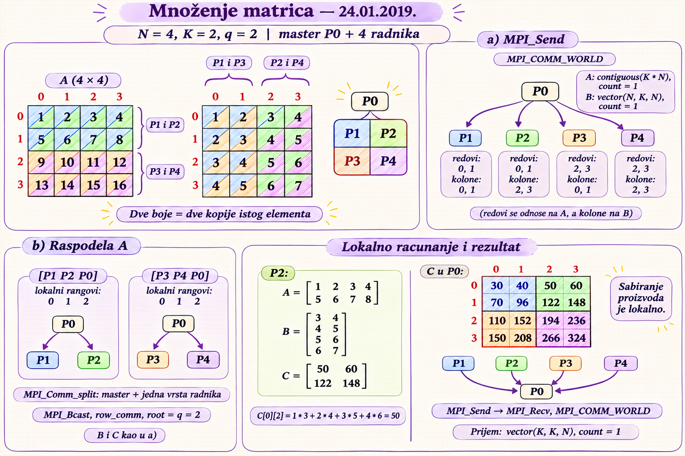

# Zadatak 2 — 24.01.2019.

## Tekst zadatka

**a)** Napisati MPI program za množenje matrica A i B dimenzija n × n, čime se dobija matrica C. Matrice A i B inicijalizuju se u master procesu. A je podeljena na blokove od po k vrsta, a B na blokove od po k kolona; k je zadata konstanta i n je deljivo sa k. Broj radnika je (n/k)² i uređeni su kao matrica. Master svakom radniku šalje odgovarajuće trake A i B: svi radnici iste vrste dobijaju iste vrste A, a svi radnici iste kolone iste kolone B. Radnici računaju svoje delove rezultata, koji prikazuje master. Svaku traku A, odnosno B, poslati jednim pozivom MPI_Send, uz count=1 i izvedeni tip podataka.

**b)** Slanje blokova A iz dela a) implementirati grupnim operacijama i funkcijama za kreiranje novih komunikatora.

Na fotografiji je reč „vektora” ispravljena u „matrice”. U opisu B postoji i omaška „u drugoj vrsti”; prema podeli na kolone i prethodnoj rečenici, odnosi se na **drugu kolonu mreže**.

- [Deo a): slanje izvedenih tipova](mpi_strip_matrix_product_a.c)
- [Deo b): kolektivna raspodela A](mpi_strip_matrix_product_b.c)

## Postupak za a)

1. Postavimo q=N/K. Master je P0, a **q² radnika su P1…P(q²)**. Ukupno je 1+q² procesa. Radnik ima koordinate `row=(rank-1)/q`, `col=(rank-1)%q`.
2. Radnik dobija A vrste `row*K…row*K+K-1` i B kolone `col*K…col*K+K-1`. Lokalni nizovi su `local_a[K][N]` i `local_b[N][K]`.
3. `MPI_Type_contiguous(K*N, MPI_DOUBLE, &row_type)` opisuje celu traku A. Master šalje sa adrese `&a[row*K][0]`, uz `count=1`.
4. `MPI_Type_vector(N, K, N, MPI_DOUBLE, &column_type)` opisuje N grupa od K elemenata, sa korakom N. Master šalje sa `&b[0][col*K]`, uz `count=1`. Radnik prima K*N običnih elemenata u kontinualni niz. Extent ne prilagođavamo jer šaljemo samo jedan primerak tipa.
5. Radnik računa `local_c[i][j] = Σ(t=0…N-1) local_a[i][t]*local_b[t][j]`. To je završni element `C[row*K+i][col*K+j]`: svi sabirci su lokalni, pa redukcija nije potrebna.
6. Radnik šalje K*K elemenata rezultata. Master prima direktno na `&c[row*K][col*K]`, pomoću `MPI_Type_vector(K,K,N,...)` i `count=1`. Tako se blok smešta na pravo mesto bez dodatnog preslaganja.

Master najpre šalje sve trake A, zatim sve trake B, pa prima rezultate. Radnik prati redosled prijem A, prijem B, računanje, slanje C. Nije potrebna dodatna sinhronizacija.

## Izmena za b)

Menja se samo raspodela A. Za svaku vrstu `r=0…q-1`, **svi procesi** pozivaju `MPI_Comm_split`:

- P0 i radnici vrste r imaju `color=0`; ostali `MPI_UNDEFINED`.
- Radnici imaju `key=col`, a master `key=q`.
- Novi `row_comm` zato sadrži radnike sa lokalnim rangovima 0…q-1 i master sa lokalnim rangom q.

Master poziva `MPI_Bcast(&a[r*K][0],1,row_type,q,row_comm)`, a radnici te vrste `MPI_Bcast(local_a,K*N,MPI_DOUBLE,q,row_comm)`. Potpisi tipova su isti: K*N elemenata tipa MPI_DOUBLE. **Koren je lokalni rang q**, iako je njegov rang u MPI_COMM_WORLD jednak 0. Svaki radnik učestvuje u jednom broadcast-u, a master u q broadcast-a. Komunikatori se stvaraju redom; procesi van date vrste ne pozivaju njen Bcast. Ovo direktno ispunjava zahtev b), bez dodatnog međukoraka raspodele. B i rezultat C ostaju kao u a).

## Primer i skica



Za N=4 i K=2 postoje četiri radnika, odnosno ukupno pet procesa:

```text
            kolona 0       kolona 1
vrsta 0       P1              P2
vrsta 1       P3              P4

P0: izdvojeni master
```

Dve boje u ćeliji A ili B označavaju dve kopije istog elementa kod različitih radnika. Svaki blok C ima jednog vlasnika.

P2 dobija:

```text
local_a             local_b       local_c
1 2 3 4             3 4           50  60
5 6 7 8             4 5          122 148
                    5 6
                    6 7
```

Na primer, `C[0][2]=1*3+2*4+3*5+4*6=50`. Master dobija:

```text
 30  40  50  60
 70  96 122 148
110 152 194 236
150 208 266 324
```

## Prevođenje i pokretanje

Iz ovog foldera:

```sh
mpicc -std=c99 -Wall -Wextra -pedantic mpi_strip_matrix_product_a.c -o mpi_strip_matrix_product_a
mpirun --oversubscribe -np 5 ./mpi_strip_matrix_product_a

mpicc -std=c99 -Wall -Wextra -pedantic mpi_strip_matrix_product_b.c -o mpi_strip_matrix_product_b
mpirun --oversubscribe -np 5 ./mpi_strip_matrix_product_b
```

Podrazumevano N=4, K=2. Za druge konstante dodati, na primer, `-DN=6 -DK=2` i pokrenuti 10 procesa. N i K moraju biti pozitivni, a N deljivo sa K. Nizovi na steku namenjeni su malim ispitnim primerima.

## Lokalni izvori

- [18.01.2021.](../exam_2021_01_18/mpi_strip_matrix_product.c): isti oblik traka A i B i lokalnog množenja; ovde je master izdvojen i deo a) izričito zahteva MPI_Send.
- [23.06.2022.](../exam_2022_06_23/mpi_block_matrix_product.c): izvedeni tipovi za direktan prijem blokova.
- Dopunski materijal `04 - Additional Materials/Paralelni sistemi/elfak-parallel-systems-main/Priprema/MPI/jun-2022/Source.c`: MPI_Type_vector, komunikatori i množenje lokalnih traka.
- Skice 03.07.2020. i 23.06.2022: vizuelne reference.

## Provera

Oba programa prevedena su bez upozorenja. Za (N,K)=(4,2),(4,4),(6,2),(4,1), odnosno 5,2,10,17 procesa, svaki element rezultata poređen je sa nezavisnim sekvencijalnim množenjem. Sve provere su prošle. Provereno je i odbijanje pogrešnog broja procesa.
