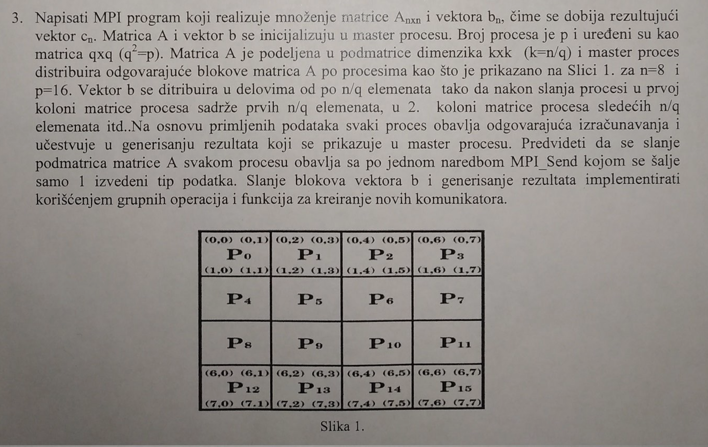
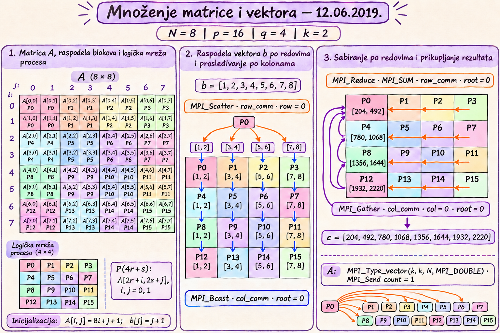

# Zadatak 3 — 12.06.2019.

[Rešenje](mpi_block_matrix_vector.c) računa proizvod `c = A*b` blokovskom raspodelom matrice. Tekst zadatka nalazi se u komentaru iznad funkcije `main`.

Podrazumevano je `N = 8`. Broj procesa mora biti `p = q*q`, a `N` mora biti deljivo sa `q`. Master je P0. Za primer sa slike koristi se 16 procesa, mreža `4 × 4` i blokovi `2 × 2`.

## Originalni zadatak



## Skica rešenja



## 1. Logička mreža i vlasništvo podataka

```c
row = rank / q;
col = rank % q;
k = N / q;
```

Proces `P(row*q+col)` dobija `k` uzastopnih vrsta i `k` uzastopnih kolona. Lokalni i globalni indeksi povezani su izrazima

```c
local_a[i][j] = a[row * k + i][col * k + j];
local_b[j] = b[col * k + j];
```

Za `N = 8` i `p = 16` mreža procesa je

```text
P0   P1   P2   P3
P4   P5   P6   P7
P8   P9   P10  P11
P12  P13  P14  P15
```

| Proces | Vrste A | Kolone A | Elementi b |
| --- | --- | --- | --- |
| P0 | 0, 1 | 0, 1 | b[0], b[1] |
| P1 | 0, 1 | 2, 3 | b[2], b[3] |
| P4 | 2, 3 | 0, 1 | b[0], b[1] |
| P15 | 6, 7 | 6, 7 | b[6], b[7] |

Dva poziva formiraju komunikatore

```c
MPI_Comm_split(MCW, row, col, &row_comm);
MPI_Comm_split(MCW, col, row, &col_comm);
```

U `row_comm` učestvuju procesi iste vrste mreže, uređeni po `col`. Njihov lokalni rang je `col`. U `col_comm` učestvuju procesi iste kolone, uređeni po `row`. Njihov lokalni rang je `row`.

## 2. Inicijalizacija i slanje matrice A

Master inicijalizuje `a[i][j] = i*N + j + 1` i `b[j] = j + 1`. Ove vrednosti izabrane su za proveru rešenja.

```c
MPI_Type_vector(k, k, N, MPI_DOUBLE, &block_type);
MPI_Type_commit(&block_type);
```

Izvedeni tip obuhvata `k` blokova od po `k` uzastopnih elemenata. Počeci dva susedna bloka udaljeni su `N` elemenata, što odgovara dužini jedne vrste cele matrice.

Za svaki drugi proces master poziva

```c
MPI_Send(&a[(dest / q) * k][(dest % q) * k],
         1, block_type, dest, 0, MCW);
```

Početna adresa pokazuje na gornji levi element podmatrice primaoca. `count = 1` šalje ceo blok jednim izvedenim tipom. Primalac koristi `MPI_Recv` sa `k*k` elemenata tipa `MPI_DOUBLE` i dobija uzastopno zapakovanu lokalnu matricu.

Na primer, P1 dobija `a[0][2]`, `a[0][3]`, `a[1][2]`, `a[1][3]`, odnosno matricu `[[3,4],[11,12]]`. P0 svoj blok kopira direktno u `local_a`.

## 3. Raspodela vektora b

1. Samo prva vrsta mreže, `row == 0`, poziva `MPI_Scatter` u svom `row_comm`. P0 dobija `[1,2]`, P1 `[3,4]`, P2 `[5,6]`, a P3 `[7,8]`.
2. Svi procesi pozivaju `MPI_Bcast` u svojim kolonama. Koren 0 svake kolone je proces prve vrste, koji je prethodno primio odgovarajući deo b.

Tako P0, P4, P8 i P12 imaju `[1,2]`, dok P3, P7, P11 i P15 imaju `[7,8]`. Svaki proces poseduje elemente b koji odgovaraju kolonama njegovog bloka A.

## 4. Lokalno računanje i sabiranje

Svaki proces računa `k` parcijalnih suma

```c
local_c[i] = 0;
for (int j = 0; j < k; j++)
    local_c[i] += local_a[i][j] * local_b[j];
```

Za prvu vrstu mreže dobijaju se

| Proces | Parcijalni rezultat |
| --- | --- |
| P0 | [5, 29] |
| P1 | [25, 81] |
| P2 | [61, 149] |
| P3 | [113, 233] |

`MPI_Reduce` sa `MPI_SUM`, korenom 0 i komunikatorom `row_comm` sabira doprinose za iste vrste A. P0 dobija `[204,492]`, P4 `[780,1068]`, P8 `[1356,1644]`, a P12 `[1932,2220]`.

## 5. Sastavljanje rezultata u master procesu

Samo procesi prve kolone, `col == 0`, pozivaju `MPI_Gather` u svom `col_comm`. Njihov redosled u komunikatoru odgovara redosledu blokova vrsta matrice. P0 dobija delove uzastopno, pa konačni vektor ima ispravan poredak elemenata.

```text
Vector C: 204 492 780 1068 1356 1644 1932 2220
```

## Pokretanje

Iz ovog foldera pokreni

```sh
mpicc -std=c99 -Wall -Wextra -Wpedantic mpi_block_matrix_vector.c -o mpi_block_matrix_vector
mpirun --oversubscribe -np 16 ./mpi_block_matrix_vector
```

Rešenje je kompajlirano bez upozorenja i provereno sa 1, 4, 16 i 64 procesa. Svaki rezultat upoređen je sa sekvencijalnim proizvodom. Provereno je i odbijanje neispravnih konfiguracija sa 2 i 9 procesa.

## Lokalni izvori

- `../exam_2020_07_03/mpi_block_matrix_vector_a.c` za slanje blokova izvedenim tipom, komunikatore vrsta i kolona i kolektivne operacije.
- `01 - Current Accreditation/04 - Additional Materials/Paralelni sistemi/Paralelni sistemi/Pismeni/MPI/MPI/MPI_LAB_4_DANICA.txt` za primere novih komunikatora. Putanja je relativna u odnosu na koren projekta.

Strelice na skici predstavljaju tok podataka kolektivnih operacija. MPI bira konkretan algoritam njihovog izvršavanja.
