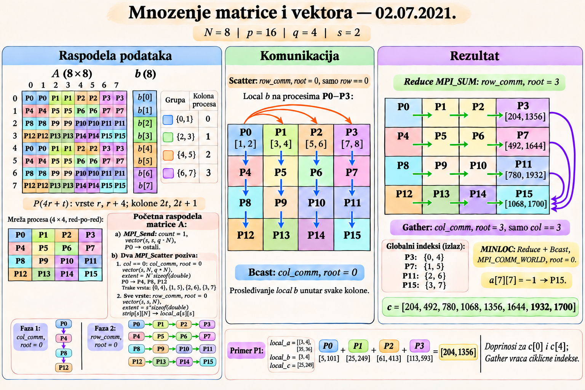

# Zadatak 2 — 02.07.2021.

[Deo a): MPI_Send](mpi_cyclic_rows_matrix_vector_a.c) · [Deo b): grupna raspodela](mpi_cyclic_rows_matrix_vector_b.c)

## Zadatak

Napisati MPI program koji množi matricu A dimenzija k × k i vektor b dužine k, čime se dobija vektor c. A i b inicijalizuje master P0. Broj procesa je p = q², sa logičkom mrežom q × q. Za s = k/q, proces Pi dobija ciklične vrste i/q, i/q+q, …, i/q+(s−1)q i uzastopne kolone (i%q)s, …, (i%q)s+s−1 matrice A. Iste indekse kolona dobija iz vektora b.

Svi procesi učestvuju u računanju, a rezultat se prikazuje u procesu koji poseduje minimum matrice A. Ceo blok matrice šalje se odjednom. U delu a) svakom drugom procesu blok A šalje se jednom naredbom MPI_Send, sa count = 1 i izvedenim tipom. Raspodelu b i generisanje rezultata realizovati grupnim operacijama uz nove komunikatore. U delu b) i raspodelu A realizovati grupnim operacijama uz nove komunikatore.

U kodu oznaka N odgovara k iz zadatka. Podrazumevano je N = 8.

## 1. Raspodela i komunikatori

Koordinate procesa su `row = rank/q` i `col = rank%q`. Lokalni blok ima s × s elemenata:

```c
local_a[i][j] = a[row + i*q][col*s + j];
local_b[j] = b[col*s + j];
```

Za N = 8 i p = 16:

| Proces | Globalne vrste A | Globalne kolone A | Deo b |
| --- | --- | --- | --- |
| P0 | 0, 4 | 0, 1 | b[0], b[1] |
| P1 | 0, 4 | 2, 3 | b[2], b[3] |
| P4 | 1, 5 | 0, 1 | b[0], b[1] |
| P15 | 3, 7 | 6, 7 | b[6], b[7] |

`MPI_Comm_split(MCW, row, col, &row_comm)` grupiše istu vrstu mreže; lokalni rang je col. Drugi poziv, sa color = col i key = row, daje col_comm i lokalni rang row.

## 2. Slanje matrice A

Tip `MPI_Type_vector(s, s, q*N, MPI_DOUBLE, &block_type)` bira s grupa od po s uzastopnih elemenata, sa korakom q*N između početaka grupa. Na primer, iz adrese a[0][2] bira a[0][2], a[0][3], a[4][2], a[4][3].

**Deo a).** P0 svoj blok kopira lokalno. Svakom procesu dest > 0 šalje jedan block_type, počev od `a[dest/q][(dest%q)*s]`. Primalac prima s*s običnih MPI_DOUBLE elemenata u gust lokalni blok. Nije potrebno slanje samom sebi.

**Deo b).** Matrica A raspodeljuje se pomoću dva Scatter poziva u novim komunikatorima:

1. Samo procesi za koje je `col == 0` pozivaju MPI_Scatter u svom col_comm, sa lokalnim korenom 0 (P0). Tip `MPI_Type_vector(s, N, q*N, ...)`, sa extent-om N*sizeof(double), bira s cikličnih celih vrsta. Prijem je u gust niz `strip[s][N]`. Za primer sa slike P0 dobija vrste {0,4}, P4 vrste {1,5}, P8 vrste {2,6}, a P12 vrste {3,7}.
2. Svaka vrsta mreže poziva MPI_Scatter u row_comm, sa lokalnim korenom 0. Koren deli svoju traku na blokove: tip `MPI_Type_vector(s, s, N, ...)`, sa extent-om s*sizeof(double), bira po s kolona iz svake vrste guste trake. Svaki proces dobija ceo konačni blok u local_a jednim prijemom u okviru ove grupne operacije.

Prvi tip ima korak q*N jer čita izvornu matricu A. Drugi ima korak N jer čita već spakovanu traku strip. Na primer, P4 prima iz A vrste 1 i 5, a zatim kroz row_comm deli njihove kolone procesima P4–P7. Oba Scatter poziva za A koriste nove komunikatore.

## 3. Raspodela vektora b

Samo prva vrsta mreže poziva MPI_Scatter u row_comm, sa korenom 0 i po s elemenata. P0, P1, P2 i P3 dobijaju redom [1,2], [3,4], [5,6], [7,8]. Zatim MPI_Bcast u svakoj col_comm, sa lokalnim korenom 0, dostavlja isti deo b celoj koloni procesa.

## 4. Lokalni proizvod i minimum

Svaki proces računa `local_c[i] = Σ local_a[i][j]*local_b[j]`. To je doprinos za globalni element c[row+i*q], a ne još njegov konačni rezultat.

Na primer, P1 ima local_a = [[3,4],[35,36]] i local_b = [3,4], pa dobija [25,249]. Doprinosi prve vrste mreže su:

```text
P0 [5,101] + P1 [25,249] + P2 [61,413] + P3 [113,593]
= [204,1356], za c[0] i c[4].
```

Svaki proces nalazi minimum svog bloka. MPI_Reduce sa MPI_MINLOC i MPI_DOUBLE_INT bira par (minimum, svetski rang) u P0, a MPI_Bcast taj par dostavlja svima. Ako više procesa poseduje minimum, bira se najmanji rang.

## 5. Sklapanje rezultata

1. Iz globalnog ranga vlasnika minimuma dobijamo result_row i result_col.
2. MPI_Reduce sa MPI_SUM u svakoj row_comm sabira lokalne doprinose. Lokalni koren je result_col.
3. Samo izabrana kolona procesa poziva MPI_Gather u col_comm, sa lokalnim korenom result_row.

Prijemni tip je `MPI_Type_vector(s, 1, q, ...)`, sa extent-om sizeof(double). Zato deo iz vrste r završava direktno na indeksima c[r], c[r+q], …, umesto da se delovi pogrešno nadovežu.

Za minimum u P15, koreni redukcija P3, P7, P11 i P15 imaju redom [204,1356], [492,1644], [780,1932], [1068,1700]. Gather ih raspoređuje na indekse {0,4}, {1,5}, {2,6}, {3,7} vektora c u P15.

## Skica



Skica je generisana ugrađenim imagegen alatom uz postojeću skicu od 03.07.2020. kao stilsku referencu. [Korišćeni prompt](matrix_vector_sketch_prompt.txt). Strelice predstavljaju logički tok podataka grupnih operacija.

## Prevođenje i provera

```sh
mpicc -std=c99 -Wall -Wextra -pedantic mpi_cyclic_rows_matrix_vector_a.c -o mpi_cyclic_rows_matrix_vector_a
mpicc -std=c99 -Wall -Wextra -pedantic mpi_cyclic_rows_matrix_vector_b.c -o mpi_cyclic_rows_matrix_vector_b
mpiexec --oversubscribe -np 16 ./mpi_cyclic_rows_matrix_vector_a
mpiexec --oversubscribe -np 16 ./mpi_cyclic_rows_matrix_vector_b
```

Inicijalizacija: a[i][j] = i*N+j+1, b[j] = j+1, uz a[N−1][N−1] = −1. Očekivani završni izlaz za 16 procesa:

```text
Result process: 15
Minimum A: -1
Vector C: 204 492 780 1068 1356 1644 1932 1700
```

Oba fajla kompajliraju se bez upozorenja. Rezultati za 1, 4 i 16 procesa provereni su prema nezavisnom sekvencijalnom računanju. Za 2 procesa oba programa odbijaju nevažeću mrežu. Druga dimenzija zadaje se opcijom -DN=12; mora biti pozitivna i deljiva sa q. Lokalni nizovi promenljive dužine namenjeni su malim ispitnim primerima.

## Lokalni izvori

- [Primer 07.10.2021.](../exam_2021_10_07/mpi_cyclic_rows_matrix_vector.c): ista raspodela i ciklično sklapanje rezultata; ovde je raspodela A u delu b) razložena na dva Scatter poziva u novim komunikatorima.
- [Primer 03.07.2020, deo a)](../exam_2020_07_03/mpi_block_matrix_vector_a.c): jedno slanje izvedenog tipa po procesu, MINLOC i komunikatori vrsta i kolona.
- Provereni su i dopunski materijali u 04 - Additional Materials/Paralelni sistemi, uključujući Priprema/MPIFiles/jun-2021/Source.c. Taj primer obrađuje MPI datoteke; za ovu raspodelu neposredni oslonac su gornji lokalni zadaci.
