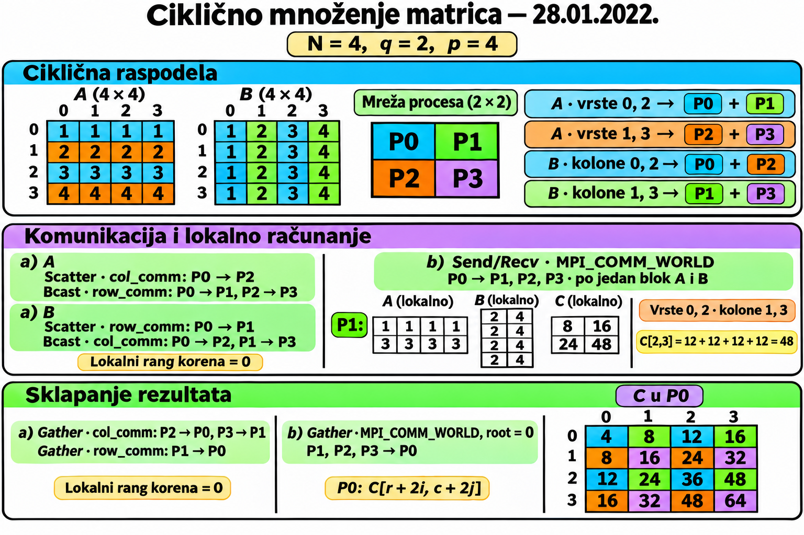

# Ciklično množenje matrica — 28.01.2022.

- [Deo a — grupne operacije](mpi_cyclic_matrix_product_a.c)
- [Deo b — raspodela operacijama Send i Recv](mpi_cyclic_matrix_product_b.c)

## Zadatak i lokalno računanje

P0 inicijalizuje matrice A i B dimenzija n × n. Ukupno p = q² procesa čini mrežu q × q. Za proces ranga `rank` važi `row = rank / q` i `col = rank % q`. Neka je `s = n / q`.

1. Proces u vrsti `row` dobija s vrsta matrice A sa indeksima `row + q*i`. Proces u koloni `col` dobija s kolona matrice B sa indeksima `col + q*j`. Svaka traka prenosi se kao celina.
2. Proces računa `local_c[i][j] = Σₜ local_a[i][t] * local_b[t][j]`, gde t prolazi od 0 do n−1. Dobijeni element ide na `C[row + q*i][col + q*j]`. Zbir po t računa se lokalno jer proces ima celu odgovarajuću vrstu A i celu kolonu B.

## a) Grupne operacije

1. `MPI_Comm_split` formira `row_comm` sa lokalnim rangom `col` i `col_comm` sa lokalnim rangom `row`. Svaka grupna operacija ima lokalni koren 0.
2. U prvoj koloni mreže `MPI_Scatter` raspoređuje A. Tip `a_strip` opisuje s punih vrsta sa korakom q·n elemenata. Extent od n elemenata pomera početak sledeće trake za jednu vrstu. `MPI_Bcast` deli svaku traku duž njene vrste mreže.
3. U prvoj vrsti mreže `MPI_Scatter` raspoređuje B. Tip `MPI_Type_vector(n * s, 1, q, MPI_DOUBLE, &b_strip)` bira ukupno n·s elemenata sa korakom q. Pošto je n = q·s, taj korak bira tačno s kolona u svakoj vrsti i nastavlja od iste kolone u sledećoj vrsti. Za n = 4 i q = 2, prvi blok bira pozicije 0, 2, 4, 6, 8, 10, 12, 14. Extent od jednog elementa pomera početak sledećeg bloka za jednu kolonu. `MPI_Bcast` deli svaku traku duž njene kolone mreže.
4. `MPI_Gather` u svakoj koloni mreže slaže lokalne blokove u traku n × s u procesu iz vrste 0. Prijemni tip ima korak q·s i extent s elemenata, pa lokalnu vrstu i procesa iz vrste r upisuje u vrstu r + q·i. Drugi `MPI_Gather`, u prvoj vrsti mreže, koristi prijemni tip za traku B i upisuje kolone svake trake direktno na njihova mesta u C kod P0.

## b) Point-to-point raspodela

1. P0 šalje dve poruke svakom drugom procesu preko `MPI_COMM_WORLD`. Za A šalje jedan `a_strip` počev od `A[row][0]`, a za B jedan `b_strip` počev od `B[0][col]`. Tip za B bira n·s elemenata sa korakom q, kao u delu a. Početnu kolonu određuje adresa u pozivu `MPI_Send`, pa promena extent-a ovde nije potrebna. Oznake 0 i 1 razlikuju poruke. P0 svoj deo kopira lokalno.
2. `MPI_Gather` preko `MPI_COMM_WORLD` smesti lokalne blokove kod P0 po rangu. P0 prolazi kroz C redom. Za mesto `C[i][j]` vlasnik je u vrsti `i % q` i koloni `j % q` mreže, pa mu je rang `(i % q) * q + j % q`. Unutar njegovog bloka element je na mestu `[i / q][j / q]`. Na primer, za n = 4 i q = 2, `C[2][3]` čitamo iz `blocks[1][1][1]`, gde je vrednost 48.

## Skica



Za n = 4 i p = 4, P1 računa vrste 0 i 2 i kolone 1 i 3. Na primer, `C[2][3] = 3·4 + 3·4 + 3·4 + 3·4 = 48`. Pune boje u A i B označavaju grupe vrsta i kolona. Uz svaku grupu u legendi prikazana su oba procesa koja dobijaju njene elemente. Boje u matrici C označavaju koji je proces izračunao pojedinačni element, a celu matricu ispisuje P0.

## Prevođenje i pokretanje

```sh
mpicc -std=c99 -Wall -Wextra -pedantic mpi_cyclic_matrix_product_a.c -o mpi_cyclic_matrix_product_a
mpicc -std=c99 -Wall -Wextra -pedantic mpi_cyclic_matrix_product_b.c -o mpi_cyclic_matrix_product_b
mpirun -np 4 ./mpi_cyclic_matrix_product_a
mpirun -np 4 ./mpi_cyclic_matrix_product_b
```

Podrazumevano je n = 4. Za drugo n dodaj, na primer, `-DN=6` pri prevođenju. Broj procesa mora biti kvadrat, a n mora biti pozitivan i deljiv sa q. Programi koriste lokalne nizove promenljive dužine i namenjeni su ispitnim primerima.

## Lokalni izvori

- [18.01.2021.](../exam_2021_01_18/mpi_strip_matrix_product.c) — raspodela traka preko komunikatora vrsta i kolona.
- [23.06.2022.](../exam_2022_06_23/mpi_block_matrix_product.c) — računanje lokalnih blokova i sklapanje uz izvedene prijemne tipove.
- [Jun 2022. iz dopunskih materijala](../../../../../04%20-%20Additional%20Materials/Paralelni%20sistemi/elfak-parallel-systems-main/Priprema/MPI/jun-2022/Source.c) — slanje blokova operacijom `MPI_Send`.

## Provera

Oba programa prevedena su sa opcijom `-Werror`. Svaki element rezultata proveren je za n = 4 sa 1, 4 i 16 procesa, kao i za n = 6 sa 9 procesa. Za n = 4 programi odbijaju pokretanje sa 2 procesa (broj procesa nije kvadrat) i sa 9 procesa (n nije deljivo sa q).
