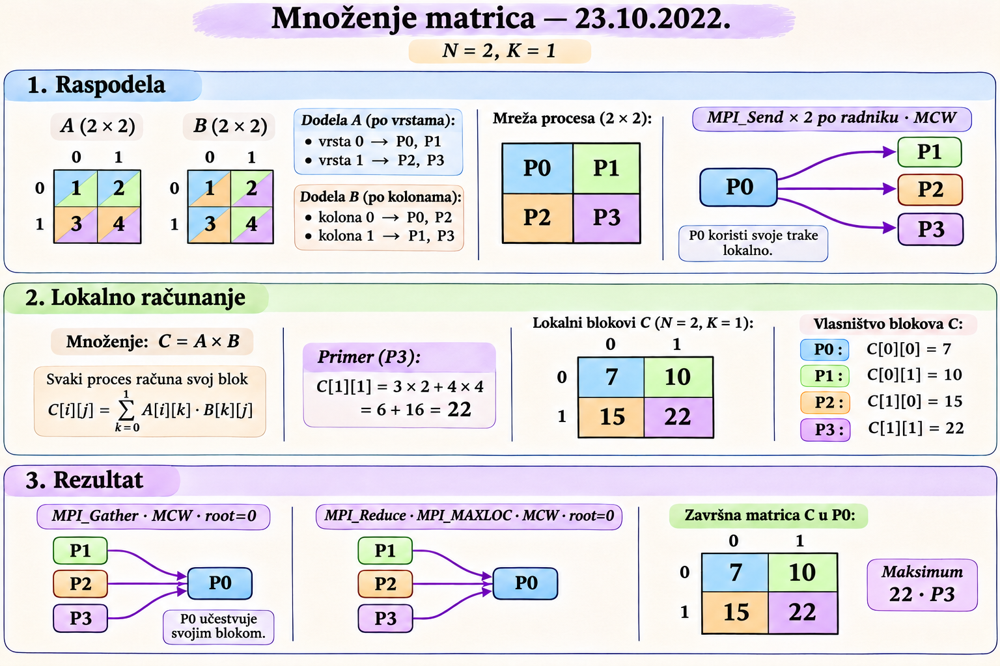
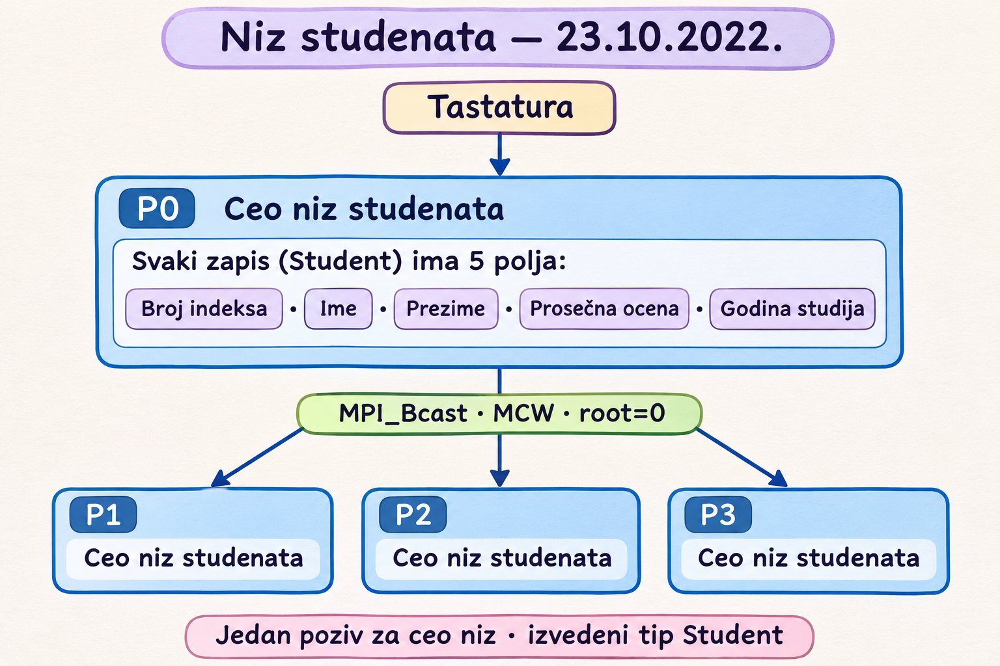

# Zadatak 2 — 23.10.2022.

## 2a — Množenje matrica i nalaženje maksimuma

[Rešenje u C-u](mpi_strip_matrix_max.c)

U tekstu zadatka B je nazvan vektorom, ali ima dimenzije n × n i deli se na trake kolona. U rešenju je B matrica.

1. Za q = n/k koristimo q² procesa, uključujući master P0. Proces r ima koordinate `row = r/q` i `col = r%q`.
2. P0 svakom radniku šalje k vrsta A počev od `row*k` i k kolona B počev od `col*k`. Za svaku traku koristi poseban `MPI_Send` sa `count = 1`. `MPI_Type_contiguous` opisuje k celih vrsta A, a `MPI_Type_vector(N, K, N, …)` opisuje k susednih kolona B. Radnik prima obe trake u kontinualne nizove. P0 lokalno preuzima svoje trake.
3. Svaki proces računa svoj blok k × k u C. Svi sabirci za jedan element nalaze se na istom procesu. Na skici P3 računa `C[1][1] = 3*2 + 4*4 = 22`.
4. `MPI_Gather` skuplja gotove blokove po rangu u P0. Za globalni element `C[i][j]` P0 čita blok procesa `(i/k)*q + j/k`, na lokalnoj poziciji `[i%k][j%k]`.
5. `MPI_Reduce` sa `MPI_MAXLOC` i tipom `MPI_2INT` poredi parove (lokalni maksimum, rang). P0 dobija globalni maksimum i rang vlasnika. Kod jednakih maksimuma rezultat sadrži manji rang. Obe grupne operacije koriste `MCW` sa korenom 0.



[Prompt za skicu](matrix_product_sketch_prompt.txt)

```sh
mpicc -std=c99 -Wall -Wextra -pedantic mpi_strip_matrix_max.c -o mpi_strip_matrix_max
mpirun --oversubscribe -np 4 ./mpi_strip_matrix_max
```

Podrazumevano je n = 2, k = 1. Za n = 4 i k = 2 dodaj `-DN=4 -DK=2` pri prevođenju. Oba primera koriste četiri procesa. U prvom primeru C ima vrste `7 10` i `15 22`, a maksimum 22 pripada P3.

## 2b — Prosleđivanje celog niza studenata

[Rešenje u C-u](mpi_student_broadcast.c)

1. P0 učitava broj studenata i prosleđuje ga pomoću `MPI_Bcast` da bi svi procesi mogli da alociraju niz odgovarajuće dužine. Zatim P0 učitava zapise. Ime i prezime unose se kao pojedinačne reči, do 31 znaka po polju.
2. `MPI_Type_create_struct` opisuje pet polja zapisa `Student`. `offsetof` određuje njihov položaj, a `MPI_Type_create_resized` postavlja korak između zapisa na `sizeof(Student)`.
3. Svi procesi pozivaju jedan `MPI_Bcast` za ceo popunjen niz u `MCW`, sa korenom 0. Svaki proces zatim ispisuje primljene zapise.



[Prompt za skicu](student_broadcast_sketch_prompt.txt)

```sh
mpicc -std=c99 -Wall -Wextra -pedantic mpi_student_broadcast.c -o mpi_student_broadcast
printf '2\n101 Ana Ilic 9.25 3\n102 Marko Nikolic 8.50 2\n' | mpirun --oversubscribe -np 4 ./mpi_student_broadcast
```

Svaki od četiri procesa ispisuje oba zapisa. Redosled ispisa procesa može da se menja.
