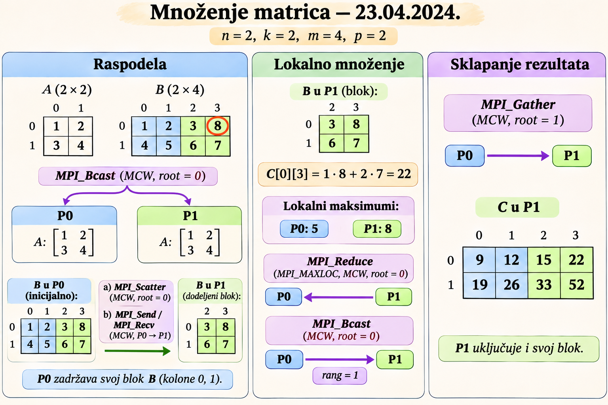

# Prvi kolokvijum, 23.04.2024. — zadatak 1

Množe se matrice A dimenzija n × k i B dimenzija k × m. Svaki od p procesa dobija celu matricu A i računa m/p uzastopnih kolona matrice C. Konačan rezultat ispisuje proces čiji blok B sadrži globalni maksimum.



## Postupak

1. P0 čita dimenzije i šalje ih svim procesima pomoću `MPI_Bcast`. Dimenzije moraju biti pozitivne i m mora biti deljivo sa p. P0 zatim čita A i B i šalje celu A pomoću `MPI_Bcast`.
2. Neka je `width = m / p`. Proces r dobija kolone od `r * width` do `(r + 1) * width - 1`. Tip `MPI_Type_vector(k, width, m, MPI_INT, ...)` uzima po `width` uzastopnih elemenata iz svake od k vrsta B.
   - **Deo a** koristi `MPI_Scatter`. Pomoću `MPI_Type_create_resized` postavlja se extent na `width * sizeof(int)`, pa počeci susednih blokova leže u istoj vrsti, na razmaku od `width` kolona.
   - **Deo b** koristi po jedan `MPI_Send` sa izvornim vektorskim tipom i po jedan `MPI_Recv` za svaki proces različit od P0. Početak bloka zadaje se adresom `b + r * width`. P0 direktno kopira svoje kolone. U oba dela prijemni blok je zbijen, sa po `width` elemenata u vrsti.
3. Svaki proces nalazi maksimum svog bloka B i množi A tim blokom. Za lokalnu kolonu j računa skalarni proizvod vrste A i kolone j lokalnog bloka B. Rezultat upisuje u globalnu kolonu `r * width + j` pri sklapanju.
4. `MPI_Reduce` sa `MPI_2INT` i `MPI_MAXLOC` daje P0 par (maksimum, rang). Ako više procesa ima isti maksimum, bira se najmanji rang. P0 prosleđuje izabrani rang pomoću `MPI_Bcast`.
5. `MPI_Gather` skuplja gotove blokove u izabranom procesu. Prijemni tip je vektor od n vrsta, sa blokom širine `width` i korakom m. Extent je ponovo `width * sizeof(int)`, pa se blokovi upisuju direktno u odgovarajuće kolone C. Sve komunikacije koriste `MCW`.

## Primer

Za n = 2, k = 2, m = 4 i p = 2, unos je prvo `n k m`, zatim elementi A i B po vrstama.

```text
2 2 4
1 2
3 4
1 2 3 8
4 5 6 7
```

| Proces | Globalne kolone | Blok B po vrstama | Lokalni maksimum | Blok C po vrstama |
| --- | --- | --- | ---: | --- |
| P0 | 0, 1 | `[1, 2]`, `[4, 5]` | 5 | `[9, 12]`, `[19, 26]` |
| P1 | 2, 3 | `[3, 8]`, `[6, 7]` | 8 | `[15, 22]`, `[33, 52]` |

P1, na primer, računa `C[0][3] = 1 * 8 + 2 * 7 = 22`. Pošto sadrži globalni maksimum 8, P1 sklapa blokove i ispisuje celu matricu.

```text
Matrix C (rank 1):
9 12 15 22
19 26 33 52
```

## Pokretanje

```sh
mpicc -std=c99 -Wall -Wextra mpi_column_matrix_product_a.c -o mpi_column_matrix_product_a
mpicc -std=c99 -Wall -Wextra mpi_column_matrix_product_b.c -o mpi_column_matrix_product_b

mpirun -np 2 ./mpi_column_matrix_product_a
mpirun -np 2 ./mpi_column_matrix_product_b
```
