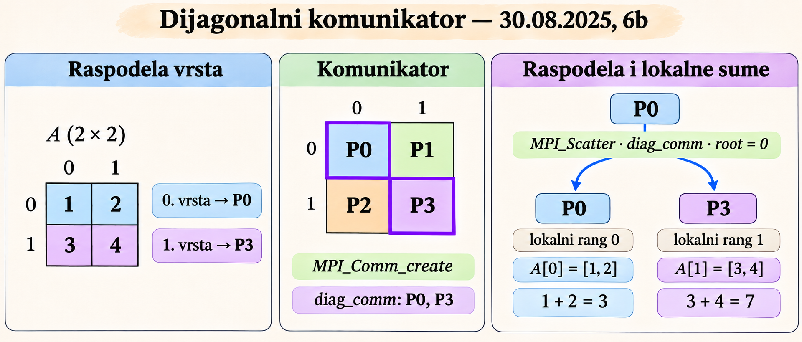

# 30.08.2025. — 6b: Raspodela vrsta u dijagonalnom komunikatoru

[Rešenje u C-u](mpi_diagonal_row_scatter.c)

1. Za `p = q²` procesa formiramo logičku mrežu `q × q`. Globalni rang procesa na poziciji `(i, i)` je `i*q + i`.
2. Pomoću `MPI_Group_incl` izdvajamo dijagonalne rangove u rastućem redosledu. Svi procesi pozivaju `MPI_Comm_create`. U komunikatoru `diag_comm` nastavljaju samo procesi kojima su koordinate vrste i kolone jednake (`rank / q == rank % q`). P0 u njemu ima lokalni rang 0.
3. Tekst zadatka ostavlja broj kolona slobodnim. U primeru koristimo matricu `q × q` i popunjavamo je brojevima od 1 do `q²`. Korenski proces P0 jednim pozivom `MPI_Scatter` u `diag_comm` šalje vrstu `i` procesu sa lokalnim rangom `i`.
4. Svaki član sam sabira elemente svoje vrste i ispisuje globalni rang, lokalni rang i sumu.

Za četiri procesa `diag_comm` čine P0 i P3. P0 dobija vrstu `[1, 2]` i sumu 3, a P3 dobija `[3, 4]` i sumu 7. Redosled ispisa može da se razlikuje.



[Prompt za skicu](diagonal_row_scatter_sketch_prompt.txt)

## Pokretanje

```sh
mpicc -std=c99 -Wall -Wextra -pedantic mpi_diagonal_row_scatter.c -lm -o mpi_diagonal_row_scatter
mpirun -np 4 ./mpi_diagonal_row_scatter
```

## Lokalni izvori

- [29.05.2022, zadatak 2b — izdvajanje dijagonalnih procesa](../exam_2022_05_29/README.md)
- [Lab 2, zadatak 3 — raspodela vrsta i računanje lokalne sume](../../../../../04%20-%20Additional%20Materials/Paralelni%20sistemi/elfak-parallel-systems-main/Lab%20vez%CC%8Cbe/Lab2/zad3/Source.c)
