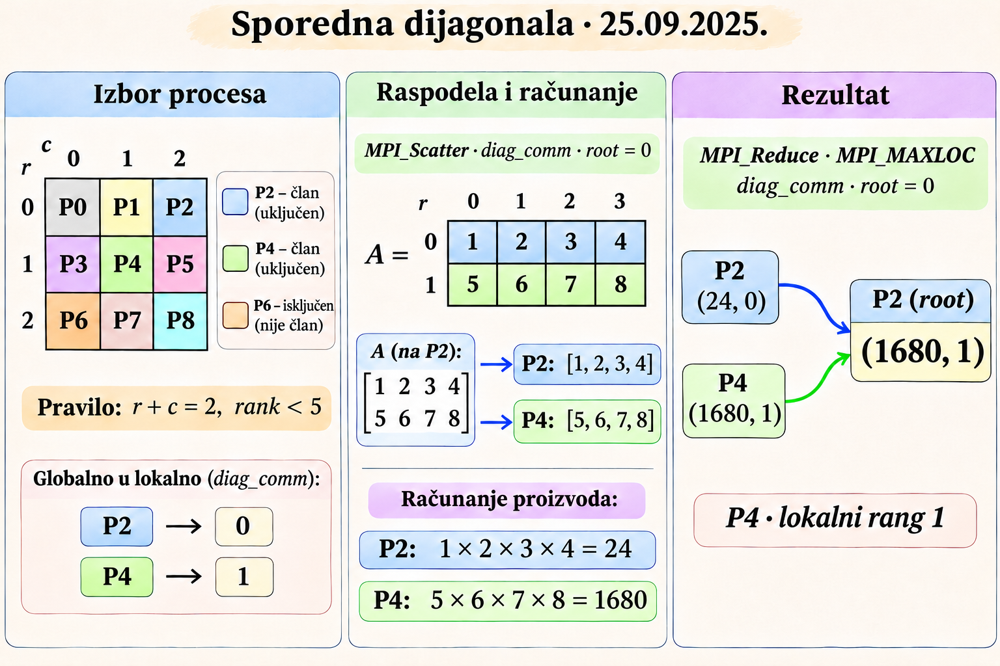

# 25.09.2025. — 1b: Proizvodi vrsta na sporednoj dijagonali

[Rešenje u C-u](mpi_secondary_diagonal_row_products.c)

1. Za `p = q*q`, proces sa globalnim rangom `rank` ima koordinate `r = rank/q` i `c = rank%q`. Na sporednoj dijagonali važi `r + c = q-1`. Od tih procesa izdvajamo samo one za koje važi `rank < X`.
2. `MPI_Group_incl` izdvaja članove u rastućem redosledu globalnih rangova. Svi procesi pozivaju `MPI_Comm_create` u `MCW`. Samo izabrani članovi koriste `diag_comm` za raspodelu i redukciju. Prvi član dobija lokalni rang 0 i inicijalizuje matricu A sa istim dimenzijama i vrednostima kao u 1a. Matrica ima `N = 2` vrste i `K = 4` kolone, pa može da posluži najviše dva člana.
3. `MPI_Scatter` u `diag_comm` sa lokalnim korenom 0 šalje svih `K` elemenata vrste `i` procesu sa lokalnim rangom `i`. Svaki član izračunava proizvod elemenata svoje vrste i formira par `(proizvod, lokalni rang)`.
4. `MPI_Reduce` sa `MPI_MAXLOC` i tipom `MPI_2INT` vraća najveći proizvod i pripadajući lokalni rang korenu 0 u `diag_comm`. Ako su proizvodi jednaki, bira se manji lokalni rang. Koren ispisuje globalne rangove članova, najveći proizvod i lokalni rang procesa koji ga ima.

Za devet procesa i `X = 5`, sporednu dijagonalu čine P2, P4 i P6. U grupu ulaze P2 i P4, sa lokalnim rangovima 0 i 1. P2 dobija `[1, 2, 3, 4]` sa proizvodom 24, a P4 dobija `[5, 6, 7, 8]` sa proizvodom 1680. P2 ispisuje maksimum 1680 i lokalni rang 1.



[Prompt za skicu](secondary_diagonal_sketch_prompt.txt)

## Pokretanje

```sh
mpicc -std=c99 -Wall -Wextra -pedantic mpi_secondary_diagonal_row_products.c -lm -o mpi_secondary_diagonal_row_products
mpirun --oversubscribe -np 9 ./mpi_secondary_diagonal_row_products
```

Prag je zadat u kodu kao `#define X 5`. Za drugi prag promeni vrednost makroa i ponovo kompajliraj program.
