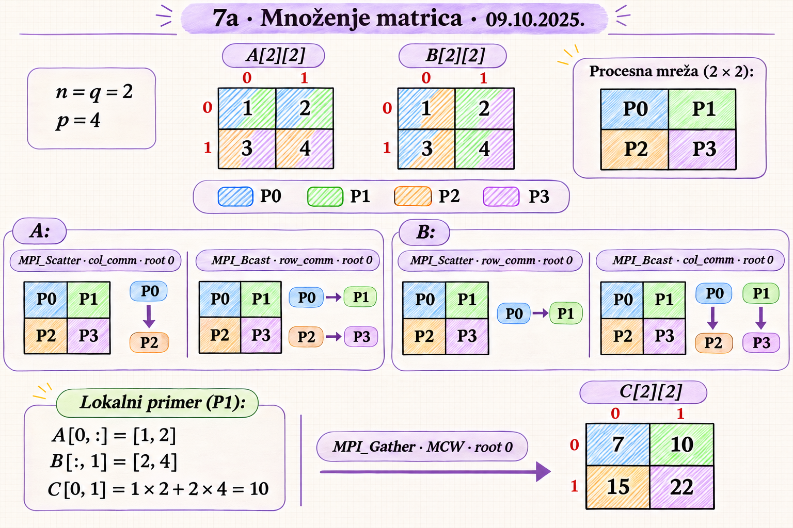
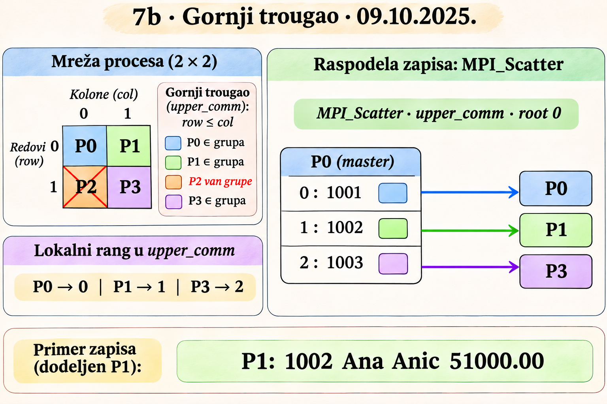

# MPI — 09.10.2025, zadatak 7

## 7a — Množenje matrica

[Rešenje u C-u](mpi_row_column_matrix_product.c)

Master P0 inicijalizuje kvadratne matrice A i B. Za p = n² procesa, proces P(i·n + j) u mreži n × n dobija celu vrstu i matrice A i celu kolonu j matrice B. Računa element C[i][j], a P0 prikazuje celu matricu C.

1. `MPI_Comm_split` formira `row_comm` za svaku vrstu i `col_comm` za svaku kolonu mreže. Lokalni rang u `row_comm` jednak je koloni, a u `col_comm` vrsti.
2. P0 poziva `MPI_Scatter` u prvoj koloni mreže, sa lokalnim korenom 0. Svaki primalac dobija odjednom n uzastopnih elemenata direktno iz A. Zatim `MPI_Bcast` u svakoj vrsti mreže, sa lokalnim korenom 0, prosleđuje celu primljenu vrstu.
3. P0 poziva `MPI_Scatter` u prvoj vrsti mreže, sa lokalnim korenom 0. `MPI_Type_vector(n, 1, n, MPI_DOUBLE, ...)` opisuje kolonu B, a `MPI_Type_create_resized` postavlja extent na jedan `double`, tako da sledeća kolona počinje za jedan element udesno. Svaki primalac dobija celu kolonu direktno iz B. Zatim `MPI_Bcast` u svakoj koloni mreže, sa lokalnim korenom 0, prosleđuje celu primljenu kolonu.
4. Svaki proces računa skalarni proizvod svoje vrste i kolone. Za n = 2 i A = B = [[1, 2], [3, 4]], P1 računa C[0][1] = 1·2 + 2·4 = 10.
5. `MPI_Gather` u `MCW`, sa korenom P0, skuplja po jedan gotov element od svakog procesa. Redosled globalnih rangova odgovara redosledu elemenata matrice C po vrstama. Za dati primer C = [[7, 10], [15, 22]].



[Prompt za skicu](matrix_product_sketch_prompt.txt)

## 7b — Raspodela zaposlenih u gornjem trouglu

[Rešenje u C-u](mpi_upper_triangle_employees.c)

1. U gornji trougao uključujemo glavnu dijagonalu, tako da pripadaju procesi sa `row <= col`. U mreži 2 × 2 to su P0, P1 i P3.
2. `MPI_Group_incl` formira grupu od izabranih rangova, poređanih po vrstama. Svi procesi pozivaju `MPI_Comm_create`. Operaciju raspodele pozivaju samo članovi `upper_comm`. P0 ima lokalni rang 0.
3. `MPI_Type_create_struct` opisuje matični broj, ime, prezime i prosečnu platu. Pomaci polja dobijaju se pomoću `offsetof`. Extent je `sizeof(Employee)`, što odgovara rastojanju između uzastopnih zapisa u C nizu.
4. P0 priprema po jedan zapis za svakog člana. `MPI_Scatter` u `upper_comm`, sa lokalnim korenom 0, dodeljuje zapis prema lokalnom rangu. U mreži 2 × 2, P0 dobija zapis 1001, P1 zapis 1002 i P3 zapis 1003.



[Prompt za skicu](employee_distribution_sketch_prompt.txt)

## Pokretanje

```sh
mpicc -std=c99 -Wall -Wextra -pedantic mpi_row_column_matrix_product.c -lm -o /tmp/mpi_row_column_matrix_product
mpicc -std=c99 -Wall -Wextra -pedantic mpi_upper_triangle_employees.c -lm -o /tmp/mpi_upper_triangle_employees
mpirun --oversubscribe -np 4 /tmp/mpi_row_column_matrix_product
mpirun --oversubscribe -np 4 /tmp/mpi_upper_triangle_employees
```
