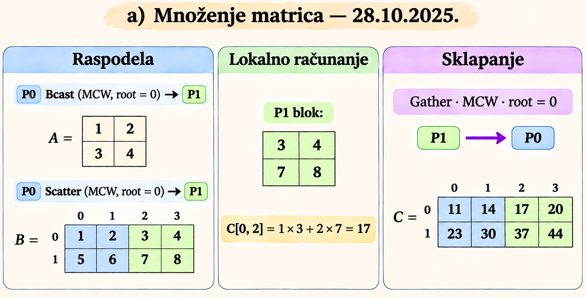
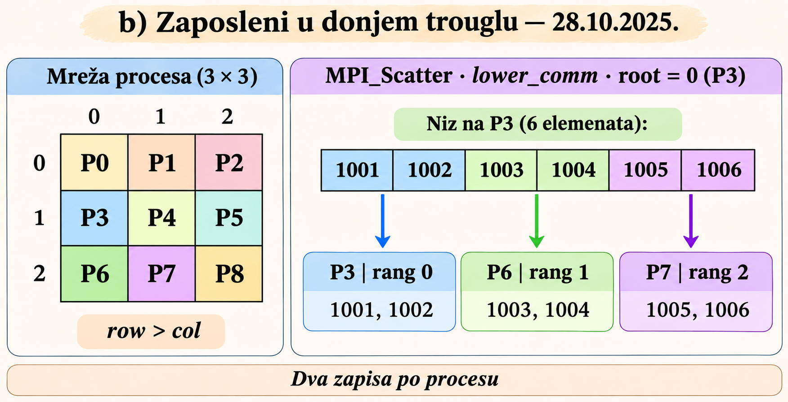

# MPI — 28.10.2025.

## a) Množenje matrica po blokovima kolona

[Rešenje u C-u](mpi_column_matrix_product.c)

1. P0 učitava dimenzije `n k m`, pa matrice A i B po vrstama. Broj kolona B mora biti deljiv brojem procesa `p`. P0 šalje celu A svim procesima pomoću `MPI_Bcast`.
2. Svaki proces dobija `w = m/p` uzastopnih kolona B. Tip `MPI_Type_vector(k, w, m, ...)` opisuje blok kroz svih `k` vrsta. `MPI_Type_create_resized` postavlja extent na širinu bloka, pa `MPI_Scatter` uzima blok za proces `r` od kolone `r*w`. Svaki proces, uključujući P0, prima svoj blok odjednom.
3. Svaki proces množi A svojim blokom B i računa odgovarajuće kolone C. `MPI_Gather` koristi izvedeni prijemni tip da upiše blokove direktno u C na P0. Koren svih operacija u `MCW` je 0.



```sh
mpicc -std=c99 -Wall -Wextra -pedantic mpi_column_matrix_product.c -o /tmp/mpi_column_matrix_product
printf '2 2 4\n1 2\n3 4\n1 2 3 4\n5 6 7 8\n' | mpirun -np 2 /tmp/mpi_column_matrix_product
```

```text
Matrix C:
11 14 17 20
23 30 37 44
```

## b) Raspodela zaposlenih u donjem trouglu

[Rešenje u C-u](mpi_lower_triangle_employees.c)

1. Za kvadratnu mrežu `q × q`, proces globalnog ranga `r` ima koordinate `r/q` i `r%q`. `MPI_Group_incl` bira rangove za koje je vrsta veća od kolone, a `MPI_Comm_create` formira `lower_comm`.
2. Prvi član grupe ima lokalni rang 0 i inicijalizuje po dva zapisa za svakog člana. `MPI_Type_create_struct` opisuje matični broj, ime, prezime i prosečnu platu. Extent postavljamo na `sizeof(Employee)` kako bi tip pratio razmak zapisa u C nizu.
3. `MPI_Scatter` u `lower_comm` sa lokalnim korenom 0 deli po dva uzastopna zapisa svakom članu. Za devet procesa P3 dobija zapise 1001 i 1002, P6 dobija 1003 i 1004, a P7 dobija 1005 i 1006.



```sh
mpicc -std=c99 -Wall -Wextra -pedantic mpi_lower_triangle_employees.c -o /tmp/mpi_lower_triangle_employees -lm
mpirun --oversubscribe -np 9 /tmp/mpi_lower_triangle_employees
```
