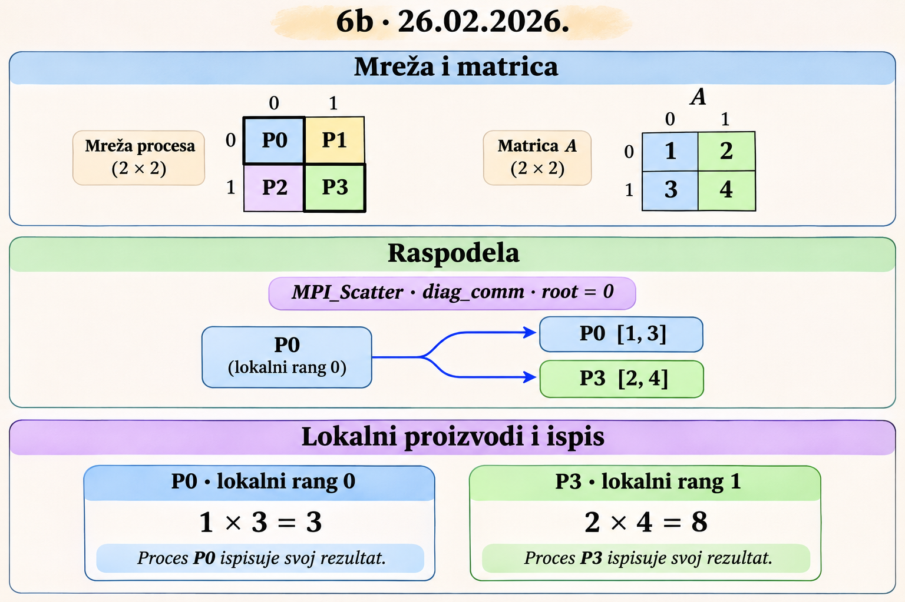

# MPI 6b — 26.02.2026.

Raspodela kolona matrice A procesima na glavnoj dijagonali kvadratne mreže. Izvorni kod je u [mpi_main_diagonal_column_products.c](mpi_main_diagonal_column_products.c).



1. Od `p = q*q` procesa formiramo logičku mrežu `q × q`. Globalni rang procesa na poziciji `(r, c)` je `r*q + c`. Na glavnoj dijagonali važi `r == c`, pa su rangovi `i*(q+1)` za `i = 0, …, q-1`.
2. `MPI_Group_incl` formira grupu od tih rangova, tim redosledom. Svi procesi pozivaju `MPI_Comm_create` nad `MCW`. Dijagonalni procesi u `diag_comm` dobijaju lokalne rangove `0, …, q-1`. Globalni P0 je i lokalni koren 0.
3. U primeru A ima dve vrste i `q` kolona. `MPI_Type_vector` opisuje jednu kolonu s korakom `q`. Extent jednog `int` omogućava da `MPI_Scatter` u `diag_comm` lokalnom rangu `i` pošalje kolonu `i`. Svaki član množi elemente primljene kolone i ispisuje globalni i lokalni rang i proizvod.

```sh
mpicc -std=c99 mpi_main_diagonal_column_products.c -lm -o mpi_main_diagonal_column_products
mpirun -np 4 ./mpi_main_diagonal_column_products
```

Jedan mogući redosled ispisa:

```text
Process 0 (diagonal rank 0), column 0: product = 3
Process 3 (diagonal rank 1), column 1: product = 8
```

[Zadatak 6a](../../matrix_matrix_products/exam_2026_02_26/README.md)
