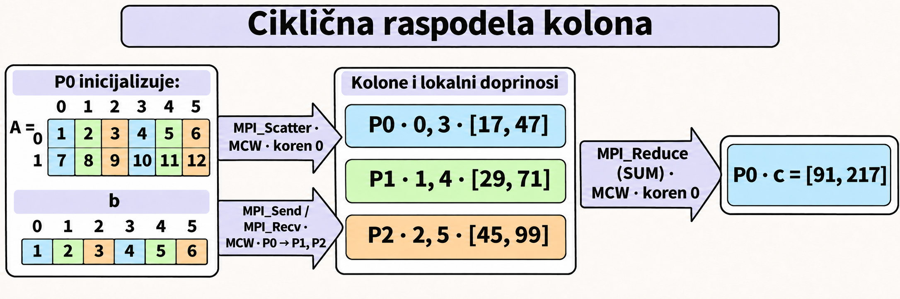
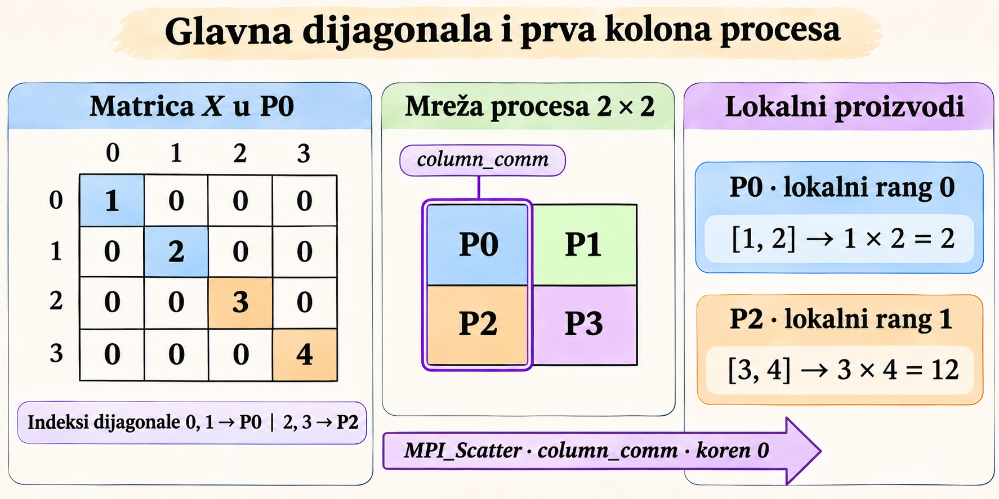

# MPI zadatak 6 sa roka 19.05.2026.

## 6a. Ciklična raspodela kolona i množenje matrice vektorom



1. P0 inicijalizuje matricu A dimenzija 2 × 6 vrednostima od 1 do 12 po vrstama, a vektor b vrednostima od 1 do 6. Broj procesa p mora da deli broj kolona k. Proces r dobija kolone A i elemente b sa globalnim indeksima `r, r+p, ..., r+k-p`.
2. Pošto p deli k, korak p u memoriji bira odgovarajuće kolone i pri prelasku u sledeću vrstu. Tip `MPI_Type_vector(n*(k/p), 1, p, MPI_INT, ...)` opisuje sve elemente za jedan proces. `MPI_Type_create_resized` postavlja extent na veličinu jednog elementa, pa `MPI_Scatter` iz P0 u `MCW` za proces r počinje od `A[0][r]`.
3. Za b, P0 opisuje `k/p` elemenata tipom `MPI_Type_vector(k/p, 1, p, MPI_INT, ...)` i svakom drugom procesu šalje jednu poruku počev od `b[r]`. Primalac poziva `MPI_Recv` i dobija neprekidan lokalni niz. P0 neposredno izdvaja svoj deo.
4. Svaki proces računa doprinos svakoj vrsti koristeći primljene kolone i svoj deo b. `MPI_Reduce` sa `MPI_SUM` sabira doprinose u P0 u komunikatoru `MCW`.

| Proces | Globalni indeksi | Lokalni b | Lokalni doprinos |
| --- | --- | --- | --- |
| P0 | 0, 3 | [1, 4] | [17, 47] |
| P1 | 1, 4 | [2, 5] | [29, 71] |
| P2 | 2, 5 | [3, 6] | [45, 99] |

P2 dobija lokalni blok `[[3, 6], [9, 12]]`. Njegovi doprinosi su `3·3 + 6·6 = 45` i `9·3 + 12·6 = 99`. U P0 se dobija `c = [17 + 29 + 45, 47 + 71 + 99] = [91, 217]`.

```sh
mpicc -std=c11 -Wall -Wextra -o mpi_cyclic_column_matrix_vector mpi_cyclic_column_matrix_vector.c
mpirun -np 3 ./mpi_cyclic_column_matrix_vector
```

```text
Process 0: c = 91 217
```

## 6b. Glavna dijagonala matrice i prva kolona mreže procesa



1. Neka je `q = sqrt(p)`. Broj procesa mora biti potpun kvadrat, a n deljivo sa q. U mreži sa rangovima poređanim po vrstama, prvu kolonu čine globalni rangovi `0, q, 2q, ..., (q-1)q`. `MPI_Group_incl` zadržava taj redosled, pa globalni rang `i*q` dobija lokalni rang i. Svi procesi pozivaju `MPI_Comm_create` nad `MCW`, a samo članovi prve kolone koriste `column_comm` za raspodelu.
2. P0 inicijalizuje X dimenzija 4 × 4 sa dijagonalom `[1, 2, 3, 4]` i nulama van nje. Tip `MPI_Type_vector(n/q, 1, n+1, MPI_INT, ...)` opisuje `n/q` uzastopnih elemenata dijagonale. Extent se postavlja na `(n/q)*(n+1)*sizeof(int)`, pa naredni blok počinje od sledećeg dela dijagonale.
3. `MPI_Scatter` u `column_comm` sa lokalnim korenom 0 raspodeljuje blokove direktno iz X. Svaki član tada računa proizvod svog bloka i prikazuje globalni i lokalni rang uz proizvod.

Za četiri procesa, prva kolona mreže 2 × 2 sadrži P0 i P2. P0 dobija `X[0][0]` i `X[1][1]` i računa `1·2 = 2`. P2 dobija `X[2][2]` i `X[3][3]` i računa `3·4 = 12`.

```sh
mpicc -std=c11 -Wall -Wextra -o mpi_first_column_diagonal_products mpi_first_column_diagonal_products.c -lm
mpirun -np 4 ./mpi_first_column_diagonal_products
```

```text
Process 0 (column rank 0): product = 2
Process 2 (column rank 1): product = 12
```

Redosled redova u izlazu može da se razlikuje.
