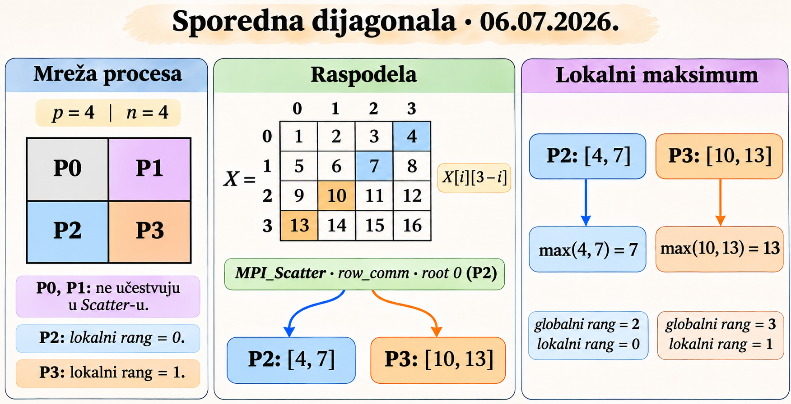

# Raspodela sporedne dijagonale

Ispit iz Paralelnih sistema, 6. jul 2026, zadatak b. Tekst zadatka i rešenje su u [mpi_secondary_diagonal_max.c](mpi_secondary_diagonal_max.c).

## Postupak

1. Neka je `q = sqrt(p)`. Proces sa globalnim rangom r ima vrstu `r/q` i kolonu `r%q`. Pomoću `MPI_Comm_split` samo procesi druge vrste (indeks 1) ulaze u `row_comm`. Lokalni rang je jednak koloni, pa je Pq koren sa lokalnim rangom 0.
2. Pq inicijalizuje X. Sporedna dijagonala počinje u `X[0][n-1]`. Od `X[i][n-1-i]` do sledećeg elementa linearni pomeraj je `n-1`. Zato `MPI_Type_vector(n/q, 1, n-1, MPI_INT, ...)` opisuje jedan deo dijagonale. Extent se postavlja na `(n/q)*(n-1)*sizeof(int)` da bi sledeći blok počeo na sledećem nedodeljenom elementu dijagonale.
3. `MPI_Scatter` u `row_comm` šalje po jedan blok direktno iz X, počevši od `X[0][n-1]`. Svaki član prima `n/q` uzastopnih elemenata, računa njihov maksimum i ispisuje globalni i lokalni rang uz rezultat.

Za četiri procesa i matricu X sa vrednostima od 1 do 16, P2 prima `[4, 7]`, a P3 prima `[10, 13]`. Lokalni maksimumi su redom 7 i 13. Redosled ispisivanja zavisi od izvršavanja procesa.



[Prompt za skicu](diagonal_sketch_prompt.txt)

## Pokretanje

```sh
mpicc -std=c99 -Wall -Wextra -pedantic mpi_secondary_diagonal_max.c -lm -o mpi_secondary_diagonal_max
mpirun -np 4 ./mpi_secondary_diagonal_max
```
