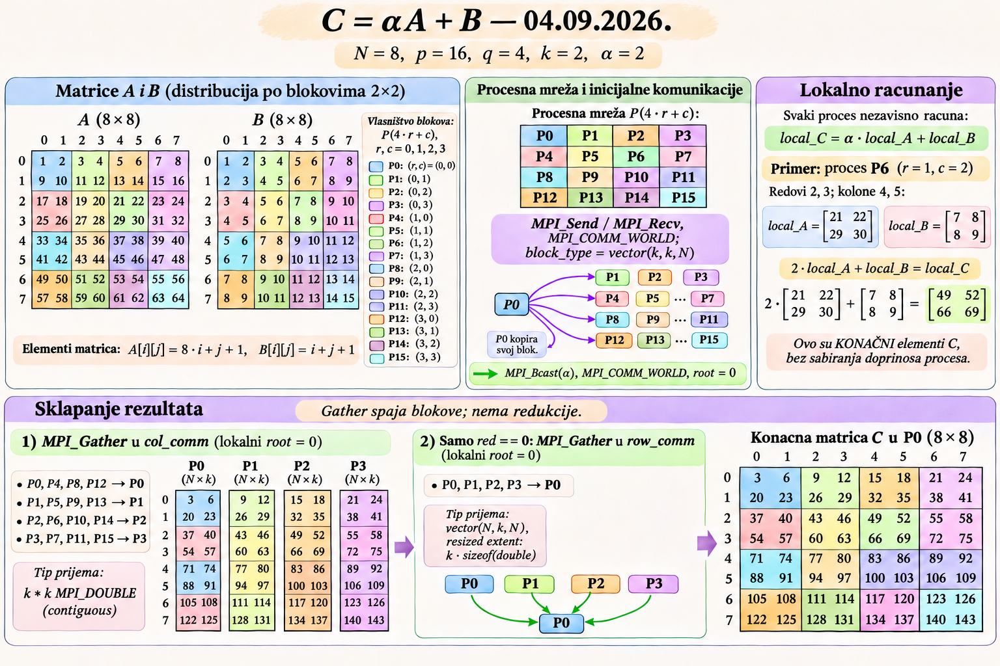

# Linearna kombinacija matrica — 04.09.2026.

[Rešenje u C-u](mpi_block_matrix_sum.c)

## Zadatak 7

Napisati MPI program koji na osnovu matrica A i B dimenzija n × n generiše matricu C = αA + B. Matrice A i B i skalar α inicijalizuju se u master procesu. Ukupno p = q² procesa uređeno je kao mreža q × q, pri čemu je n deljivo sa q. Master distribuira odgovarajuće blokove dimenzija (n/q) × (n/q), prema blokovskoj raspodeli sa slike za n = 8 i p = 16. Svaki proces obavlja lokalno izračunavanje i učestvuje u generisanju konačnog rezultata. Delove matrica slati direktno iz A i B point-to-point operacijama, a ostatak komunikacije realizovati grupnim operacijama.

## Postupak

1. Odredimo q i proverimo uslove `q*q == size` i `N % q == 0`. Veličina bloka je `k = N/q`, a koordinate procesa su `row = rank/q` i `col = rank%q`. Proces dobija vrste `row*k` do `(row+1)*k-1` i kolone `col*k` do `(col+1)*k-1`.
2. `MPI_Type_vector(k, k, N, MPI_DOUBLE, &block_type)` opisuje k vrsta od po k elemenata, sa korakom N između početaka vrsta. P0 šalje jedan takav blok direktno iz A i jedan iz B svakom drugom procesu. `MPI_Recv` prima iste k² vrednosti u kontinualan lokalni blok. P0 svoj blok kopira, čime izbegava blokirajuće slanje samom sebi.
3. P0 inicijalizuje `alpha = 2.0` i operacijom `MPI_Bcast` šalje skalar svim procesima u `MPI_COMM_WORLD`, sa korenom 0.
4. Svaki proces računa `local_c_block[i][j] = alpha * local_a_block[i][j] + local_b_block[i][j]`. Svaki element C zavisi samo od odgovarajućih elemenata A i B, pa je lokalni blok već konačan. Nije potrebna redukcija.
5. `MPI_Comm_split(MCW, col, row, &col_comm)` grupiše procese po kolonama, u redosledu vrsta. `MPI_Gather` sa lokalnim korenom 0 spaja njihove blokove u vertikalnu traku `c_column_strip[N][k]`. Trake dobijaju procesi prve vrste: za p = 16 to su P0, P1, P2 i P3. Prijem po k² uzastopnih elemenata odgovara ovom rasporedu.
6. `MPI_Comm_split(MCW, row, col, &row_comm)` grupiše procese po vrstama, u redosledu kolona. Samo prva vrsta poziva drugi `MPI_Gather`, sa lokalnim korenom 0. On spaja trake u C u procesu P0. Ostale vrste imaju zasebne komunikatore, pa ne učestvuju u ovom pozivu.
7. Prijemni tip drugog Gather-a opisuje `MPI_Type_vector(N, k, N, ...)`, a `MPI_Type_create_resized` postavlja extent na `k*sizeof(double)`. Svaka traka popunjava N vrsta od po k elemenata; sledeći prilog počinje k elemenata desno. Tako se rezultat smešta direktno u ispravan raspored C, bez naknadnog preslaganja.

Za podrazumevanu inicijalizaciju `A[i][j] = i*N+j+1` i `B[i][j] = i+j+1`, proces P6 za N = 8 i p = 16 dobija vrste 2–3 i kolone 4–5:

```text
local_A = [21 22]    local_B = [7 8]    local_C = [49 52]
          [29 30]              [8 9]              [66 69]
```

Na primer, `C[2][4] = 2*21 + 7 = 49`. Završno prikupljanje samo smešta ovaj element na njegovo mesto u P0.

## Skica



Boja označava vlasnika bloka, dosledno u matricama i logičkoj mreži. Strelice grupnih operacija prikazuju logički tok podataka. [Prompt za ugrađeni imagegen alat](matrix_sum_sketch_prompt.txt).

## Prevođenje i pokretanje

```sh
mpicc -std=c99 -Wall -Wextra -pedantic mpi_block_matrix_sum.c -o mpi_block_matrix_sum
mpirun --oversubscribe -np 16 ./mpi_block_matrix_sum
```

Podrazumevano je N = 8. Za drugu dimenziju dodati, na primer, `-DN=12` pri prevođenju. N mora biti pozitivan i deljiv sa q, a broj procesa potpun kvadrat. Kao susedni primeri, rešenje koristi lokalne nizove promenljive dužine i namenjeno je malim ispitnim matricama.

## Lokalni izvori

- [Zadatak 23.06.2022.](../exam_2022_06_23/mpi_block_matrix_product.c): direktno slanje blokova izvedenim tipom i sklapanje rezultata kroz dva Gather-a.
- [Jun 2022. u dopunskim materijalima](../../../../../04%20-%20Additional%20Materials/Paralelni%20sistemi/elfak-parallel-systems-main/Priprema/MPI/jun-2022/Source.c): blokovski tip i komunikatori vrsta i kolona. Ovde se lokalno računa linearna kombinacija, pa razmena blokova radi množenja matrica nije potrebna.

## Provera

Prevođenje sa `-std=c99 -Wall -Wextra -pedantic` prolazi bez upozorenja. Svi elementi C provereni su nezavisnim sekvencijalnim računom za N = 8 sa p = 1, 4 i 16 i za N = 12 sa p = 9. Za p = 2 program prijavljuje nevažeću mrežu i završava neuspešnim statusom.
