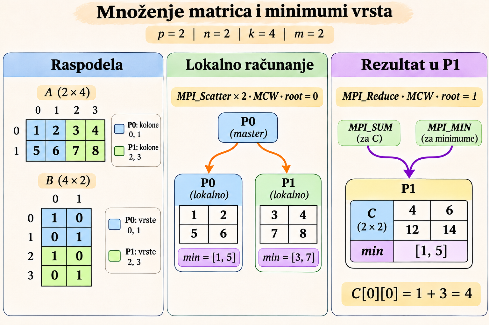

# 25.09.2025. — 1a: Množenje matrica i minimumi vrsta

[Rešenje u C-u](mpi_matrix_product_row_min.c)

1. P0 inicijalizuje A dimenzija n × k i B dimenzija k × m. Za `p` procesa i `w = k/p`, proces sa rangom `r` dobija globalne kolone A i vrste B sa istim indeksima od `r*w` do `(r+1)*w-1`. Koristimo uzastopne blokove jer tekst zadatka ne propisuje cikličnu raspodelu.
2. Za A, `MPI_Type_vector(n, w, k, ...)` opisuje `n` delova vrste od po `w` elemenata. `MPI_Type_create_resized` postavlja extent na `w*sizeof(int)`, tako da `MPI_Scatter` u `MCW` sa korenom 0 uzima sledeći blok `w` kolona direktno iz A. Drugi `MPI_Scatter` sa istim korenom uzima `w*m` uzastopnih elemenata direktno iz B.
3. Svaki proces množi primljene blokove i dobija doprinos svim elementima C. Za svaku vrstu A računa minimum svojih primljenih kolona.
4. Dva poziva `MPI_Reduce` u `MCW` koriste isti odredišni rang. `MPI_SUM` sabira doprinose matrici C, a `MPI_MIN` bira najmanji lokalni minimum za svaku vrstu A.

Sa dva procesa, P0 daje doprinos `[[1, 2], [5, 6]]`, a P1 `[[3, 4], [7, 8]]`. Zbir je `C = [[4, 6], [12, 14]]`. Minimumi prvog i drugog reda A su 1 i 5.



[Prompt za skicu](matrix_product_sketch_prompt.txt)

## Pokretanje

```sh
mpicc -std=c99 -Wall -Wextra -pedantic mpi_matrix_product_row_min.c -o mpi_matrix_product_row_min
mpirun -np 2 ./mpi_matrix_product_row_min 1
```

Argument `1` bira proces koji ispisuje rezultat. Bez argumenta rezultat ispisuje poslednji proces. U primeru je `k = 4`, pa program može da se pokrene sa 1, 2 ili 4 procesa.
