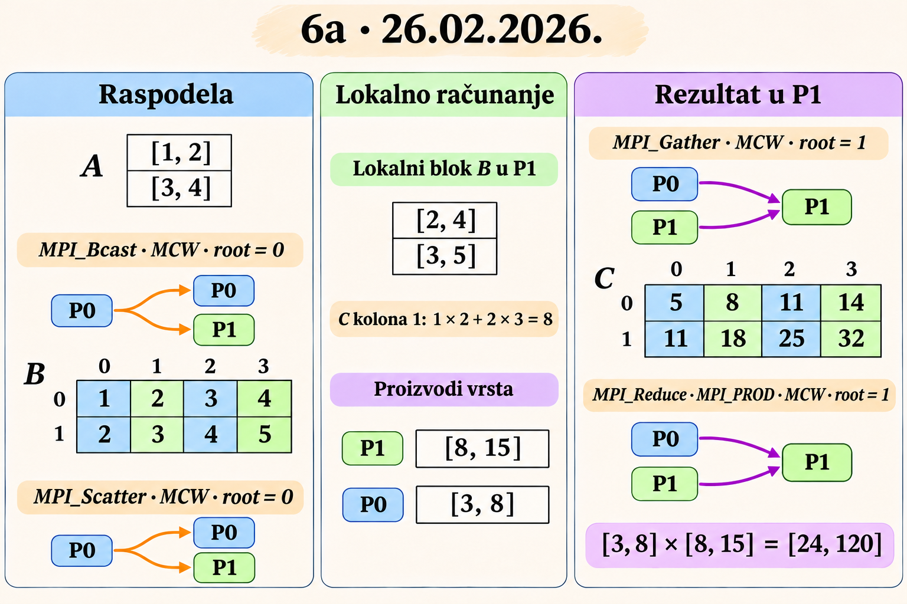

# MPI 6a — 26.02.2026.

Množenje matrica uz cikličnu raspodelu kolona matrice B i računanje proizvoda njenih vrsta. Izvorni kod je u [mpi_cyclic_column_matrix_product.c](mpi_cyclic_column_matrix_product.c).



1. P0 inicijalizuje matrice A i B. Pomoću `MPI_Bcast` šalje celu A svim procesima u `MCW`.
2. Za `p` procesa svaki dobija `width = K / p` kolona matrice B. U memoriji su uzastopni elementi namenjeni istom procesu udaljeni za `p` mesta, uključujući prelaz u sledeću vrstu jer je `K` deljivo sa `p`. Zato `MPI_Type_vector` bira `S * width` pojedinačnih elemenata s korakom `p`. Uz extent od jednog `int`, `MPI_Scatter` za proces `i` počinje od `B[0][i]` i čita sve njegove kolone direktno iz B.
3. Svaki proces iz cele A i lokalnog bloka B računa svoje gotove kolone C. Za svaku vrstu B posebno množi elemente u svojim kolonama.
4. `MPI_Gather` upisuje lokalnu kolonu `j` procesa `i` u globalnu kolonu `i + j*p`. Prijemni izvedeni tip ima isti korak kao tip za B, uz `N * width` elemenata. `MPI_Reduce` sa `MPI_PROD` množi lokalne proizvode po vrstama. Koren obe operacije je poslednji proces, izabran kao proizvoljno odredište.

```sh
mpicc -std=c99 mpi_cyclic_column_matrix_product.c -o mpi_cyclic_column_matrix_product
mpirun -np 2 ./mpi_cyclic_column_matrix_product
```

```text
Process 1
Matrix C:
5 8 11 14
11 18 25 32
Row products of B:
24 120
```

[Zadatak 6b](../../logical_process_grid/exam_2026_02_26/README.md)
