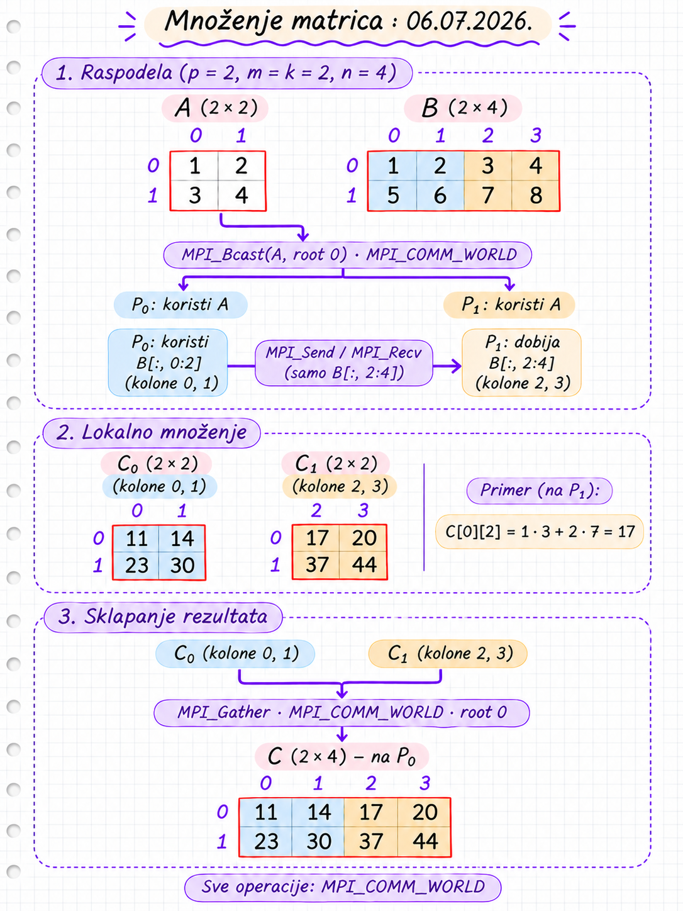

# Množenje matrica po blokovima kolona

Ispit iz Paralelnih sistema, 6. jul 2026, zadatak a. Tekst zadatka i rešenje su u [mpi_matrix_column_product.c](mpi_matrix_column_product.c).

## Postupak

1. P0 inicijalizuje A i B. Operacijom `MPI_Bcast` deli celu matricu A svim procesima u `MPI_COMM_WORLD`.
2. Ako je širina bloka `w = n/p`, proces r dobija kolone B od `r*w` do `(r+1)*w-1`. Tip `MPI_Type_vector(k, w, n, MPI_INT, ...)` opisuje po w uzastopnih elemenata iz svake vrste. P0 šalje jedan takav blok svakom drugom procesu direktno iz B, a svoj blok preuzima pomoću `MPI_Sendrecv` samom sebi. Blokovi se primaju kao uzastopni elementi.
3. Svaki proces množi celu A svojim blokom B. Dobija sve vrste dodeljenih kolona C. Na primer, za dva procesa P1 računa `C[0][2] = 1*3 + 2*7 = 17`.
4. `MPI_Gather` sklapa C na P0 u `MPI_COMM_WORLD`. Prijemni tip opisuje w elemenata u svakoj od m vrsta sa korakom n. Extent je w elemenata, pa blok procesa r počinje u koloni `r*w`.



[Prompt za skicu](distribution_sketch_prompt.txt)

## Pokretanje

```sh
mpicc -std=c99 -Wall -Wextra -pedantic mpi_matrix_column_product.c -o mpi_matrix_column_product
mpirun -np 2 ./mpi_matrix_column_product
```

```text
Matrix C:
11 14 17 20
23 30 37 44
```
