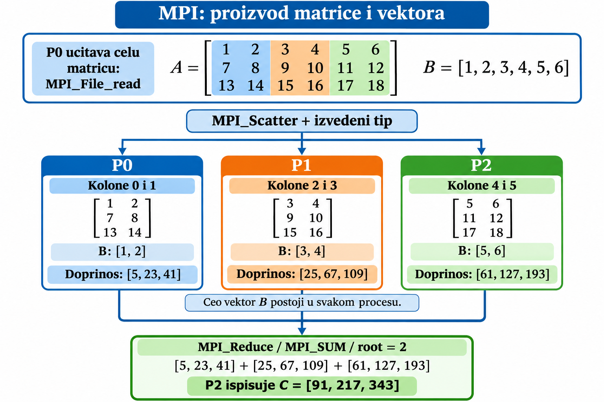

# Proizvod matrice i vektora sa raspodelom kolona

Rešenje zadatka 7. a) je u `mpi_column_matrix_vector_product.c`.
Dimenzije su zadate konstantama K = 3 i M = 6. `april23.dat` je binarni
fajl sa K * M vrednosti tipa `double` u nativnom formatu, po vrstama,
bez zaglavlja sa dimenzijama. Priloženi fajl sadrži brojeve od 1 do 18.
Tekstualni fajl sa ciframa nije odgovarajući ulaz za `MPI_DOUBLE`.
Vektor B = [1, 2, 3, 4, 5, 6] inicijalizuje se u svakom procesu.

## Postupak

1. Master P0 otvara fajl pomoću `MPI_File_open(MPI_COMM_SELF, ...)`,
   učitava celu matricu jednim `MPI_File_read(file, a, K * M, MPI_DOUBLE, ...)`
   i zatvara ga pomoću `MPI_File_close`. Otvaranje je kolektivno nad zadatim
   komunikatorom: koristi se `MPI_COMM_SELF` jer samo master pristupa fajlu.
   `MPI_Get_count` proverava da je učitano svih K * M elemenata.
2. Svaki proces dobija `local_cols = M / size` uzastopnih kolona.
   `MPI_Type_vector(K, local_cols, M, ...)` opisuje K blokova: iz svake
   vrste uzima se `local_cols` elemenata, a razmak između početaka vrsta je M.
3. `MPI_Type_create_resized` postavlja extent na `local_cols * sizeof(double)`.
   Zbog toga `MPI_Scatter`, sa jednim izvedenim tipom po procesu, za sledeći
   proces kreće od sledećeg bloka kolona. Podaci se primaju zbijeno u
   `local_a[K][local_cols]`, po vrstama. Promena extenta ne menja elemente
   koje tip obuhvata, već razmak između početaka blokova za procese.
4. Proces r računa za svaku vrstu i:
   `local_result[i] = sum(local_a[i][j] * b[r * local_cols + j])`.
   Globalni indeks vektora B uključuje pomeraj `r * local_cols`.
5. `MPI_Reduce` sa `MPI_SUM` sabira delimične vektore dužine K.
   Koren je `size - 1`, pa rezultat odmah dobija i ispisuje proces sa
   najvećim identifikatorom. Master takođe računa svoj deo.

Nisu potrebni slanje vektora B, dodatne potvrde prijema ili barijere.

## Primer za tri procesa



```text
       P0     P1     P2
A = [ 1  2 | 3  4 | 5  6 ]
    [ 7  8 | 9 10 |11 12 ]
    [13 14 |15 16 |17 18 ]

B = [ 1  2 | 3  4 | 5  6 ]
```

Ceo B postoji u svim procesima, ali svaki koristi samo odgovarajuće elemente.
Indeksi kolona u tabeli počinju od nule.

| Proces | Kolone A | Korišćeni elementi B | Delimični rezultat |
| --- | --- | --- | --- |
| P0 | 0, 1 | 1, 2 | [1·1+2·2, 7·1+8·2, 13·1+14·2] = [5, 23, 41] |
| P1 | 2, 3 | 3, 4 | [3·3+4·4, 9·3+10·4, 15·3+16·4] = [25, 67, 109] |
| P2 | 4, 5 | 5, 6 | [5·5+6·6, 11·5+12·6, 17·5+18·6] = [61, 127, 193] |

Sabiranjem odgovarajućih elemenata u P2 dobija se:

```text
C = [5, 23, 41] + [25, 67, 109] + [61, 127, 193]
  = [91, 217, 343]
```

## Pokretanje

Iz ovog foldera, da bi program pronašao `april23.dat`:

```sh
mpicc -std=c99 -Wall -Wextra -pedantic mpi_column_matrix_vector_product.c -o mpi_column_matrix_vector_product
mpirun -np 3 ./mpi_column_matrix_vector_product
```

Za ponovno generisanje binarnog primera pomoću MPI funkcija:

```sh
mpicc generate_matrix_file.c -o generate_matrix_file
mpirun -np 1 ./generate_matrix_file
```

Očekivani ispis:

```text
Process 2: result C = 91 217 343
```

Broj procesa mora da deli M = 6: može biti 1, 2, 3 ili 6.

## Lokalni izvori

- Postojeći primer `../../matrix_matrix_products/column_matrix_product/mpi_column_matrix_product.c`:
  opis bloka kolona tipom `MPI_Type_vector` i promena extenta.
- Dodatni materijali `Paralelni sistemi/elfak-parallel-systems-main/IzvedeniTipovi.md`:
  parametri izvedenog vektorskog tipa.
- Dodatni ispitni primer `Priprema/MPI/apr-2023-a/Source.c`:
  delimični proizvodi matrice i vektora i sabiranje pomoću `MPI_Reduce`.

- Dodatni primer `Priprema/MPIFiles/apr-2023/Source.cpp`: MPI otvaranje,
  čitanje, pisanje i zatvaranje binarnih fajlova.
