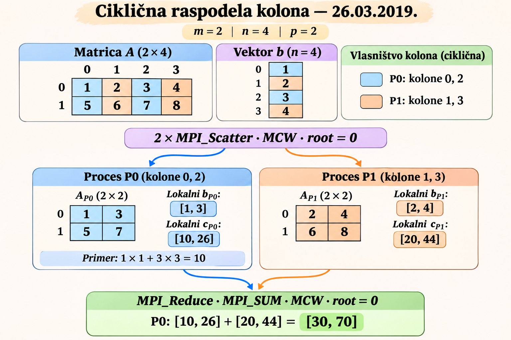

# 26.03.2019. — Zadatak 2

## Množenje matrice i vektora cikličnom raspodelom kolona

1. P0 učita m i n i prosledi ih pomoću `MPI_Bcast`. Zatim učita A po vrstama i vektor b.
2. U ravnoj memoriji proces r dobija elemente na pozicijama `r, r+p, r+2p, …`. Kako je n deljivo sa p, obrazac se ponavlja kroz sve vrste. Za A, `MPI_Type_vector` opisuje `m*(n/p)` elemenata sa korakom p. Za b opisuje `n/p` elemenata sa istim korakom. Veličina koraka između početaka susednih blokova (extent) podešava se na `sizeof(int)`, pa slanje za proces r počinje na poziciji r. Dva poziva `MPI_Scatter` raspodeljuju A i b u uzastopne lokalne nizove.
3. Svaki proces za svaku vrstu računa zbir proizvoda iz dodeljenih kolona. `MPI_Reduce` sa `MPI_SUM` sabira odgovarajuće elemente lokalnih vektora u P0.

## Primer

```sh
mpicc mpi_cyclic_matrix_vector.c -o mpi_cyclic_matrix_vector
printf '2 4\n1 2 3 4\n5 6 7 8\n1 2 3 4\n' | mpirun -np 2 ./mpi_cyclic_matrix_vector
```

P0 dobija kolone 0 i 2 i doprinos `[10, 26]`. P1 dobija kolone 1 i 3 i doprinos `[20, 44]`. P0 ispisuje `Result: 30 70`.

Lokalni izvor je `Danica 26.3.2019..txt` iz dodatnih materijala za pismeni ispit iz MPI-ja.

## Skica


