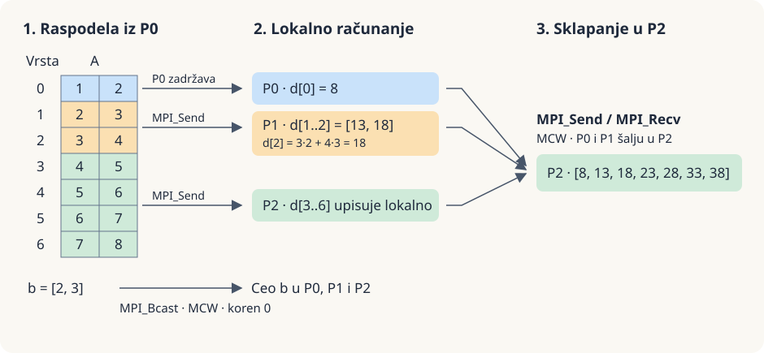

# 26.01.2024. — Zadatak 1

## Množenje matrice i vektora blokovima od 2ⁱ vrsta

1. Master P0 učitava dimenzije `k n` i šalje ih pomoću `MPI_Bcast`. Za `p` procesa raspodela pokriva `k = 2^p - 1` vrsta. Proces Pᵢ dobija `2^i` vrsta počevši od globalnog indeksa `2^i - 1`, jer su prethodnim procesima dodeljene ukupno `1 + 2 + … + 2^(i-1)` vrste.
2. P0 učitava matricu A po vrstama i vektor b. Zadržava vrstu 0, a svakom drugom procesu šalje njegov uzastopni blok jednim pozivom `MPI_Send`. Zatim šalje ceo vektor b svim procesima pomoću `MPI_Bcast`.
3. Svaki proces računa po jedan element rezultata za svaku svoju vrstu. Na primer, za vrstu 2 procesa P1 dobija se `d[2] = 3·2 + 4·3 = 18`.
4. Pₚ₋₁ ima najviše vrsta i svoj deo računa direktno u vektoru d, od indeksa `2^(p-1) - 1`. Ostali procesi šalju svoje delove jednim pozivom `MPI_Send`. Pₚ₋₁ prima svaki blok pomoću `MPI_Recv` direktno na njegovu poziciju u d. Za tri procesa P2 prima jedan element od P0 na indeks 0 i dva od P1 na indekse 1 i 2. Svoj deo upisuje na indekse 3 do 6.

## Primer pokretanja

```sh
mpicc mpi_doubling_row_blocks.c -o mpi_doubling_row_blocks
printf '7 2\n1 2\n2 3\n3 4\n4 5\n5 6\n6 7\n7 8\n2 3\n' |
    mpirun -np 3 ./mpi_doubling_row_blocks
```

| Proces | Globalne vrste A | Lokalni deo d |
| --- | --- | --- |
| P0 | 0 | 8 |
| P1 | 1, 2 | 13, 18 |
| P2 | 3, 4, 5, 6 | 23, 28, 33, 38 |

```text
Result on process 2: 8 13 18 23 28 33 38
```

## Skica


