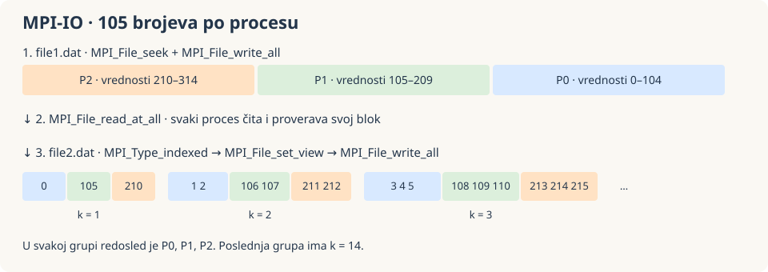

# MPI-IO — 02.07.2021, zadatak 3

[Rešenje u C-u](mpi_reverse_growing_block_file_io.c) · [Zadatak 2 sa istog ispita](../../logical_process_grid/exam_2021_07_02/README.md)



1. **Upis u `file1.dat`.** Proces ranga `r` priprema 105 brojeva, od `105*r` do `105*r + 104`. Za `p` procesa prvi element njegovog bloka ima indeks `(p - 1 - r)*105`. Proces postavlja svoj pojedinačni pokazivač pomoću `MPI_File_seek`, pa poziva `MPI_File_write_all`. Pomeraj se računa u bajtovima, množenjem indeksa sa `sizeof(int)`.
2. **Ponovno čitanje i provera.** Procesi zatvaraju i ponovo otvaraju prvu datoteku. Svaki koristi isti pomeraj kao eksplicitni argument poziva `MPI_File_read_at_all`. Proverava broj pročitanih elemenata i poredi svaku pročitanu vrednost sa upisanom.
3. **Upis u `file2.dat`.** U grupi `k`, svaki proces upisuje sledećih `k` brojeva. Promenljiva `used` broji koliko je brojeva svaki proces već rasporedio. Zato grupa počinje na indeksu `p*used`, a blok procesa `r` počinje još `r*k` mesta dalje. Petlja u istom prolazu beleži dužinu i početak bloka i povećava `used` za `k`. Kad `used` dostigne 105, svih 14 blokova je spremno za `MPI_Type_indexed`. Nakon `MPI_File_set_view` čitav upis ide jednim kolektivnim pozivom `MPI_File_write_all`.

## Pokretanje

Program pravi ili prepisuje `file1.dat` i `file2.dat` u radnom direktorijumu.

```sh
mpicc -std=c11 -Wall -Wextra -o mpi_reverse_growing_block_file_io mpi_reverse_growing_block_file_io.c
mpirun -np 3 ./mpi_reverse_growing_block_file_io
```

Za tri procesa, `file1.dat` sadrži redom blokove `210–314`, `105–209` i `0–104`. Prve tri grupe u `file2.dat` izgledaju ovako, gde razmak između blokova odvaja doprinose P0, P1 i P2.

```text
0        105          210
1 2      106 107      211 212
3 4 5    108 109 110  213 214 215
```

Poslednja grupa sadrži blokove `91–104`, `196–209` i `301–314`, na početnim indeksima 273, 287 i 301.
