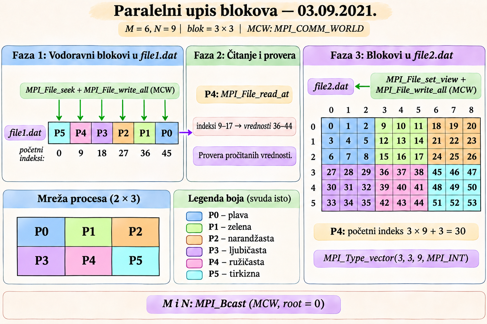

# Paralelni upis blokova u binarnu datoteku

Ispit 3. 9. 2021, zadatak 3.

1. **Prvi upis.** Proces ranga `r` pripremi devet brojeva počev od `9*r`. U podrazumevanom pogledu datoteke pomeraji se mere u bajtovima. Zato `MPI_File_seek` postavlja pojedinačni pokazivač na `(p - 1 - r) * 9 * sizeof(int)`, gde je `p` broj procesa. Kolektivni `MPI_File_write_all` upisuje blokove u redosledu od P(p−1) do P0.
2. **Čitanje i provera.** Posle ponovnog otvaranja `file1.dat`, svaki proces poziva `MPI_File_read_at` sa istim eksplicitnim pomerajem. Proverava da je pročitao devet brojeva i da se svaki poklapa sa odgovarajućim upisanim brojem.
3. **Upis matrice.** P0 prosleđuje dimenzije pomoću `MPI_Bcast`. Obe dimenzije moraju biti pozitivni umnošci broja 3, uz uslov `(M/3) * (N/3) == p`. U mreži širine `q = N/3`, proces `r` počinje u globalnoj vrsti `3*(r/q)` i koloni `3*(r%q)`. Tip `MPI_Type_vector(3, 3, N, MPI_INT, &block_type)` opisuje tri grupe od po tri uzastopna broja, sa korakom od `N` elemenata između početaka vrsta. Proces preko `MPI_File_set_view` bira početak svog bloka u bajtovima. Zatim svi procesi jednim pozivom `MPI_File_write_all` direktno upisuju svoje blokove u `file2.dat`. Matrica je u datoteci smeštena po vrstama.

Za `M = 6` i `N = 9`, P4 čita vrednosti 36–44 sa pozicija 9–17 u `file1.dat`. U `file2.dat` upisuje ih u vrste 3–5 i kolone 3–5, počev od indeksa 30. Indeksi u primeru počinju od nule.



## Pokretanje

```sh
mpicc -std=c11 -Wall -Wextra -o mpi_block_file_io mpi_block_file_io.c
printf '6 9\n' | mpiexec -n 6 ./mpi_block_file_io
od -An -v -td4 file2.dat
```

Datoteke `file1.dat` i `file2.dat` nastaju u radnom direktorijumu. Primer ispisa pomoću `od` podrazumeva četvorobajtni `int`.
