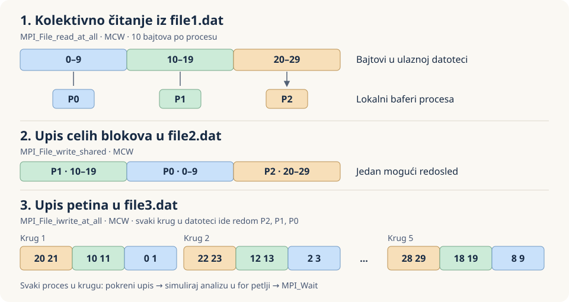

# Paralelno čitanje i upis log podataka

Ispit 24. 9. 2021, zadatak 3. Pošto format log zapisa nije zadat, program tretira datoteku kao niz bajtova (`MPI_BYTE`). Ako je `N` veličina datoteke, a `p` broj procesa, `N` mora biti deljivo sa `5*p` da bi svi procesi dobili jednake blokove i podelili ih na pet jednakih delova. Lokalni blok od `L = N/p` bajtova može imati najviše `INT_MAX` bajtova zbog parametra `count` u pozivima čitanja i upisa.



1. **Čitanje iz `file1.dat`.** Proces ranga `r` kolektivno čita `L` uzastopnih bajtova od pomeraja `r*L` pomoću `MPI_File_read_at_all`.
2. **Upis u `file2.dat`.** Svaki proces upisuje ceo lokalni blok pozivom `MPI_File_write_shared`. Zajednički pokazivač na datoteku svakom pozivu dodeljuje uzastopni prostor za njegov blok. Redosled blokova zavisi od izvršavanja. [MPI standard za zajedničke pokazivače](https://www.mpi-forum.org/docs/mpi-4.1/mpi41-report/node370.htm)
3. **Raspored u `file3.dat`.** U krugu `k` (od 0 do 4), proces ranga `r` uzima `C = L/5` bajtova iz lokalnog bafera od indeksa `k*C`. Ispred njegovog dela u izlazu je `k*p` delova iz prethodnih krugova i `p-1-r` delova procesa višeg ranga iz tekućeg kruga. Izlazni pomeraj je zato `(k*p + p-1-r)*C`. Svi pomeraji su u bajtovima.
4. **Preklapanje upisa i analize.** U svakom krugu `MPI_File_iwrite_at_all` pokreće neblokirajući kolektivni upis. Proces zatim izvršava `for` petlju koja simulira analizu bez pristupa aktivnom baferu, pa poziva `MPI_Wait`. Napredovanje upisa tokom petlje zavisi od implementacije MPI-ja. [MPI standard za neblokirajući kolektivni I/O](https://www.mpi-forum.org/docs/mpi-3.1/mpi31-report/node343.htm)

Obe izlazne datoteke se pri svakom pokretanju prepisuju i imaju po `N` bajtova.

## Pokretanje

```sh
mpicc -std=c11 -Wall -Wextra -o mpi_overlapped_log_io mpi_overlapped_log_io.c
python3 -c "from pathlib import Path; Path('file1.dat').write_bytes(bytes(range(30)))"
mpirun -np 3 ./mpi_overlapped_log_io
od -An -v -t u1 file2.dat
od -An -v -t u1 file3.dat
```

U ovom primeru `L = 10` i `C = 2`. U `file2.dat` su celi blokovi `0–9`, `10–19` i `20–29` u proizvoljnom redosledu. Prvi krug u `file3.dat` daje `20 21 10 11 0 1`, drugi `22 23 12 13 2 3`, a peti `28 29 18 19 8 9`.
