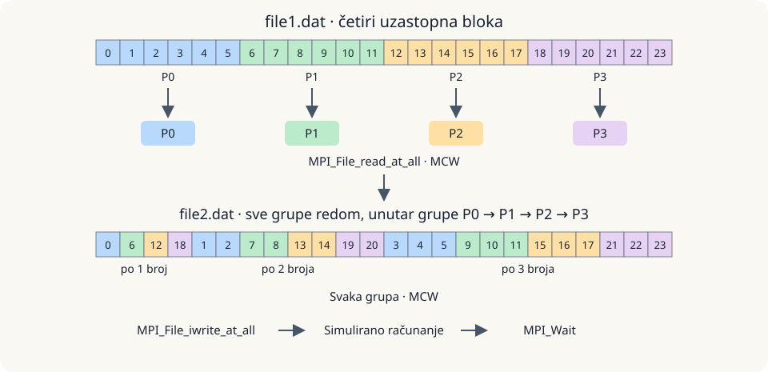

# Paralelni upis blokova rastuće dužine uz preklapanje sa računanjem

Ispit 7. 10. 2021, zadatak 3. Ulazna binarna datoteka `file1.dat` unapred je pripremljena i sadrži brojeve zapisane u izvornom formatu tipa `int`. Broj elemenata mora biti deljiv brojem procesa.



1. **Čitanje.** Ako ima `p` procesa i svaki dobija po `n` brojeva, proces ranga `r` poziva `MPI_File_read_at_all` i čita svoj blok počev od indeksa `r*n`. U podrazumevanom pogledu oba fajla pomeraji se prosleđuju u bajtovima, pa se indeks množi sa `sizeof(int)`.
2. **Raspored izlaza.** U grupi `k` svaki proces uzima sledećih `b = min(k, n - used)` brojeva iz svog bloka, gde je `used` broj prethodno upisanih elemenata po procesu. Ispred grupe je ukupno `p*used` brojeva, a ispred procesa `r` unutar grupe još `r*b`. Zato njegov blok počinje na indeksu `p*used + r*b`. Poslednja grupa može biti kraća.
3. **Preklapanje.** Svi procesi započinju upis grupe pomoću `MPI_File_iwrite_at_all`, izvršavaju simulirano računanje u odvojenoj promenljivoj, pa pozivaju `MPI_Wait` pre prelaska na sledeću grupu. Stvarni napredak upisa tokom računanja zavisi od MPI implementacije. [Open MPI dokumentacija](https://docs.open-mpi.org/en/main/man-openmpi/man3/MPI_File_iwrite_at_all.3.html)

## Pokretanje

Primer za četiri procesa i šest brojeva po procesu. Python komanda pravi probni ulaz od 0 do 23 i prepisuje postojeći `file1.dat` u radnom direktorijumu.

```sh
mpicc -std=c11 -Wall -Wextra -pedantic -o mpi_overlapped_file_io mpi_overlapped_file_io.c
python3 -c 'from array import array; open("file1.dat", "wb").write(array("i", range(24)).tobytes())'
mpirun -np 4 ./mpi_overlapped_file_io
od -An -v -t d4 file2.dat
```

Očekivani redosled, sa jednom grupom po redu prikaza.

```text
 0          6         12         18
 1  2       7  8      13 14      19 20
 3  4  5    9 10 11   15 16 17   21 22 23
```
