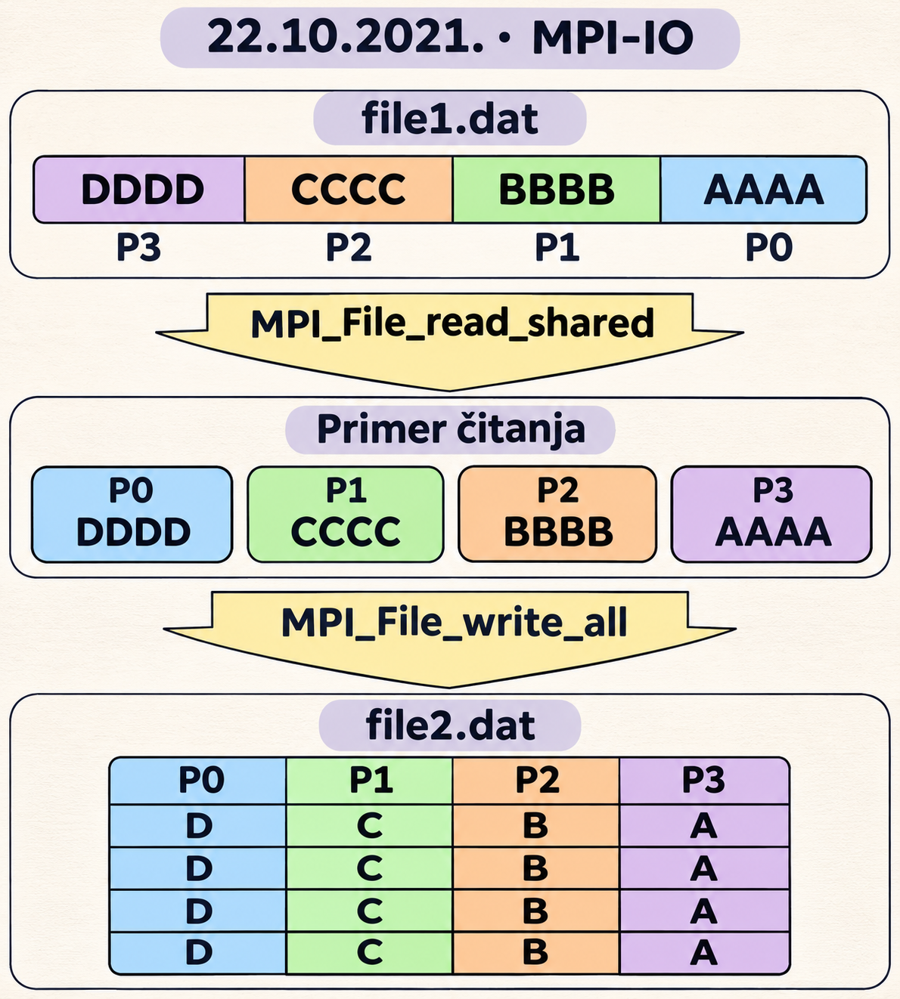

# 22.10.2021. — Zadatak 3, paralelni rad sa datotekama



1. Broj procesa određuje `N`, jer svaki proces popunjava jednu od `N` kolona. Proces ranga `r` postavlja svoj pojedinačni pokazivač na `(N - 1 - r) * N` i kolektivno upisuje svoj blok. Za četiri procesa sadržaj `file1.dat` je `DDDDCCCCBBBBAAAA`.
2. Svi procesi završe zatvaranje prve datoteke pre ponovnog otvaranja. Svaki poziv `MPI_File_read_shared` preko zajedničkog pokazivača preuzima sledećih `N` znakova. Redosled poziva određuje koji će blok dobiti koji proces. Skica prikazuje jedan mogući ishod.
3. Pogled na `file2.dat` za proces `r` počinje na bajtu `r`. Vektorski tip bira `N` znakova sa korakom `N`, pa jedan poziv `MPI_File_write_all` paralelno upisuje sve kolone. Posle upisa svih procesa veličina svake datoteke postavlja se na `N * N` bajtova, čime se uklanja eventualni višak od prethodnog pokretanja.

## Pokretanje

```sh
mpicc -Wall -Wextra mpi_reverse_blocks_column_io.c -o mpi_reverse_blocks_column_io
mpirun -np 4 ./mpi_reverse_blocks_column_io
od -An -c file1.dat
od -An -c file2.dat
```

[Prompt za skicu](file_io_sketch_prompt.txt)
