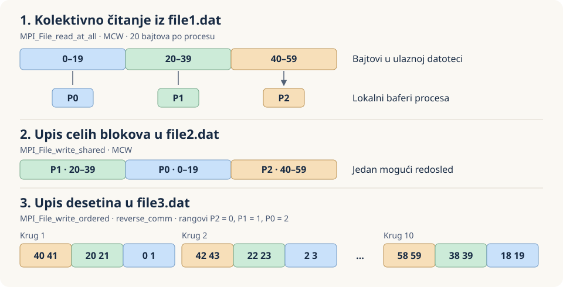

# Paralelni upis binarnih log podataka

Ispit 30. 3. 2022, zadatak 3. Ulaz je postojeća datoteka `file1.dat`. Pošto format log zapisa nije zadat, program obrađuje sirove bajtove (`MPI_BYTE`). Program pretpostavlja da je veličina datoteke deljiva sa `10*p`, gde je `p` broj procesa. Lokalni blok može imati najviše `INT_MAX` bajtova zbog parametra `count` u korišćenim MPI funkcijama.



1. **Čitanje iz `file1.dat`.** Ako datoteka ima `N` bajtova, svaki proces čita `L = N/p` bajtova. Proces ranga `r` poziva `MPI_File_read_at_all` u komunikatoru `MCW` sa pomerajem `r*L`. Pomeraj je u bajtovima jer podrazumevani pogled na datoteku koristi `MPI_BYTE`.
2. **Upis u `file2.dat`.** Svaki proces poziva `MPI_File_write_shared` jednom i upisuje svih `L` bajtova. Zajednički pokazivač svakom pozivu dodeljuje poseban uzastopni blok. Redosled blokova može biti bilo koja permutacija rangova. [MPI standard za zajedničke pokazivače](https://www.mpi-forum.org/docs/mpi-3.1/mpi31-report/node326.htm)
3. **Upis u `file3.dat`.** Svi procesi ulaze u isti komunikator `reverse_comm` pozivom `MPI_Comm_split` sa ključem `p - 1 - r`. To je novi rang procesa. U krugu `k` proces šalje svojih sledećih `C = L/10` bajtova iz lokalnog bafera od indeksa `k*C`. `MPI_File_write_ordered` raspoređuje te delove po rastućim rangovima u `reverse_comm`, pa u datoteci svaki krug ide od procesa `P(p-1)` do `P0`. Deo procesa `r` u krugu `k` počinje od bajta `(k*p + p - 1 - r)*C`. [MPI standard za uređeni upis](https://www.mpi-forum.org/docs/mpi-3.1/mpi31-report/node326.htm)

Obe izlazne datoteke imaju veličinu `N` i prepisuju se pri svakom pokretanju.

## Pokretanje

Primer pravi ulaz od 60 bajtova. Na tri procesa lokalni blok ima 20 bajtova, a jedna desetina ima 2 bajta.

```sh
mpicc -std=c11 -Wall -Wextra -o mpi_round_robin_log_io mpi_round_robin_log_io.c
python3 -c "from pathlib import Path; Path('file1.dat').write_bytes(bytes(range(60)))"
mpirun -np 3 ./mpi_round_robin_log_io
od -An -v -t u1 file2.dat
od -An -v -t u1 file3.dat
```

U `file2.dat` pojaviće se blokovi `0–19`, `20–39` i `40–59` u redosledu koji zavisi od izvršavanja. Prva dva kruga u `file3.dat` daju `40 41 20 21 0 1` i `42 43 22 23 2 3`. Poslednji daje `58 59 38 39 18 19`.
