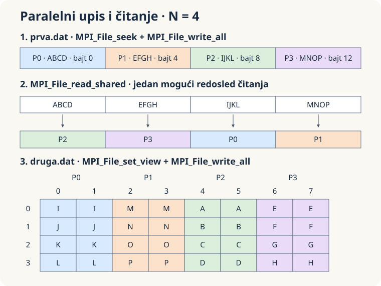

# Ispit 23.06.2022. – paralelni upis i čitanje datoteke

Rešenje [trećeg zadatka](mpi_paired_column_file_io.c) uzima broj pokrenutih procesa kao `N`, jer matrica ima `2N` kolona, a svaki proces dobija po dve.



1. **Upis u `prva.dat`.** Proces ranga `r` generiše `N` znakova, postavlja pojedinačni pokazivač na bajt `r * N` pozivom `MPI_File_seek` i kolektivno upisuje svoj blok pomoću `MPI_File_write_all`. Datoteka tako sadrži `N²` znakova poređanih po rangu.
2. **Ponovno otvaranje i čitanje.** `MPI_File_close` sinhronizuje upisane podatke, a barijera obezbeđuje da svi završe zatvaranje pre ponovnog otvaranja. Zajednički pokazivač kreće od početka. Svaki `MPI_File_read_shared` preuzima sledećih `N` znakova i pomera pokazivač za toliko. Redosled kojim procesi dobijaju blokove zavisi od izvršavanja. [MPI Forum – zajednički pokazivači](https://www.mpi-forum.org/docs/mpi-4.1/mpi41-report/node370.htm) · [MPI Forum – konzistentnost datoteke](https://www.mpi-forum.org/docs/mpi-4.1/mpi41-report/node383.htm)
3. **Upis u `druga.dat`.** Svaki pročitani znak ponavlja se u obe kolone istog reda. Tip `MPI_Type_vector(N, 2, 2*N, MPI_CHAR, ...)` opisuje `N` parova bajtova sa korakom od `2N` bajtova. Pogled procesa ranga `r` počinje od bajta `2*r`, pa njegov par u redu `i` počinje od bajta `i * 2N + 2*r`. Jedan poziv `MPI_File_write_all` po procesu upisuje ceo lokalni blok i omogućava MPI biblioteci da optimizuje upis.

Barijera pre svakog poziva `MPI_File_set_size` obezbeđuje da svi završe upis pre podešavanja veličine. Time se uklanjaju eventualni zaostali bajtovi iz prethodnog pokretanja.

## Pokretanje

```sh
mpicc -Wall -Wextra mpi_paired_column_file_io.c -o mpi_paired_column_file_io
mpirun -np 4 ./mpi_paired_column_file_io
hexdump -v -e '8/1 "%c" "\n"' druga.dat
```

Za četiri procesa `prva.dat` sadrži `ABCDEFGHIJKLMNOP`, a `druga.dat` ima 32 bajta u formatu po redovima. Na primer, ako P0 pročita `IJKL`, njegovi parovi u kolonama 0 i 1 redom su `II`, `JJ`, `KK` i `LL`.
