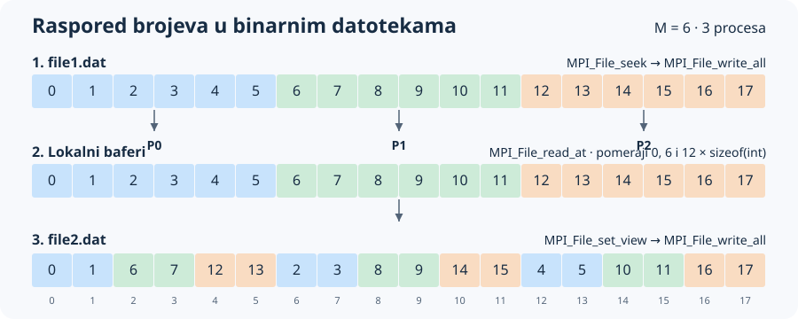

# Paralelni upis i čitanje binarnih datoteka

Ispit 7. 7. 2022, zadatak 3. U programu je `M = 6`. Broj procesa `p` mora da deli `M` kako bi svaki proces mogao da podeli svojih `M` brojeva na `p` jednakih blokova.



1. **Upis u `file1.dat`.** Proces ranga `r` formira brojeve od `r*M` do `r*M + M - 1`. Pozivom `MPI_File_seek` postavlja svoj pojedinačni pokazivač na `r*M*sizeof(int)`, pa svi procesi upisuju svoje blokove pozivom `MPI_File_write_all`. Podrazumevani pogled koristi `MPI_BYTE`, pa je pomeraj izražen u bajtovima.
2. **Čitanje i provera.** Posle zatvaranja i ponovnog otvaranja `file1.dat`, svaki proces koristi `MPI_File_read_at` sa istim eksplicitnim pomerajem. Proverava broj pročitanih elemenata pomoću `MPI_Get_count`, a zatim poredi svaku vrednost sa onom koju je upisao.
3. **Upis u `file2.dat`.** Neka je `b = M/p`. Tip `MPI_Type_vector(p, b, M, MPI_INT, ...)` opisuje `p` blokova od po `b` brojeva, sa razmakom `M` između početaka susednih blokova. Proces `r` postavlja početak svog pogleda na `r*b*sizeof(int)` bajtova funkcijom `MPI_File_set_view`. Tako blok `k` procesa `r` počinje na indeksu `k*M + r*b` druge datoteke. Jedan poziv `MPI_File_write_all` upisuje svih `M` pročitanih brojeva kroz taj pogled.

Za tri procesa `b = 2`. Proces P1, na primer, upisuje parove `6 7`, `8 9` i `10 11` od indeksa 2, 8 i 14. Podaci ostaju u lokalnim baferima procesa između čitanja i drugog upisa.

## Pokretanje

```sh
mpicc -std=c11 -Wall -Wextra -o mpi_interleaved_file_io mpi_interleaved_file_io.c
mpirun -np 3 ./mpi_interleaved_file_io
od -An -v -t d4 file1.dat
od -An -v -t d4 file2.dat
```

Očekivani sadržaj za tri procesa, prikazan kao niz celih brojeva:

```text
file1.dat: 0 1 2 3 4 5 6 7 8 9 10 11 12 13 14 15 16 17
file2.dat: 0 1 6 7 12 13 2 3 8 9 14 15 4 5 10 11 16 17
```
