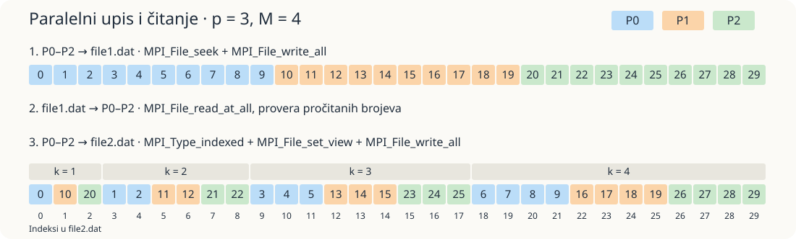

# Paralelni upis blokova rastuće dužine

Ispit 5. 12. 2022, zadatak 3. U programu je izabrano `M = 4`, pa svaki proces upisuje `N = M*(M+1)/2 = 10` brojeva. Neka je `p` broj procesa, a `r` rang procesa.



1. **Upis u `file1.dat`.** Proces `r` formira brojeve od `r*N` do `r*N + N - 1`. Pozivom `MPI_File_seek` postavlja svoj pojedinačni pokazivač na `r*N*sizeof(int)` i zatim kolektivno upisuje svoj blok pomoću `MPI_File_write_all`. Podrazumevani pogled koristi `MPI_BYTE`, pa je pomeraj u bajtovima.
2. **Čitanje i provera.** Svi procesi ponovo otvaraju `file1.dat` i pozivaju `MPI_File_read_at_all`. Proces `r` prosleđuje isti pomeraj kao eksplicitni argument. Pomoću `MPI_Get_count` proverava da li je pročitao `N` brojeva, a zatim ih poredi sa vrednostima koje je upisao.
3. **Upis u `file2.dat`.** U grupi `k`, za `k = 1, …, M`, svaki proces upisuje po `k` brojeva. Pre te grupe nalazi se `p*k*(k-1)/2` brojeva, a unutar nje ispred procesa `r` nalazi se još `r*k` brojeva. Zato njegov blok počinje na indeksu `p*k*(k-1)/2 + r*k`. `MPI_Type_indexed` opisuje svih `M` blokova dužina `1, 2, …, M` i njihove početke u jedinicama `MPI_INT`. Svaki proces postavlja svoj pogled pomoću `MPI_File_set_view` i upisuje sve pročitane brojeve jednim kolektivnim pozivom `MPI_File_write_all` na `MPI_COMM_WORLD`.

Za tri procesa, P1 upisuje blokove `[10]`, `[11, 12]`, `[13, 14, 15]` i `[16, 17, 18, 19]` na indekse 1, 5, 12 i 22 druge datoteke.

## Pokretanje

```sh
mpicc -std=c11 -Wall -Wextra -o mpi_growing_block_file_io mpi_growing_block_file_io.c
mpirun -np 3 ./mpi_growing_block_file_io
od -An -v -t d4 file1.dat
od -An -v -t d4 file2.dat
```

Za tri procesa `file1.dat` sadrži brojeve od 0 do 29 redom. U `file2.dat` redosled je sledeći, sa jednom grupom po redu prikaza.

```text
 0           10           20
 1  2        11 12        21 22
 3  4  5     13 14 15     23 24 25
 6  7  8  9  16 17 18 19  26 27 28 29
```
