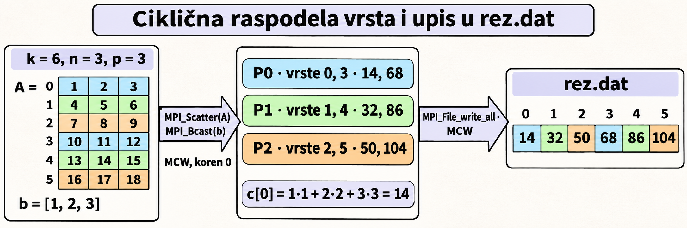

# Ciklično množenje matrice i vektora sa paralelnim upisom

Ispit 06.07.2023, zadatak 1. U programu je `k = 6` i `n = 3`. Proces 0 inicijalizuje matricu brojevima od 1 do 18 po vrstama i vektor `b = [1, 2, 3]`. Broj procesa `p` mora da deli `k`.



1. **Raspodela matrice.** `MPI_Type_vector(k/p, n, p*n, MPI_INT, ...)` opisuje svih `k/p` vrsta jednog procesa. Svaka vrsta ima `n` elemenata, a razmak između početaka dve vrste istog procesa iznosi `p*n` elemenata. `MPI_Type_create_resized` postavlja extent na veličinu jedne vrste, pa `MPI_Scatter` sa korenom 0 za proces ranga `r` počinje od vrste `r`. Sve vrste tog procesa šalju se direktno iz matrice u jednom bloku opisanom izvedenim tipom.
2. **Raspodela vektora.** `MPI_Bcast` sa korenom 0 u komunikatoru `MCW` šalje ceo vektor `b` svim procesima.
3. **Lokalno računanje.** Svaki proces računa skalarni proizvod svake primljene vrste sa `b`. Na primer, sa tri procesa P0 računa `c[0] = 1*1 + 2*2 + 3*3 = 14` i `c[3] = 10*1 + 11*2 + 12*3 = 68`.
4. **Paralelni upis.** Proces ranga `r` pomoću `MPI_File_set_view` vidi pozicije `r, r+p, ..., r+k-p` u datoteci. Početni pomeraj je `r*sizeof(int)` bajtova, a tip datoteke `MPI_Type_vector(k/p, 1, p, MPI_INT, ...)` opisuje korak između elemenata. Jedan kolektivni poziv `MPI_File_write_all` upisuje sve lokalne rezultate na njihove globalne pozicije. Datoteka sadrži tačno `k` vrednosti tipa `int` u izvornom binarnom formatu.

## Pokretanje

```sh
mpicc -std=c11 -Wall -Wextra -o mpi_cyclic_row_matrix_vector_io mpi_cyclic_row_matrix_vector_io.c
mpirun -np 3 ./mpi_cyclic_row_matrix_vector_io
od -An -v -t d4 rez.dat
```

Na sistemu sa četvorobajtnim tipom `int`, očekivani izlaz komande `od` je `14 32 50 68 86 104`.
