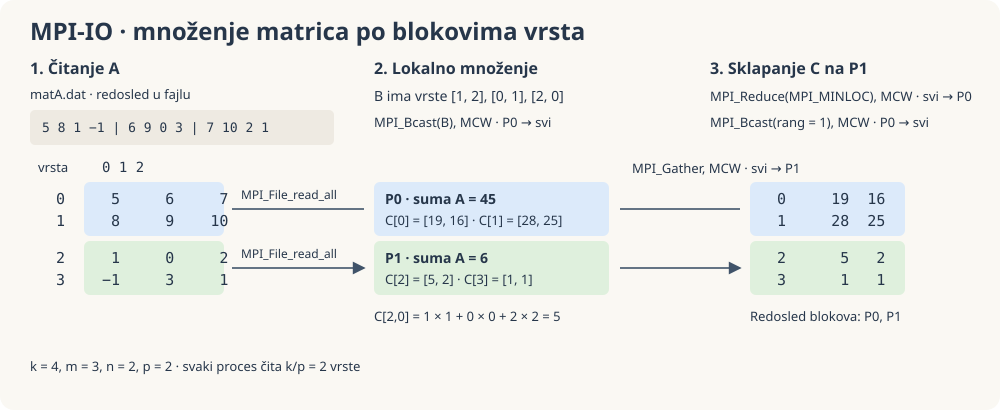

# Ispit 22. 9. 2023. — MPI, zadatak 1

[Rešenje u C-u](mpi_block_row_file_matrix_product.c)



## Postupak

1. Proces P0 učitava dimenzije `k m n` i prosleđuje ih svim procesima. Svaki proces dobija `rows = k / p` uzastopnih vrsta matrice A, počev od globalne vrste `rank * rows`.
2. Datoteka `matA.dat` sadrži binarne vrednosti tipa `int`, upisane po kolonama, bez zaglavlja. U svakoj od `m` kolona proces čita `rows` susednih elemenata. Počeci blokova susednih kolona udaljeni su `k` elemenata, pa se za pogled na datoteku koristi `MPI_Type_vector(m, rows, k, MPI_INT, ...)`. Pomeraj je `rank * rows * sizeof(int)` bajtova. `MPI_File_read_all` čita blok u kompaktan kolonski raspored, tako da je lokalni element vrste `i` i kolone `j` na indeksu `j * rows + i`.
3. P0 učitava B po vrstama i šalje celu matricu pozivom `MPI_Bcast`. Svaki proces računa sumu pročitanih elemenata A i množi svoj blok vrsta sa celom matricom B. Tako dobija kompletne vrste matrice C za svoj opseg.
4. `MPI_Reduce` sa `MPI_MINLOC` i tipom `MPI_2INT` daje P0 par (najmanja suma, rang). Pri izjednačenju bira se manji rang. P0 objavljuje izabrani rang pozivom `MPI_Bcast`. `MPI_Gather` na izabranom procesu slaže blokove po rangu, što odgovara redosledu vrsta matrice C.

## Primer pokretanja

U direktorijumu zadatka pripremi `matA.dat` za matricu A sa vrstama `[5, 6, 7]`, `[8, 9, 10]`, `[1, 0, 2]`, `[-1, 3, 1]`. Format `@12i` zapisuje vrednosti u nativnom formatu tipa `int`.

```sh
python3 -c 'import struct; open("matA.dat", "wb").write(struct.pack("@12i", 5, 8, 1, -1, 6, 9, 0, 3, 7, 10, 2, 1))'
mpicc -std=c99 -Wall -Wextra mpi_block_row_file_matrix_product.c -o mpi_block_row_file_matrix_product
mpirun -np 2 ./mpi_block_row_file_matrix_product <<'INPUT'
4 3 2
1 2
0 1
2 0
INPUT
```

P0 dobija sumu 45, a P1 sumu 6, pa se cela matrica C sklapa na P1.

```text
Process 1 has the minimum sum of A (6).
Matrix C:
19 16
28 25
5 2
1 1
```
