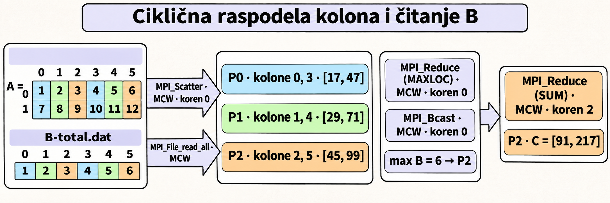

# Ciklično množenje matrice i vektora sa paralelnim čitanjem

Ispit 04.12.2023, zadatak 1. Matrica A ima `k = 2` vrste i `m = 6` kolona. Proces P0 inicijalizuje A, a svaki proces čita svoj deo vektora B iz binarne datoteke `B-total.dat`. Broj procesa `p` mora da deli `m`. Iz uslova `j mod p = r` sledi da je poslednji indeks procesa r jednak `r + m - p`.



1. **Raspodela A.** Matrica je smeštena po vrstama. Izvedeni tip `MPI_Type_vector(k*(m/p), 1, p, MPI_INT, ...)` bira svaki p-ti element iz uzastopne memorije. Pošto p deli m, korak p posle poslednje dodeljene kolone prelazi na prvu dodeljenu kolonu sledeće vrste. `MPI_Type_create_resized` postavlja extent na `sizeof(int)`, pa `MPI_Scatter` u `MCW` sa korenom 0 za proces r započinje od `A[0][r]`. Sve dodeljene kolone stižu odjednom u neprekidan lokalni blok.
2. **Čitanje B.** Tip `MPI_Type_vector(m/p, 1, p, MPI_INT, ...)` opisuje elemente u datoteci, a `MPI_File_set_view` postavlja početni pomeraj na `r*sizeof(int)` bajtova. Jedan kolektivni poziv `MPI_File_read_all` učitava sve pripadajuće elemente u lokalni niz.
3. **Lokalno računanje.** Svaki proces računa po jedan doprinos za svaku vrstu A. Računa skalarni proizvod svoje vrste lokalnog bloka i svog dela B.
4. **Izbor odredišta.** Svaki proces formira par (lokalni maksimum B, rang). `MPI_Reduce` sa `MPI_MAXLOC` i tipom `MPI_2INT` pronalazi globalni maksimum i pripadajući rang na procesu 0. Ako više procesa ima isti maksimum, bira se najmanji rang. `MPI_Bcast` iz procesa 0 šalje izabrani rang svima.
5. **Sklapanje C.** Drugi `MPI_Reduce`, sa `MPI_SUM`, sabira doprinose po vrstama. Koren je rang procesa koji je učitao maksimum B. Sve grupne operacije koriste `MCW`.

## Primer sa tri procesa

```text
          j    0  1  2  3  4  5
A, vrsta 0     1  2  3  4  5  6
A, vrsta 1     7  8  9 10 11 12
B              1  2  3  4  5  6
Proces        P0 P1 P2 P0 P1 P2
```

| Proces | Kolone A i indeksi B | Lokalni deo B | Lokalni doprinos |
| --- | --- | --- | --- |
| P0 | 0, 3 | [1, 4] | [17, 47] |
| P1 | 1, 4 | [2, 5] | [29, 71] |
| P2 | 2, 5 | [3, 6] | [45, 99] |

P2 dobija lokalnu matricu `[[3, 6], [9, 12]]` i računa `3*3 + 6*6 = 45` i `9*3 + 12*6 = 99`. Pošto je učitao B[5] = 6, P2 prima vektor `C = [17 + 29 + 45, 47 + 71 + 99] = [91, 217]`.

## Pokretanje

Komande se izvršavaju iz direktorijuma zadatka. Python pravi ulaznu datoteku sa šest uzastopnih vrednosti u izvornom binarnom formatu za C tip `int`.

```sh
python3 -c 'import struct; from pathlib import Path; Path("B-total.dat").write_bytes(struct.pack("@6i", 1, 2, 3, 4, 5, 6))'
mpicc -std=c11 -Wall -Wextra -o mpi_cyclic_column_matrix_vector_io mpi_cyclic_column_matrix_vector_io.c
mpirun -np 3 ./mpi_cyclic_column_matrix_vector_io
```

```text
Process 2: C = 91 217
```
