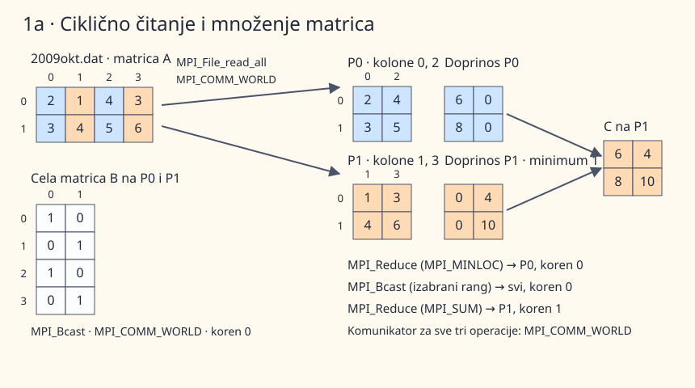
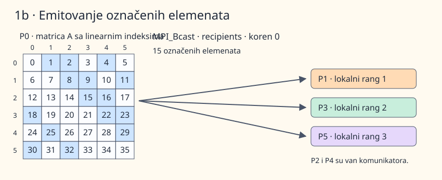

# MPI ispit 20. 9. 2024.

## 1a — Množenje matrica uz ciklično čitanje kolona



1. **Priprema ulaza.** Primer koristi `k = 2`, `m = 4` i `n = 2`. Datoteka `2009okt.dat` čuva celobrojne elemente A po vrstama u izvornom binarnom formatu. Za jednak broj kolona po procesu važi `m % p == 0`. U tekstu zadatka poslednja kolona je zapisana kao `i + n − p`. Iz uslova `j mod p = i` i dimenzija matrice A sledi `i + m − p`.
2. **Kolektivno čitanje A.** U datoteci je linearni indeks elementa `A[r][i + t*p]` jednak `r*m + i + t*p`. Kako je `m` deljivo sa `p`, linearni indeksi procesa Pi počinju od `i` i idu korakom `p` i preko granica vrsta. `MPI_Type_vector(k*(m/p), 1, p, MPI_INT, ...)` opisuje te elemente. `MPI_File_set_view` postavlja početni pomeraj `i*sizeof(int)`, a jedan poziv `MPI_File_read_all` smešta elemente u uzastopne pozicije lokalne matrice.
3. **Emitovanje B i lokalni proizvod.** P0 šalje celu B pozivom `MPI_Bcast` na `MPI_COMM_WORLD`. Proces Pi u svaki element svog doprinosa sabira proizvode `A_local[r][t] * B[i + t*p][s]` po svim lokalnim kolonama `t`.
4. **Izbor korena i zbir.** Svaki proces šalje par (lokalni minimum, rang) kroz `MPI_Reduce` sa `MPI_MINLOC` na P0. U slučaju jednakih minimuma bira se manji rang. P0 emituje izabrani rang. Drugi `MPI_Reduce`, sa `MPI_SUM`, sabira doprinose na izabranom procesu. Sve tri operacije koriste `MPI_COMM_WORLD`.

Za dva procesa P0 čita kolone 0 i 2, a P1 kolone 1 i 3. P1 čita minimum 1 i dobija konačan rezultat. Na primer, u element `C[0][1]` P0 doprinosi sa `2*0 + 4*0 = 0`, a P1 sa `1*1 + 3*1 = 4`.

```text
A = [2 1 4 3]    B = [1 0]    C₀ = [6  0]    C₁ = [0  4]    C = [6  4]
    [3 4 5 6]        [0 1]         [8  0]         [0 10]        [8 10]
                     [1 0]
                     [0 1]
```

Primer ulaza `2009okt.dat` nalazi se uz izvorni kod. VS Code pokreće program iz tog direktorijuma. Za sopstvenu matricu A koristi binarnu datoteku sa odgovarajućim dimenzijama i istim imenom.

```sh
mpicc -std=c11 -Wall -Wextra -o mpi_cyclic_file_matrix_product mpi_cyclic_file_matrix_product.c
mpirun -np 2 ./mpi_cyclic_file_matrix_product
```

## 1b — Emitovanje označenih elemenata matrice



1. **Opis označenih polja.** Za matricu 6 × 6 sa slike, linearni indeks je `6*r + c`. Pomeraji su prepisani sa slike red po red u niz `displacements`. Prvi red ima pomeraje 1, 2 i 4, a prvi označeni element četvrtog reda je `A[3][0]`, sa pomerajem `3*6 + 0 = 18`. Posebna petlja na P0 popunjava probnu matricu vrednostima `6*r + c`. `MPI_Type_indexed` opisuje 15 blokova dužine 1, sa pomerajima u jedinicama `MPI_INT`.
2. **Komunikator.** `MPI_Comm_group` izdvaja grupu iz `MPI_COMM_WORLD`. `MPI_Group_incl` bira procese P0, P1, P3 i P5 tim redom, pa su njihovi lokalni rangovi redom 0, 1, 2 i 3. Svi procesi pozivaju `MPI_Comm_create` da bi se od izabrane grupe formirao komunikator `recipients`. Uslov po globalnom rangu ograničava emitovanje na P0, P1, P3 i P5.
3. **Slanje i potvrda.** P0 je lokalni koren 0 i jednim pozivom `MPI_Bcast` šalje jednu instancu izvedenog tipa. Primaoci koriste isti tip, tako da se elementi upisuju na iste pozicije. Svaki primalac ispisuje potvrdu nakon emitovanja.

```sh
mpicc -std=c11 -Wall -Wextra -o mpi_marked_matrix_broadcast mpi_marked_matrix_broadcast.c
mpirun -np 6 ./mpi_marked_matrix_broadcast
```

P1, P3 i P5 ispisuju po jednu potvrdu za 15 elemenata. Redosled ispisa zavisi od izvršavanja procesa.
