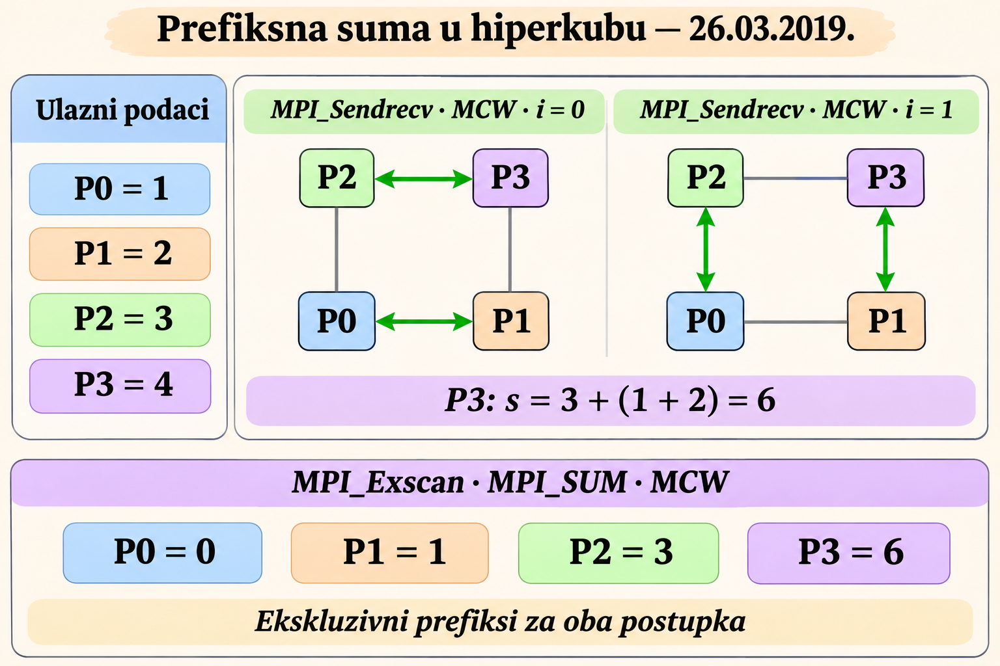

# 26.03.2019. — Zadatak 3a

## Prefiksna suma u hiperkubu

Tekst zadatka traži da Pₖ prikaže sumu prvih k elemenata, `a[0] + … + a[k-1]`. Slika zadatka prikazuje prefikse koji uključuju i `a[k]`. Oba programa prate tekst i računaju ekskluzivni prefiks, pa je rezultat za P0 jednak 0.

1. P0 učita p brojeva i pomoću `MPI_Scatter` dodeli svakom procesu po jedan. Broj procesa mora biti stepen dvojke.
2. U direktnoj varijanti `block_sum` počinje od lokalnog broja, a `prefix` od nule. U koraku i svaki proces razmeni `block_sum` sa partnerom `rank ^ (1 << i)` pomoću `MPI_Sendrecv`. Primljeni zbir uvek dodaje u `block_sum`, a u `prefix` ga dodaje samo ako partner ima manji rang, jer tada primljeni zbir obuhvata prethodni blok elemenata. Posle log₂(p) koraka svaki proces ima svoj prefiks.
3. U grupnoj varijanti `MPI_Exscan` sa `MPI_SUM` računa ekskluzivni prefiks po rangu u `MCW`. P0 eksplicitno postavlja rezultat na 0, jer je izlaz te operacije za rang 0 nedefinisan.

## Primer

```sh
mpicc mpi_hypercube_prefix.c -o mpi_hypercube_prefix
mpicc mpi_collective_prefix.c -o mpi_collective_prefix
printf '1 2 3 4\n' | mpirun -np 4 ./mpi_hypercube_prefix
printf '1 2 3 4\n' | mpirun -np 4 ./mpi_collective_prefix
```

Rezultati po rangu su `0, 1, 3, 6`. Redosled linija ispisa može da se razlikuje.

## Skica



[Dokumentacija Open MPI za MPI_Exscan](https://docs.open-mpi.org/en/v5.0.x/man-openmpi/man3/MPI_Exscan.3.html)
