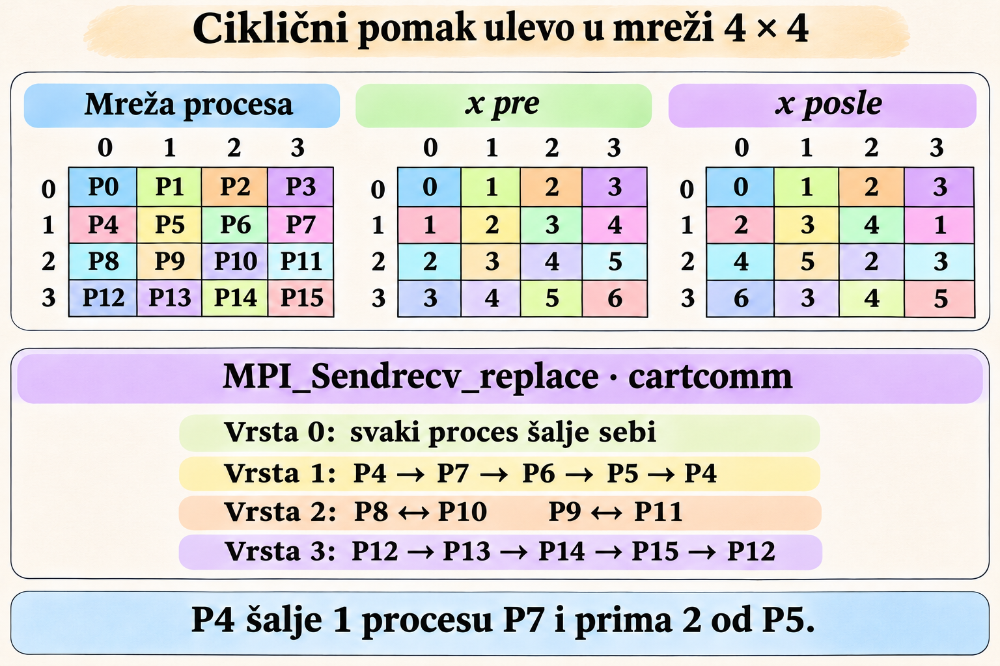

# Kartezijanska topologija — 24.04.2021, zadatak 4(a)

1. `MPI_Cart_create` formira mrežu 4 × 4. Niz `periods = {0, 1}` omogućava da se pomeranje po kolonama nastavi preko ivice iste vrste.
2. Proces na koordinatama `(row, col)` postavlja početnu vrednost `x = row + col`.
3. `MPI_Cart_shift(cartcomm, 1, -row, &source, &dest)` određuje rangove za ciklično pomeranje ulevo za `row` mesta. Proces šalje u kolonu `(col - row + 4) % 4` i prima iz kolone `(col + row) % 4`.
4. `MPI_Sendrecv_replace` šalje početnu vrednost i upisuje primljenu vrednost u isti `x`. Na primer, P4 na koordinatama (1, 0) šalje 1 procesu P7 i prima 2 od P5.

| Vrsta | x pre | x posle |
| --- | --- | --- |
| 0 | 0 1 2 3 | 0 1 2 3 |
| 1 | 1 2 3 4 | 2 3 4 1 |
| 2 | 2 3 4 5 | 4 5 2 3 |
| 3 | 3 4 5 6 | 6 3 4 5 |



[Prompt za skicu](topology_sketch_prompt.txt)

## Pokretanje

```sh
mpicc -std=c99 -Wall -Wextra mpi_cartesian_row_shift.c -o mpi_cartesian_row_shift
mpirun --oversubscribe -np 16 ./mpi_cartesian_row_shift
```

Svaki proces ispisuje rang, koordinate i vrednosti pre i posle razmene. Redosled ispisa zavisi od izvršavanja procesa.

[Zadatak 4(a) od 03.07.2020.](../exam_2020_07_03/README.md)
