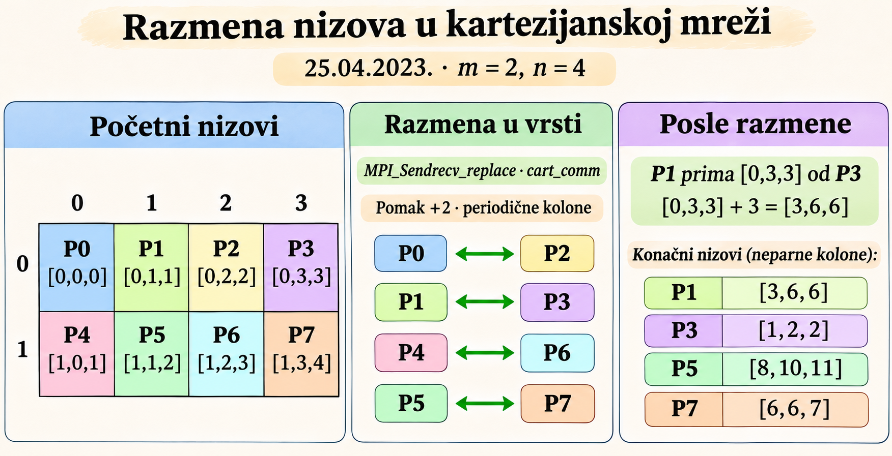
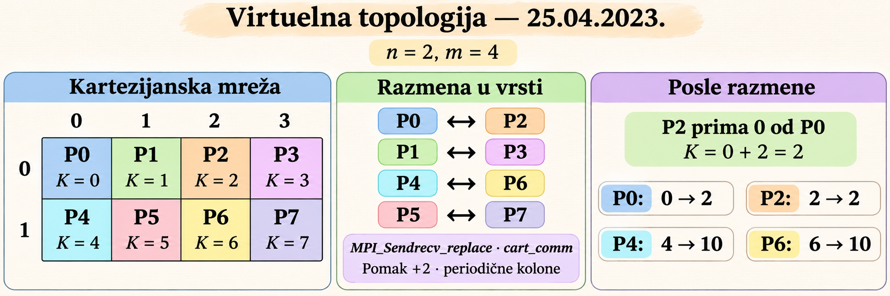

# Virtuelne topologije — 25.04.2023.

## Zadatak 1 — Razmena nizova

[Izvorni kod](mpi_cartesian_parity_array.c)



1. Pomoću `MPI_Cart_create` formiramo mrežu sa `m` vrsta i `n` kolona. Kolone su periodične, pa svaki proces ima levog i desnog suseda iste parnosti. Rangovi ostaju isti kao u `MCW`.
2. Proces na koordinatama `(r, c)` postavlja niz na `[r, c, r + c]`. Pomoću `MPI_Type_contiguous` i `MPI_Type_commit` definišemo izvedeni tip koji obuhvata sva tri uzastopna cela broja.
3. Poziv `MPI_Cart_shift(cart_comm, 1, 2, &left, &right)` određuje levog suseda u koloni `(c − 2 + n) % n` i desnog u koloni `(c + 2) % n`. Pomak za dva čuva parnost jer je `n` paran. Jedan poziv `MPI_Sendrecv_replace` šalje jedan primerak izvedenog tipa desnom susedu i u isti niz prima podatke od levog.
4. Svaki proces dodaje rang levog suseda svakom primljenom elementu. Početni i konačni niz ispisuju samo procesi čiji je indeks kolone neparan. Kolone se broje od nule.

Na skici P1 počinje sa `[0, 1, 1]`, prima `[0, 3, 3]` od P3 i dodaje 3 svakom elementu, pa ispisuje `[3, 6, 6]`. Za četiri kolone levi i desni sused su isti proces, što na skici daje dvosmerne strelice. Za dve kolone svaki proces razmenjuje niz sa samim sobom.

### Pokretanje

Argumenti su redom broj vrsta i paran broj kolona. Njihov proizvod mora biti jednak broju procesa.

```sh
mpicc -std=c11 -Wall -Wextra mpi_cartesian_parity_array.c -o mpi_cartesian_parity_array
mpirun -np 8 ./mpi_cartesian_parity_array 2 4
```

## Zadatak 2 — Razmena skalara

Procesi u dvodimenzionalnoj Kartezijanskoj mreži razmenjuju lokalnu vrednost `K` sa susedima iz iste vrste i kolona iste parnosti. Proces zatim uvećava primljenu vrednost za svoj rang. Samo procesi u parnim kolonama, numerisanim od nule, ispisuju `K` pre i posle razmene.



### Postupak

1. Pravimo mrežu `n × m` pomoću `MPI_Cart_create`. Biramo periodične kolone kako bi se razmena nastavila preko ivice vrste. Redosled rangova ostaje isti kao u `MPI_COMM_WORLD`.
2. Svaki proces postavlja `K` na svoj rang. Pozivom `MPI_Cart_shift` u drugoj dimenziji sa pomakom `+2` dobija izvor iz kolone `(c − 2) mod m` i odredište u koloni `(c + 2) mod m`. Kako je `m` parno, pomak čuva parnost i pri prelasku preko ivice.
3. Pomoću `MPI_Sendrecv_replace` svaki proces šalje početni `K` odredištu i u istu promenljivu prima vrednost od izvora. Zatim dodaje svoj rang. U mreži sa četiri kolone izvor i odredište su isti sused, pa su strelice na skici dvosmerne. Sa dve kolone svaki proces razmenjuje podatak sa samim sobom.

U mreži `2 × 4` proces P6 iz kolone 2 prima `K = 4` od P4 iz kolone 0 i dobija `K = 4 + 6 = 10`. Konačne vrednosti koje se ispisuju jesu P0 i P2 po 2, a P4 i P6 po 10. Redosled ispisa između procesa zavisi od izvršavanja.

### Pokretanje

Iz ovog foldera pokrenuti sledeće komande. Argumenti programa su broj vrsta i broj kolona.

```sh
mpicc -std=c11 -Wall -Wextra mpi_parity_exchange.c -o mpi_parity_exchange
mpirun -np 8 ./mpi_parity_exchange 2 4
```

Lokalni izvori su [prezentacija o virtuelnim topologijama](../../../materials/Virtuelne%20topologije.pdf) i primer `Zad2.c` iz `Priprema/MPI/kol-2023-treca-god` u dopunskim materijalima.
